# Práctica 1. Creación y despliegue de una aplicación Java en Tomcat utilizando Docker

**Alumno:** José Manuel Sanz (JMS)
**Módulo:** Despliegue de Aplicaciones Web (DAW2) · **Tema 3:** Servidores de Aplicaciones
**Aplicación desarrollada:** `HolaTomcatJMS`

---

## Índice

1. [Objetivo de la práctica](#1-objetivo-de-la-práctica)
2. [Arquitectura implementada](#2-arquitectura-implementada)
3. [Descripción de la solución](#3-descripción-de-la-solución)
4. [Análisis del servidor Tomcat (criterios de evaluación)](#4-análisis-del-servidor-tomcat-criterios-de-evaluación)
5. [Evidencias obtenidas](#5-evidencias-obtenidas)
6. [Problemas encontrados](#6-problemas-encontrados)
7. [Soluciones aplicadas](#7-soluciones-aplicadas)
8. [Conclusiones](#8-conclusiones)

---

## 1. Objetivo de la práctica

El objetivo es crear una aplicación web Java propia, empaquetarla como fichero **WAR** con **Maven** y desplegarla en un servidor de aplicaciones **Apache Tomcat 10**, todo ello dentro de un entorno reproducible basado en **Docker**, y documentar el proceso con **Git y Markdown**.

Objetivos concretos:

- Utilizar Docker para crear entornos de trabajo reproducibles (sin instalar Java, Maven ni Tomcat en el equipo anfitrión).
- Crear una aplicación web propia (`HolaTomcatJMS`).
- Generar el fichero WAR mediante Maven.
- Desplegar la aplicación en Tomcat.
- Analizar la estructura de directorios, los ficheros de configuración y las bibliotecas de Tomcat.
- Documentar el trabajo en un repositorio Git con este `README.md`.

**Criterios de evaluación trabajados:**

| Criterio | Descripción | Dónde se trata |
|---|---|---|
| a | Componentes y funcionamiento de los servicios del servidor de aplicaciones | Apartado 4.1 |
| b | Archivos de configuración y bibliotecas compartidas de una aplicación web | Apartados 4.2 y 4.3 |
| e | Configurar y utilizar los componentes web del servidor | Apartado 4.4 |
| f | Ajustes necesarios para el despliegue de aplicaciones | Apartados 3.7, 3.8 y 4.5 |

---

## 2. Arquitectura implementada

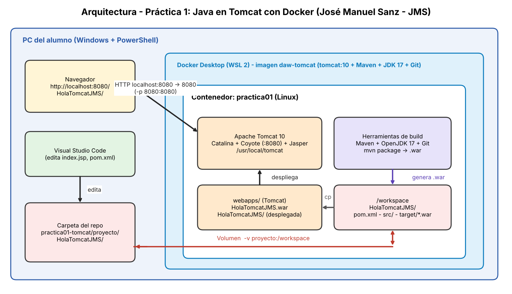

La solución se compone de:

- **Equipo anfitrión (Windows):** Docker Desktop (con WSL 2), Visual Studio Code, Git y el navegador. Solo aquí se edita el código y se consulta el resultado.
- **Imagen `daw-tomcat`:** construida con un `Dockerfile` a partir de `tomcat:10`, a la que se añaden Maven, OpenJDK 17 y Git.
- **Contenedor `practica01`:** ejecuta Tomcat (puerto 8080) y contiene las herramientas de compilación. Se trabaja en él mediante `docker exec`.
- **Puerto `8080:8080`:** el navegador del anfitrión accede a Tomcat a través de `localhost:8080`.
- **Volumen `proyecto/` ↔ `/workspace`:** el código fuente vive en el repositorio del anfitrión y es visible dentro del contenedor, de modo que el trabajo no se pierde si el contenedor se elimina y puede versionarse con Git.

Flujo de trabajo: *edición en VS Code → compilación y empaquetado con Maven en el contenedor → copia del WAR a `webapps` → Tomcat lo despliega → comprobación desde el navegador*.

---

## 3. Descripción de la solución

### 3.1 Estructura del repositorio

```text
DAW2-DESP-JoseManuelSanz/
└── tema3-ServApp/
    └── practica01-tomcat/
        ├── README.md               (este documento: solución detallada)
        ├── requisitos-practica01-tomcat.md   (enunciado proporcionado por el profesor)
        ├── .gitignore
        ├── docker/
        │   └── Dockerfile
        ├── proyecto/
        │   └── HolaTomcatJMS/      (proyecto Maven)
        └── capturas/
```

### 3.2 Instalación de Docker Desktop

Se instaló Docker Desktop (con WSL 2) y se comprobó su funcionamiento:

```powershell
docker --version
docker run hello-world
```

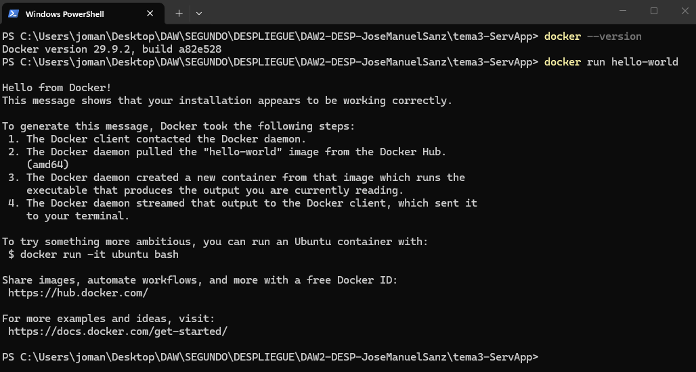

### 3.3 Visual Studio Code

Se instalaron las extensiones *Extension Pack for Java*, *Maven for Java*, *GitHub Repositories* y *Markdown All in One*.

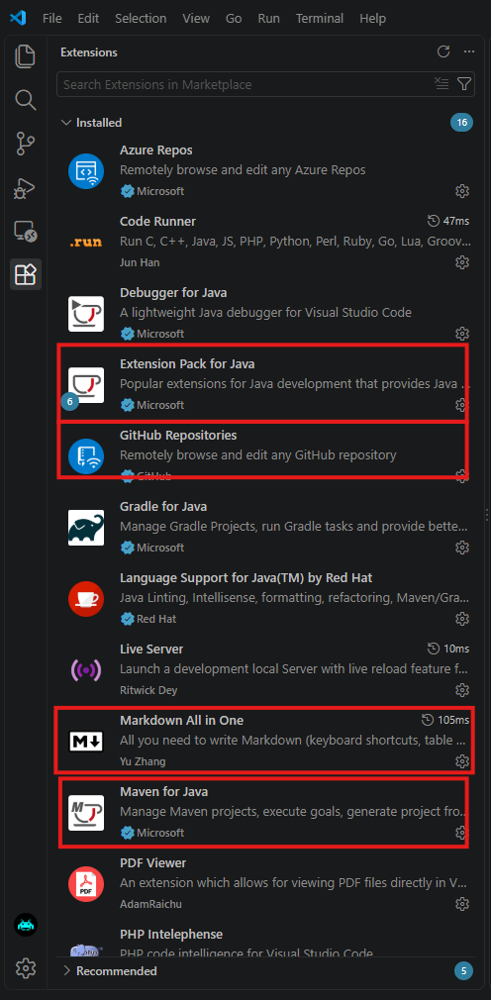

### 3.4 Dockerfile

Fichero `docker/Dockerfile`:

```dockerfile
FROM tomcat:10

RUN apt-get update && \
    apt-get install -y maven openjdk-17-jdk git

WORKDIR /workspace
```

- `FROM tomcat:10`: imagen base que ya incluye Tomcat 10 en `/usr/local/tomcat`.
- `RUN apt-get ...`: instala Maven, JDK 17 y Git dentro de la imagen.
- `WORKDIR /workspace`: directorio de trabajo, enlazado con la carpeta `proyecto/` del anfitrión.

### 3.5 Construcción de la imagen y ejecución del contenedor

```powershell
cd docker
docker build -t daw-tomcat .
docker images
```

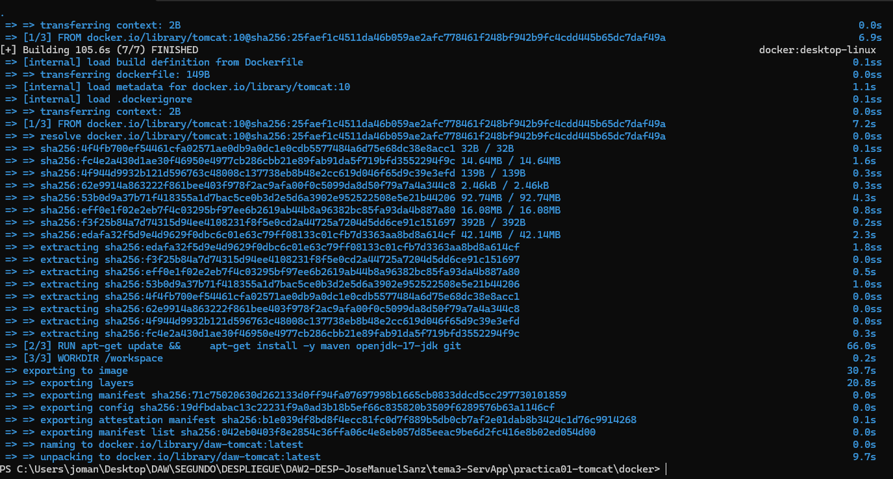
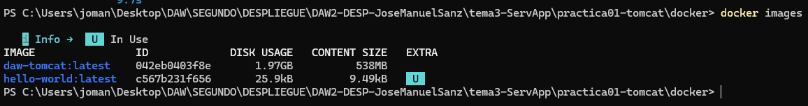

```powershell
docker run -it -p 8080:8080 -v "${PWD}\..\proyecto:/workspace" --name practica01 daw-tomcat
```

| Opción | Significado |
|---|---|
| `-it` | Terminal interactiva; deja visibles los logs de Tomcat |
| `-p 8080:8080` | Publica el puerto 8080 del contenedor en el 8080 del anfitrión |
| `-v ...:/workspace` | Monta `proyecto/` del anfitrión en `/workspace` |
| `--name practica01` | Nombre del contenedor |

Tomcat arranca correctamente y el contenedor queda en ejecución:

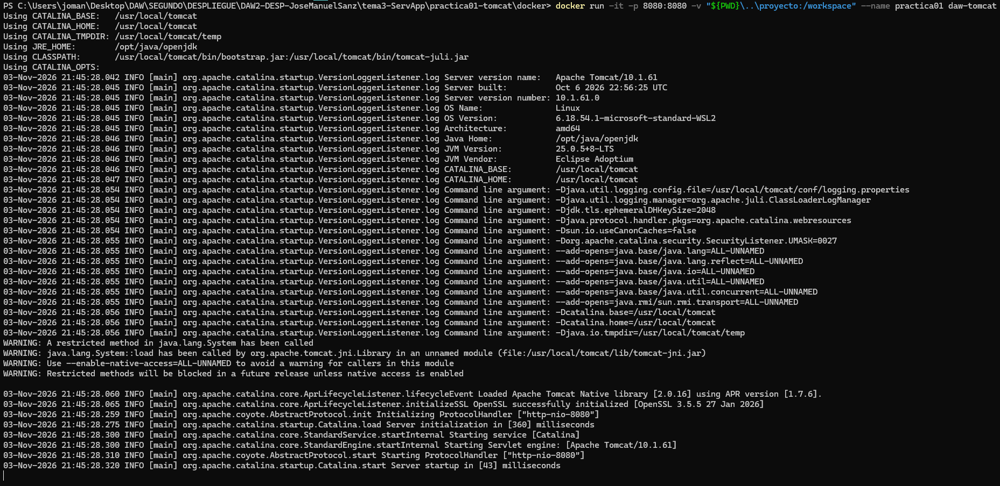
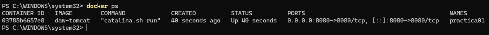

Al acceder a `http://localhost:8080` se obtiene un **error 404 de Tomcat**. Es el comportamiento esperado: el servidor responde, pero la imagen oficial deja `webapps` vacío (las aplicaciones por defecto están en `webapps.dist`).

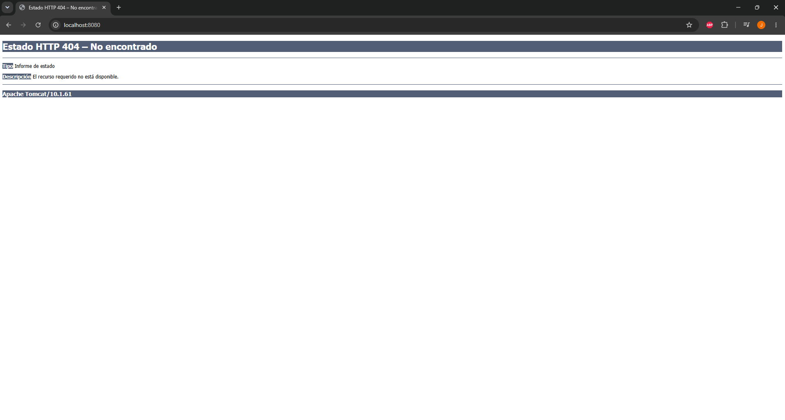

### 3.6 Creación del proyecto Maven

Desde una segunda terminal se entró en el contenedor:

```powershell
docker exec -it practica01 bash
```

Dentro del contenedor se comprobaron las herramientas y se generó el proyecto con el arquetipo `maven-archetype-webapp`:

```bash
java -version
mvn -version
cd /workspace
mvn archetype:generate \
-DgroupId=daw.alumno \
-DartifactId=HolaTomcatJMS \
-DarchetypeArtifactId=maven-archetype-webapp \
-DinteractiveMode=false
```

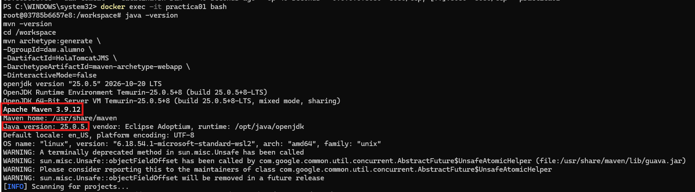
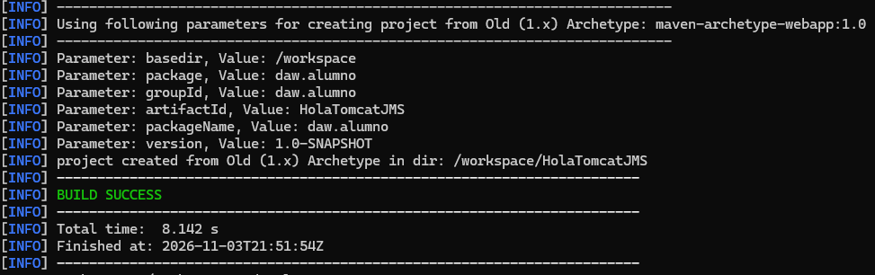

El proyecto se abrió en VS Code (*Archivo → Abrir carpeta...* → `proyecto/HolaTomcatJMS`). Gracias al volumen, los ficheros creados dentro del contenedor aparecen en el equipo anfitrión.

Estructura generada:

```text
HolaTomcatJMS/
├── pom.xml
└── src/main/webapp/
    ├── index.jsp
    └── WEB-INF/web.xml
```

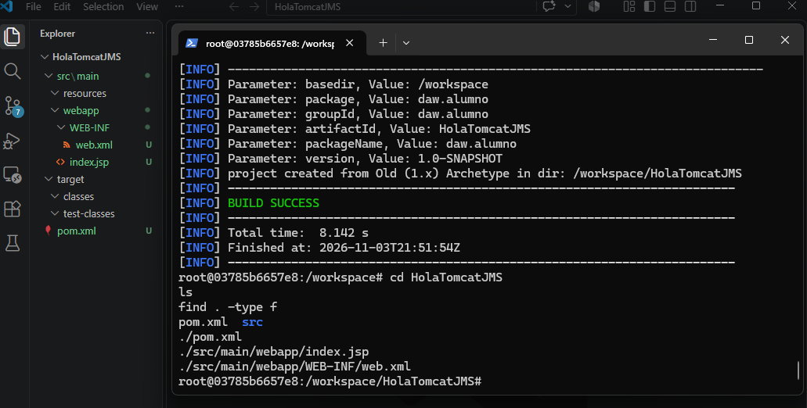

### 3.7 Generación del WAR

```bash
cd /workspace/HolaTomcatJMS
mvn compile
mvn package
ls target
```

Maven descarga los plugins necesarios, empaqueta la aplicación y genera `target/HolaTomcatJMS.war`.

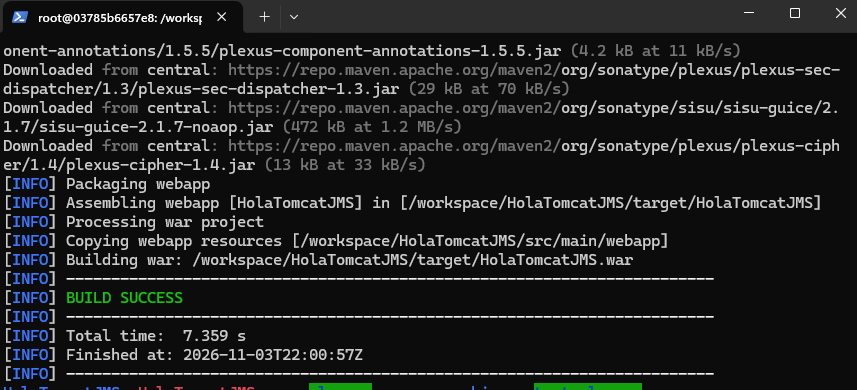
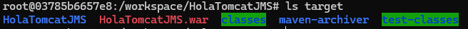

Un WAR es un fichero ZIP con la estructura estándar de una aplicación web Java. Su contenido se consultó con `jar tf`:

```bash
jar tf target/HolaTomcatJMS.war
```

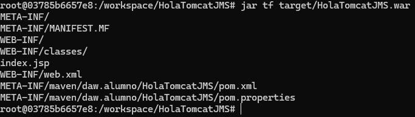

### 3.8 Despliegue en Tomcat

```bash
cp target/HolaTomcatJMS.war /usr/local/tomcat/webapps/
ls /usr/local/tomcat/webapps
```

Tomcat detecta el WAR automáticamente (despliegue en caliente), lo descomprime en `webapps/HolaTomcatJMS/` y registra la aplicación. En el log aparecen los mensajes de despliegue.

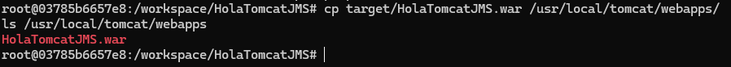
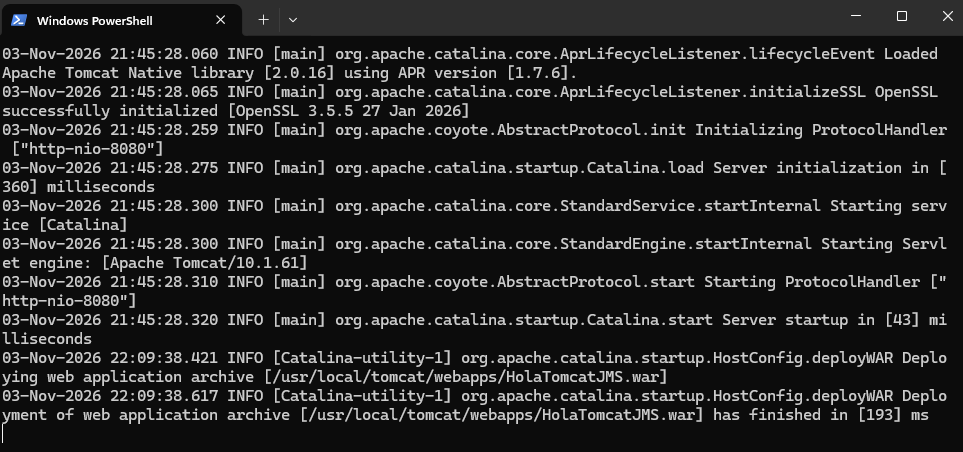

La aplicación quedó accesible en `http://localhost:8080/HolaTomcatJMS/`, mostrando inicialmente la página por defecto del arquetipo:

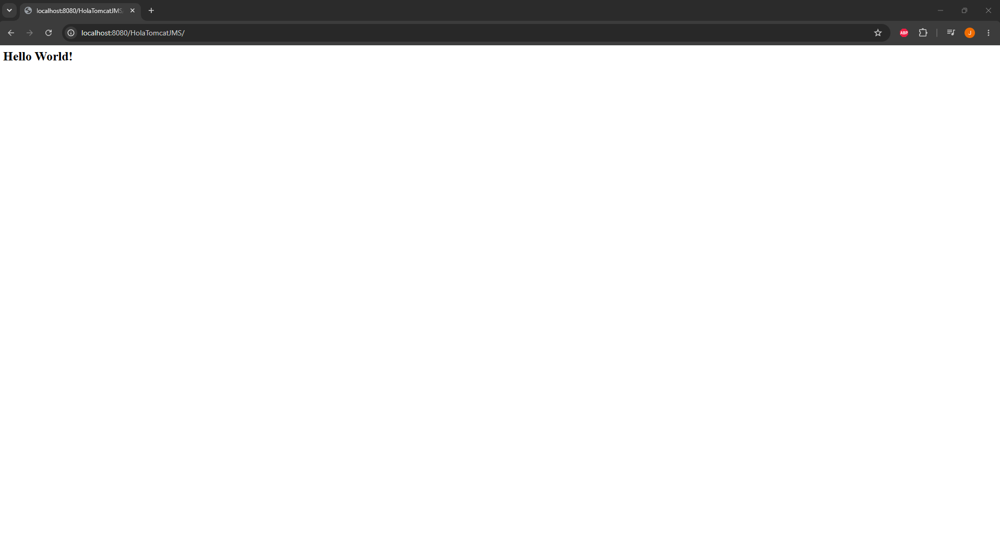

### 3.9 Personalización de la aplicación y redespliegue

Para que la aplicación fuera propia, se sustituyó `src/main/webapp/index.jsp` por una página JSP que muestra datos del servidor:

```jsp
<%@ page contentType="text/html;charset=UTF-8" language="java" %>
<html>
<head>
    <title>HolaTomcatJMS</title>
</head>
<body>
    <h1>¡Hola Tomcat! Soy José Manuel Sanz (JMS)</h1>
    <p>Práctica 1 - DAW2 - Despliegue de Aplicaciones Web</p>
    <p>Servidor: <%= application.getServerInfo() %></p>
    <p>Versión de Java: <%= System.getProperty("java.version") %></p>
    <p>Fecha y hora del servidor: <%= new java.util.Date() %></p>
</body>
</html>
```

Se volvió a empaquetar y desplegar:

```bash
cd /workspace/HolaTomcatJMS
mvn package
cp target/HolaTomcatJMS.war /usr/local/tomcat/webapps/
```

Tomcat redesplegó la aplicación sin reiniciar el servidor (`autoDeploy`).

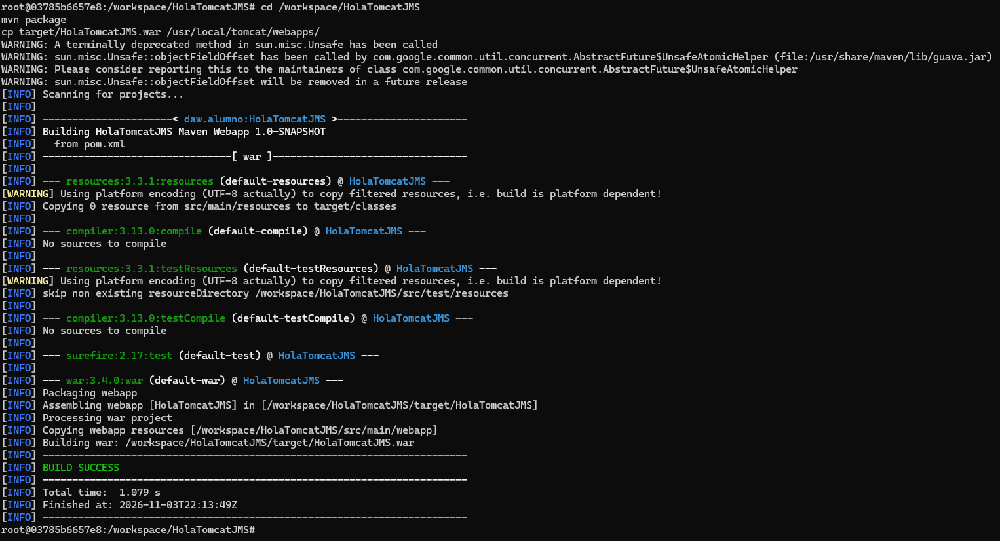

### Aplicación desplegada

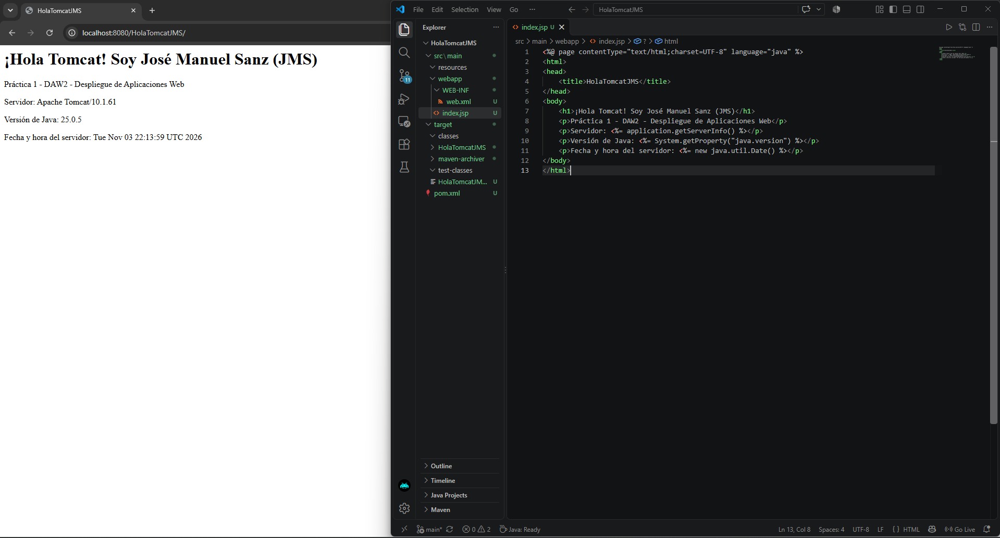

---

## 4. Análisis del servidor Tomcat (criterios de evaluación)

Todo el análisis se realizó dentro del contenedor, en `/usr/local/tomcat` (variable `CATALINA_HOME`).

### 4.1 Criterio a) Componentes y funcionamiento de los servicios de Tomcat

Apache Tomcat es un **contenedor de servlets y JSP** (implementa Jakarta Servlet, Jakarta Server Pages y otras especificaciones de Jakarta EE; Tomcat 10 usa el espacio de nombres `jakarta.*`). Se comporta a la vez como servidor web sencillo y como servidor de aplicaciones Java. Sus componentes principales son:

| Componente | Función |
|---|---|
| **Catalina** | Contenedor de servlets: núcleo de Tomcat, gestiona el ciclo de vida de las aplicaciones y las peticiones. |
| **Coyote** | Conector HTTP: escucha en el puerto 8080, recibe las peticiones y las entrega a Catalina. |
| **Jasper** | Motor JSP: traduce cada JSP a un servlet Java, lo compila y lo ejecuta. |
| **Realm** | Almacén de usuarios y roles para la autenticación (por defecto, `tomcat-users.xml`). |
| **Valve** | Componente que intercepta peticiones (por ejemplo, para registrar accesos en logs). |

La jerarquía definida en `conf/server.xml` es:

```text
Server
 └── Service (Catalina)
      ├── Connector (Coyote, puerto 8080)
      └── Engine (Catalina)
           └── Host (localhost, appBase="webapps")
                └── Context (uno por aplicación: cada WAR es un Context)
```

**Funcionamiento de una petición** a `http://localhost:8080/HolaTomcatJMS/`:

1. Docker redirige el puerto 8080 del anfitrión al 8080 del contenedor.
2. El conector Coyote recibe la petición HTTP.
3. El *Engine* la dirige al *Host* `localhost` y este al *Context* `/HolaTomcatJMS`.
4. Jasper compila `index.jsp` a servlet la primera vez, y Catalina lo ejecuta.
5. La respuesta HTML vuelve al navegador por el mismo camino.

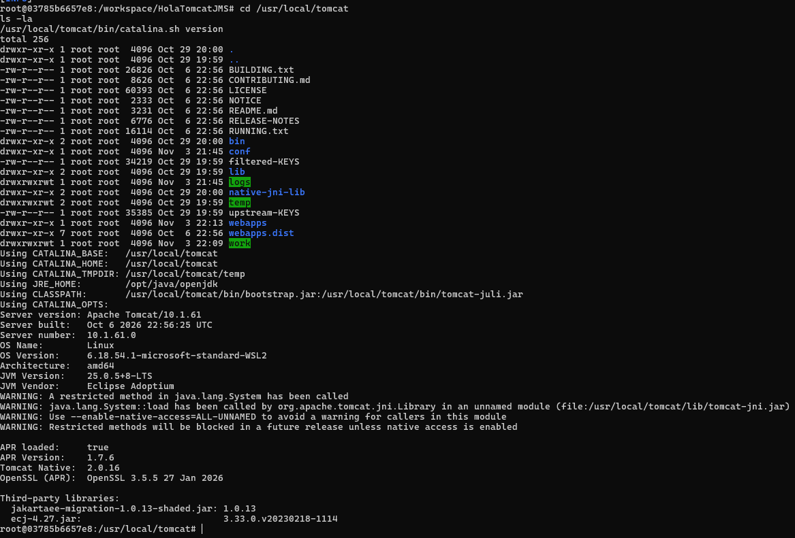

Además se copiaron las aplicaciones por defecto de `webapps.dist` a `webapps` y se accedió a la página de inicio de Tomcat. El acceso a la aplicación *Manager* devuelve un **403** por defecto, ya que ningún usuario tiene el rol necesario en `tomcat-users.xml`: es una medida de seguridad.

```bash
ls webapps.dist
cp -r webapps.dist/* webapps/
```

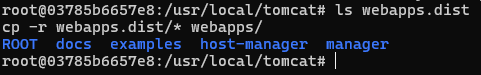

### 4.2 Criterio b) Estructura de directorios y ficheros de configuración

Estructura de `/usr/local/tomcat`:

| Directorio | Contenido |
|---|---|
| `bin` | Scripts de arranque y parada (`catalina.sh`, `startup.sh`, `shutdown.sh`). |
| `conf` | Ficheros de configuración. |
| `lib` | Bibliotecas (JAR) compartidas por Tomcat y todas las aplicaciones. |
| `logs` | Registros del servidor. |
| `temp` | Ficheros temporales. |
| `webapps` | Aplicaciones desplegadas (WAR y carpetas descomprimidas). |
| `webapps.dist` | Aplicaciones por defecto (ROOT, manager, host-manager, docs, examples). |
| `work` | Código generado y compilado a partir de los JSP. |

Principales ficheros de `conf/`:

| Fichero | Función |
|---|---|
| `server.xml` | Configuración principal: Server, Service, Connector (puertos), Engine, Host, Realm, Valve. |
| `web.xml` | Descriptor global: valores por defecto para todas las aplicaciones (servlets por defecto, tipos MIME, páginas de bienvenida). |
| `context.xml` | Configuración común a todos los contextos (recursos, observación de ficheros). |
| `tomcat-users.xml` | Usuarios y roles (acceso al Manager). |
| `catalina.properties` | Propiedades de Catalina, incluida la definición de los *class loaders* y las bibliotecas que se cargan. |
| `logging.properties` | Configuración de los logs. |

Líneas relevantes de `server.xml` (obtenidas con `grep`):

- `Connector port="8080"`: puerto HTTP en el que escucha Coyote.
- `Host name="localhost" appBase="webapps" unpackWARs="true" autoDeploy="true"`: Tomcat busca aplicaciones en `webapps`, descomprime los WAR y los despliega automáticamente. **Por eso basta con copiar el WAR a `webapps`.**

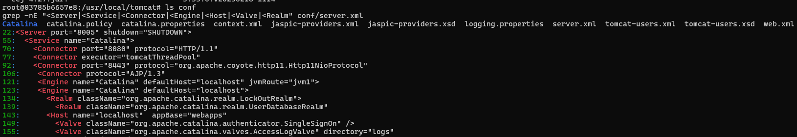

Ficheros `web.xml`: hay dos niveles. El global (`conf/web.xml`) declara servlets por defecto como `DefaultServlet` y `JspServlet`. El de la aplicación (`WEB-INF/web.xml`) es el descriptor de despliegue propio de `HolaTomcatJMS`; el generado por el arquetipo es mínimo.

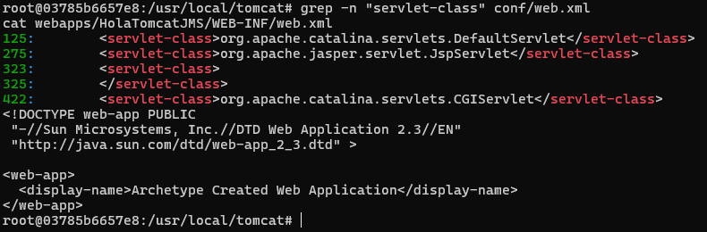

### 4.3 Criterio b) Bibliotecas compartidas

| Ubicación | Alcance | Ejemplos |
|---|---|---|
| `/usr/local/tomcat/lib` | Compartidas por Tomcat y **todas** las aplicaciones | `servlet-api.jar`, `jsp-api.jar`, `catalina.jar`, `jasper.jar` |
| `webapps/HolaTomcatJMS/WEB-INF/lib` | Privadas de la aplicación | Dependencias propias (JAR) |
| `webapps/HolaTomcatJMS/WEB-INF/classes` | Privadas de la aplicación | Clases Java propias compiladas |

La API de Servlets/JSP la aporta el propio Tomcat (en el `pom.xml` se declara con ámbito `provided` cuando se necesita), por lo que no se incluye dentro del WAR. En `work/Catalina/localhost/HolaTomcatJMS` se encuentra el servlet Java generado por Jasper a partir del JSP.

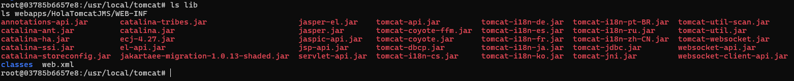
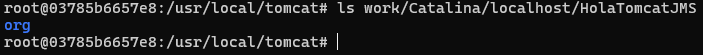

### 4.4 Criterio e) Componentes web del servidor

La aplicación utiliza un componente web, el **JSP**, sin necesidad de configurar nada adicional. Esto es posible porque el `web.xml` global asocia las peticiones `*.jsp` al `JspServlet` (Jasper). Tomcat compila el JSP, lo convierte en un servlet y lo ejecuta, y el resultado muestra información del propio servidor (`getServerInfo()`, versión de Java, fecha). Además se utilizó el log de Tomcat para verificar el comportamiento:

```bash
ls logs
tail -n 20 logs/catalina.$(date +%Y-%m-%d).log
```

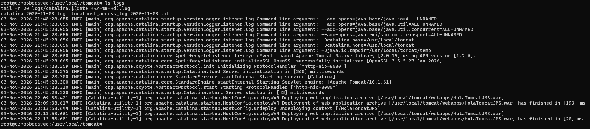

### 4.5 Criterio f) Ajustes para el despliegue

Los pasos necesarios para desplegar fueron:

1. Empaquetar la aplicación como WAR con `mvn package`.
2. Copiarlo a `webapps` (el `Host` tiene `autoDeploy="true"` y `unpackWARs="true"`).
3. Publicar el puerto 8080 del contenedor (`-p 8080:8080`) para acceder desde el anfitrión.
4. Usar el nombre del WAR como contexto de la aplicación: `HolaTomcatJMS.war` → `/HolaTomcatJMS`.
5. Para actualizar, volver a empaquetar y copiar el WAR; Tomcat redespliega sin reiniciar.

---

## 5. Evidencias obtenidas

| Nº | Evidencia | Captura |
|---|---|---|
| 01 | Docker instalado y funcionando | `01-docker-version.png` |
| 02 | Extensiones de VS Code | `02-vscode-extensiones.png` |
| 03-04 | Imagen `daw-tomcat` construida | `03-docker-build.png`, `04-docker-images.png` |
| 05-07 | Tomcat arrancado, contenedor activo y respuesta 404 | `05-...`, `06-...`, `07-...` |
| 08-10 | Java/Maven y proyecto generado | `08-...`, `09-...`, `10-...` |
| 11-13 | WAR generado y su contenido | `11-...`, `12-...`, `13-...` |
| 14-16 | Despliegue y página por defecto | `14-...`, `15-...`, `16-...` |
| 17-18 | Aplicación personalizada y redespliegue | `paginaDesplegada.jpg`, `18-...` |
| 19-25 | Análisis de Tomcat (estructura, conf, web.xml, lib, work, logs, inicio) | `19-...` a `25-...` |
| 26 | Repositorio en GitHub | `26-github-repo.png` |

Comprobaciones realizadas: `docker ps` muestra el contenedor `practica01` con el puerto 8080 publicado; `http://localhost:8080/HolaTomcatJMS/` devuelve la página personalizada; el log muestra el despliegue y el redespliegue.

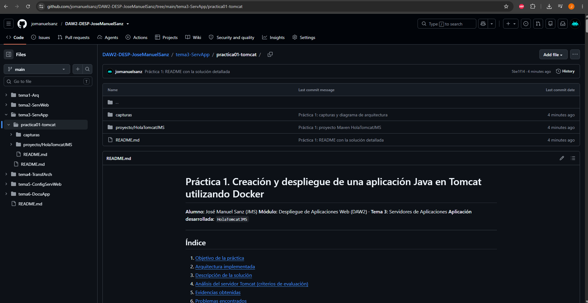

---

## 6. Problemas encontrados

> **Edita esta sección con los problemas que realmente te hayan ocurrido.** Los siguientes son los habituales; deja solo los reales o sustitúyelos.

1. **Error 404 al acceder a `http://localhost:8080`** tras arrancar el contenedor.
2. **Docker no arrancado:** el comando `docker build` o `docker run` falla con *cannot connect to the Docker daemon*.
3. **Conflicto de nombre del contenedor:** al repetir `docker run` aparece *name already in use*.
4. **Ruta del volumen:** si `docker run` no se ejecuta desde la carpeta `docker/`, `${PWD}\..\proyecto` apunta a una ruta incorrecta.
5. **Versión de Java del arquetipo:** error de compilación por `maven.compiler.source` antiguo (1.7) con JDK 17.
6. **Terminal bloqueada** por los logs de Tomcat tras `docker run`.

---

## 7. Soluciones aplicadas

1. **404:** no era un fallo. Tomcat responde, pero `webapps` está vacío en la imagen oficial. Se resolvió desplegando el WAR (y, opcionalmente, copiando `webapps.dist`).
2. **Docker no arrancado:** abrir Docker Desktop y esperar a que indique que está en ejecución.
3. **Conflicto de nombre:** usar `docker start -a practica01` para reutilizar el contenedor, o `docker rm practica01` y volver a ejecutar `docker run`.
4. **Ruta del volumen:** ejecutar `docker run` desde `practica01-tomcat/docker`.
5. **Versión de Java:** editar `pom.xml` y poner `maven.compiler.source` y `maven.compiler.target` a `17`.
6. **Terminal bloqueada:** abrir una segunda terminal y usar `docker exec -it practica01 bash`.

---

## 8. Conclusiones

- Docker permite disponer de un entorno completo (Tomcat, JDK y Maven) sin instalar nada en el equipo, y recrearlo siempre igual con el `Dockerfile`. Esto garantiza la reproducibilidad.
- El volumen separa el código (en el anfitrión y bajo control de Git) de la ejecución (en el contenedor).
- Maven automatiza la creación del proyecto y el empaquetado en WAR, que es el formato estándar de despliegue de aplicaciones web Java.
- Tomcat despliega automáticamente cualquier WAR copiado a `webapps` gracias a la configuración del `Host`, y organiza sus componentes de forma jerárquica (Server → Service → Engine → Host → Context).
- Conocer la estructura de directorios, los ficheros de configuración (`server.xml`, `web.xml`, `context.xml`, `tomcat-users.xml`) y la diferencia entre bibliotecas compartidas (`lib`) y privadas (`WEB-INF/lib`) es fundamental para administrar y depurar aplicaciones en un servidor de aplicaciones.
- Se han cubierto los criterios de evaluación a, b, e y f y se ha documentado el proceso con evidencias.
