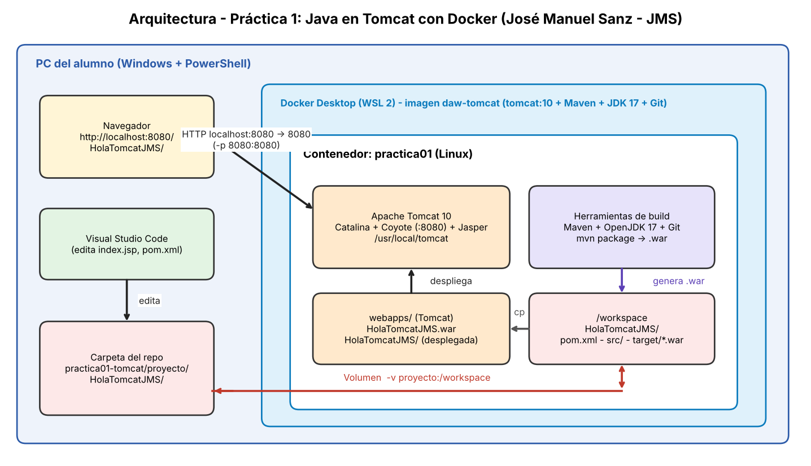

# Práctica 1 de JuanProfe. Creación y despliegue de una aplicación Java en Tomcat utilizando Docker

## Criterios de evaluación

- a) Describir los componentes y el funcionamiento de los servicios proporcionados por el servidor de aplicaciones.
- b) Identificar los principales archivos de configuración y bibliotecas compartidas para una aplicación web.
- e) Configurar y utilizar los componentes web del servidor de aplicaciones.
- f) Realizar los ajustes necesarios para el despliegue de aplicaciones sobre el servidor de aplicaciones.

## Objetivos

- Utilizar Docker para crear entornos de trabajo reproducibles.
- Crear una aplicación web propia.
- Generar un fichero WAR mediante Maven.
- Desplegar la aplicación en Tomcat.
- Analizar la estructura de directorios de Tomcat.
- Documentar el trabajo realizado mediante Git y Markdown.

## Estructura del repositorio

```text
DAW2-DESP-Alumno/
└── tema3-ServApp/
    └── practica01-tomcat/
        ├── README.md (solución detallada)
        ├── docker/
            └── Dockerfile
        ├── proyecto/
        ├── capturas/
        └── requisitos.md (md proporcionado por el profesor con los requisitos)
```

## README.md

El README de la práctica deberá contener:

- Objetivo de la práctica.
- Arquitectura implementada.
- Descripción de la solución.
- Evidencias obtenidas (pantallazos y comprobaciones)
- Problemas encontrados.
- Soluciones aplicadas.
- Conclusiones.

## Arquitectura



## Visual Studio Code
 

Instalar extensiones:

- Extension Pack for Java
- Maven for Java
- GitHub Repositories
- Markdown All in One

## Docker

Dockerfile:

```dockerfile
FROM tomcat:10

RUN apt-get update && \
    apt-get install -y maven openjdk-17-jdk git

WORKDIR /workspace
```

Construcción (con docker arrancado ejecutar):

```bash
docker build -t daw-tomcat .
```

Ejecución:

```bash 
docker run -it -p 8080:8080 -v "${PWD}\..\proyecto:/workspace" --name practica01 daw-tomcat 
```

## Proyecto Maven
Paso 1. Entrar al contenedor
```bash
docker exec -it practica01 bash
```

Paso 2. Ya dentro del contenedor
```bash
cd /workspace
```
Paso 3. Generar el proyecto Maven (recuerda cambiar HolaTomcatXXX por tu nombre)
```bash
mvn archetype:generate \
-DgroupId=daw.alumno \
-DartifactId=HolaTomcatXXX \
-DarchetypeArtifactId=maven-archetype-webapp \
-DinteractiveMode=false
```

Podemos abrir el proyecto desde Visual Studio Code
-Abre Visual Studio Code.
- Selecciona:  Archivo → Abrir carpeta...
- Selecciona la carpeta raíz del proyecto:HolaTomcatXXX

## Generación del WAR
Nos ha creado una carpeta HolaTomcatXXX, hacemos
```bash
 cd HolaTomcatXXX 
 ```
 para ir a la carpeta, ahí hacemos ls y veremos 
- archivo pom.xml
- carpeta src para los fuentes

Y ahí ejecutamos:

```bash
mvn compile
mvn package
```

Resultado esperado, hacemos ls y vemos que ha generado una carpeta target y dentro el war de nuestra aplicación:

```text
target/HolaTomcatXXX.war
```

## Despliegue en Tomcat (recuerda cambiar XXX por tu nombre)

```bash
cp target/HolaTomcatXXX.war /usr/local/tomcat/webapps/
```

Acceso:

```text
http://localhost:8080/HolaTomcatXXX
(en mi caso http://localhost:8080/HolaTomcatJuanProfe/)
```
 
## Aplicación desplegada

