# Práctica 2. Integración Nginx + Tomcat mediante Reverse Proxy

**Alumno:** José Manuel Sanz (JMS)
**Módulo:** Despliegue de Aplicaciones Web (DAW2) · **Tema 3:** Servidores de Aplicaciones
**Aplicación:** `HolaTomcatJMS` (desarrollada en la práctica 1)

---

## Índice

1. [Objetivo de la práctica](#1-objetivo-de-la-práctica)
2. [Arquitectura implementada](#2-arquitectura-implementada)
3. [Descripción de la solución](#3-descripción-de-la-solución)
4. [Evidencias obtenidas](#4-evidencias-obtenidas)
5. [Problemas encontrados](#5-problemas-encontrados)
6. [Soluciones aplicadas](#6-soluciones-aplicadas)
7. [Conclusiones](#7-conclusiones)
8. [Cuestiones finales](#8-cuestiones-finales)

---

## 1. Objetivo de la práctica

Configurar un servidor web frontal (**Nginx**) que coopere con un servidor de aplicaciones (**Tomcat**) para proporcionar acceso controlado a una aplicación web ya desplegada. Nginx actúa como **Reverse Proxy**: recibe las peticiones de los usuarios y las reenvía a Tomcat.

En la práctica 1 los usuarios accedían directamente al servidor de aplicaciones:

```text
Cliente → Tomcat → Aplicación Web
```

En esta práctica se introduce una arquitectura multicapa:

```text
Cliente → Nginx (servidor web) → Tomcat (servidor de aplicaciones) → Aplicación Web
```

**Criterios de evaluación trabajados:**

| Criterio | Descripción | Dónde se trata |
|---|---|---|
| c | Configurar el servidor de aplicaciones para cooperar con el servidor web | Apartados 3.3, 3.4 y 3.5 |
| e | Configurar y utilizar los componentes web del servidor de aplicaciones | Apartados 3.6, 3.7 y 3.8 |

---

## 2. Arquitectura implementada

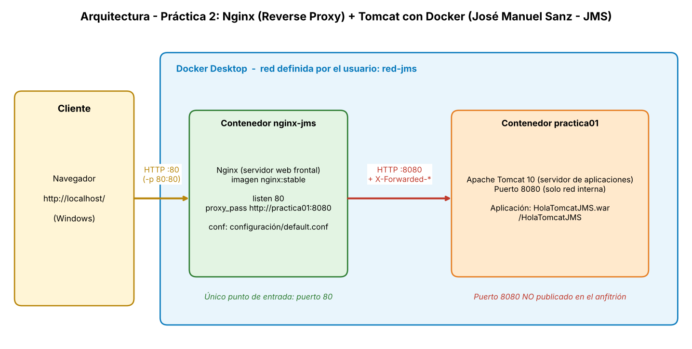

Componentes:

- **Cliente:** navegador en Windows, que accede a `http://localhost`.
- **Contenedor `nginx-jms`:** Nginx (`nginx:stable`) escuchando en el puerto 80, publicado en el anfitrión (`-p 80:80`). Es el único punto de entrada.
- **Contenedor `practica01`:** Apache Tomcat 10 (imagen `daw-tomcat` de la práctica 1) con la aplicación `HolaTomcatJMS`. Escucha en el 8080, pero este puerto **no se publica** en el anfitrión.
- **Red `red-jms`:** red Docker definida por el usuario que conecta ambos contenedores y permite a Nginx localizar a Tomcat por su nombre (`practica01`) mediante el DNS interno de Docker.
- **Fichero `configuración/default.conf`:** configuración del Reverse Proxy, montada como volumen de solo lectura en el contenedor Nginx.

---

## 3. Descripción de la solución

### 3.1 Verificación del entorno (Tarea 1)

Se comprobó que Docker Desktop estaba en ejecución, que el contenedor `practica01` de la práctica 1 estaba operativo y que la aplicación respondía sin errores:

```powershell
docker ps -a
docker exec practica01 ls /usr/local/tomcat/webapps
docker logs --tail 15 practica01
```

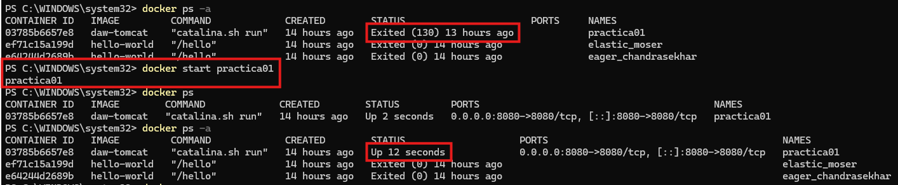

La aplicación era accesible directamente por Tomcat en el puerto 8080:

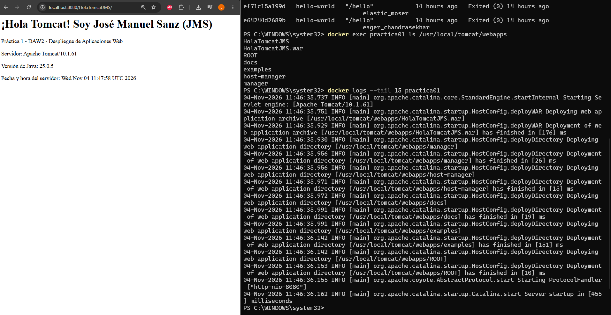

### 3.2 Estructura de trabajo (Tarea 2)

```text
tema3-ServApp/
└── practica02-reverse-proxy/
    ├── README.md               (solución detallada)
    ├── requisitos.md           (enunciado del profesor)
    ├── capturas/               (evidencias)
    └── configuración/
        └── default.conf        (configuración del Reverse Proxy)
```

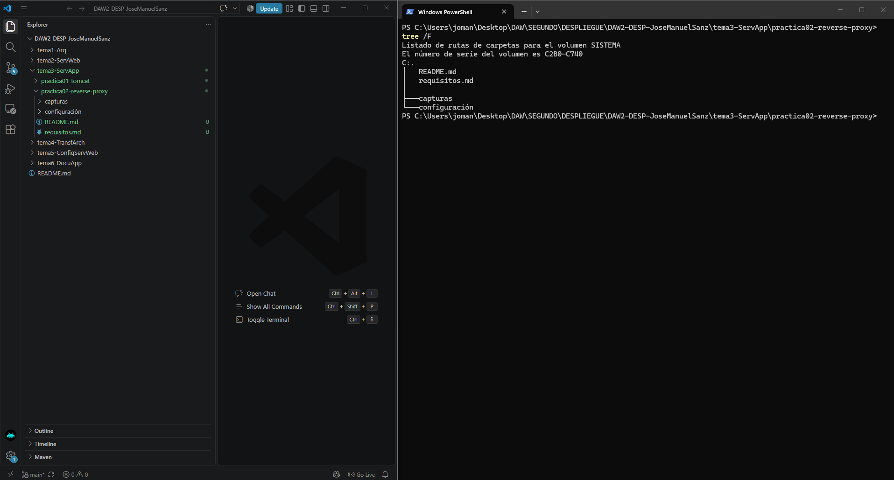

### 3.3 Red Docker compartida

Para que Nginx pueda comunicarse con Tomcat por nombre, se creó una red definida por el usuario y se conectó el contenedor existente. La red por defecto de Docker (`bridge`) no ofrece resolución DNS entre contenedores.

```powershell
docker network create red-jms
docker network connect red-jms practica01
docker network inspect red-jms
```

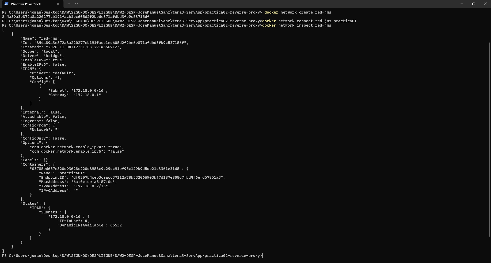

### 3.4 Configuración del Reverse Proxy (Tareas 3 y 4)

Fichero `configuración/default.conf`:

```nginx
server {
    listen 80;
    server_name localhost;

    # La raíz redirige a la aplicación
    location = / {
        return 302 /HolaTomcatJMS/;
    }

    # Reverse proxy: solo se expone la aplicación HolaTomcatJMS
    location /HolaTomcatJMS {
        proxy_pass http://practica01:8080;
        proxy_http_version 1.1;

        proxy_set_header Host              $http_host;
        proxy_set_header X-Real-IP         $remote_addr;
        proxy_set_header X-Forwarded-For   $proxy_add_x_forwarded_for;
        proxy_set_header X-Forwarded-Proto $scheme;
        proxy_set_header X-Forwarded-Host  $host;
    }
}
```

| Directiva | Función |
|---|---|
| `listen 80` | Nginx atiende peticiones HTTP en el puerto 80. |
| `location = /` | Redirige la raíz a la aplicación con un 302. |
| `location /HolaTomcatJMS` | Solo las rutas de la aplicación se reenvían a Tomcat; cualquier otra ruta no llega al servidor de aplicaciones. |
| **`proxy_pass http://practica01:8080`** | **Directiva principal del Reverse Proxy:** reenvía la petición al servidor Tomcat usando el nombre del contenedor y el puerto interno. |
| `proxy_http_version 1.1` | Usa HTTP/1.1 en la comunicación con Tomcat. |
| `proxy_set_header Host` | Conserva el `Host` original solicitado por el cliente. |
| `X-Real-IP`, `X-Forwarded-For` | Transmiten la IP del cliente original. |
| `X-Forwarded-Proto`, `X-Forwarded-Host` | Transmiten el protocolo y el host originales. |

Sin estas cabeceras, Tomcat vería todas las peticiones como si procedieran de Nginx y perdería la información de la petición original.

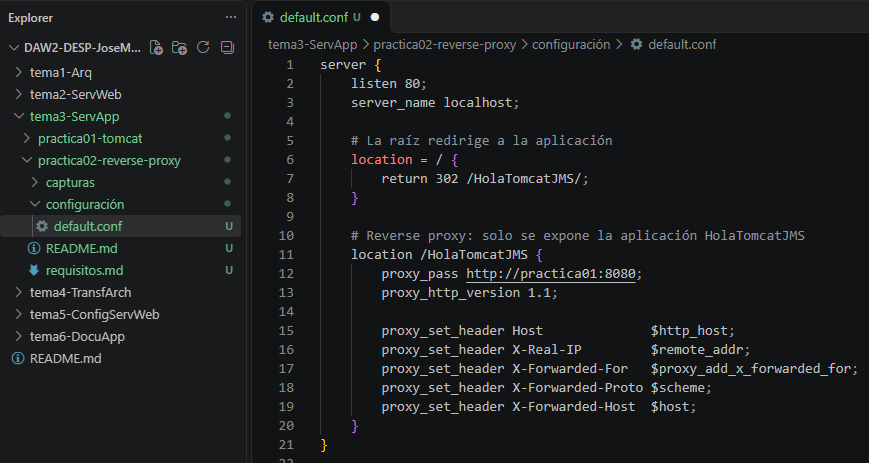

### 3.5 Despliegue de Nginx (Tarea 3)

```powershell
docker run -d --name nginx-jms --network red-jms -p 80:80 -v "${PWD}\configuración\default.conf:/etc/nginx/conf.d/default.conf:ro" nginx:stable
```

| Opción | Significado |
|---|---|
| `-d` | Ejecuta el contenedor en segundo plano. |
| `--name nginx-jms` | Nombre del contenedor. |
| `--network red-jms` | Lo conecta a la red compartida con Tomcat. |
| `-p 80:80` | Publica el puerto 80 del contenedor en el 80 del anfitrión. |
| `-v ...:ro` | Monta la configuración propia como solo lectura. |

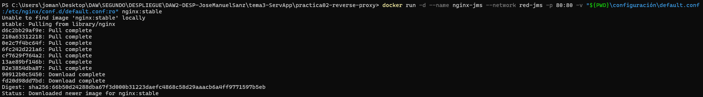

Se comprobó que ambos contenedores estaban en ejecución y que la sintaxis de la configuración era correcta:

```powershell
docker ps
docker exec nginx-jms nginx -t
```

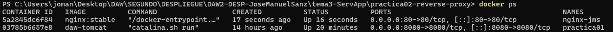
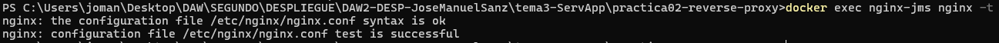

### 3.6 Verificación del acceso (Tarea 5)

La aplicación es accesible a través de Nginx en `http://localhost` (que redirige a `/HolaTomcatJMS/`):

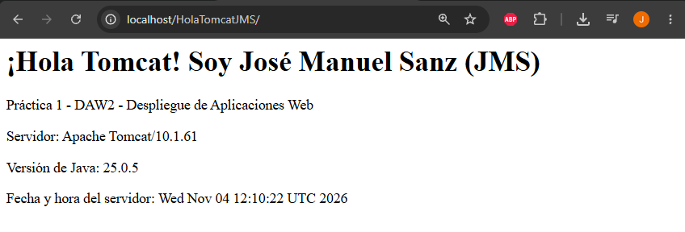

Se compararon las cabeceras de la respuesta obtenida directamente de Tomcat y a través de Nginx:

```powershell
curl.exe -I http://localhost:8080/HolaTomcatJMS/
curl.exe -I http://localhost/HolaTomcatJMS/
```

En la respuesta a través del proxy aparece `Server: nginx`, lo que confirma que es Nginx quien responde al cliente.

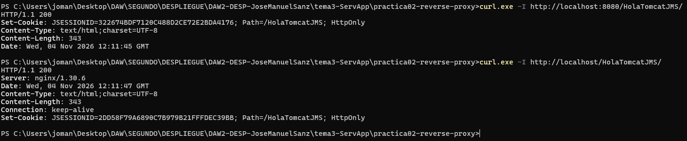

**Comprobación de que la petición alcanza Tomcat y conserva la información original.** Se amplió el `index.jsp` de la aplicación para que mostrase los datos de la petición que recibe Tomcat:

```jsp
<p>IP de origen que ve Tomcat (getRemoteAddr): <%= request.getRemoteAddr() %></p>
<p>Cabecera Host: <%= request.getHeader("Host") %></p>
<p>X-Forwarded-For: <%= request.getHeader("X-Forwarded-For") %></p>
<p>X-Real-IP: <%= request.getHeader("X-Real-IP") %></p>
<p>X-Forwarded-Proto: <%= request.getHeader("X-Forwarded-Proto") %></p>
```

Se recompiló y redesplegó con Maven dentro del contenedor:

```powershell
docker exec practica01 bash -c "cd /workspace/HolaTomcatJMS && mvn package && cp target/HolaTomcatJMS.war /usr/local/tomcat/webapps/"
```

- **Acceso directo (`:8080`):** las cabeceras `X-Forwarded-*` valen `null`, porque no hay proxy.

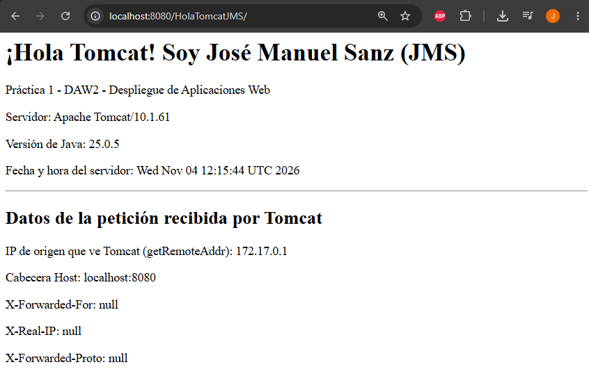

- **Acceso vía Nginx (`:80`):** aparecen las cabeceras añadidas por el proxy y `getRemoteAddr` muestra la IP del contenedor Nginx. La IP real del cliente se conserva en `X-Forwarded-For` / `X-Real-IP`. Esto demuestra que la petición ha sido ejecutada por la aplicación en Tomcat.

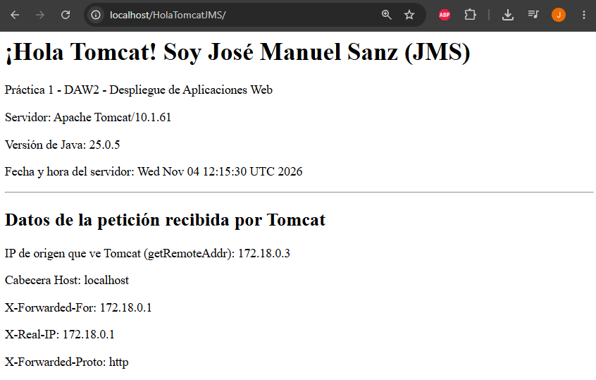

### 3.7 Análisis del tráfico (Tarea 6)

Datos de la red interna y resolución de nombres:

```powershell
docker network inspect red-jms
docker exec nginx-jms getent hosts practica01
```

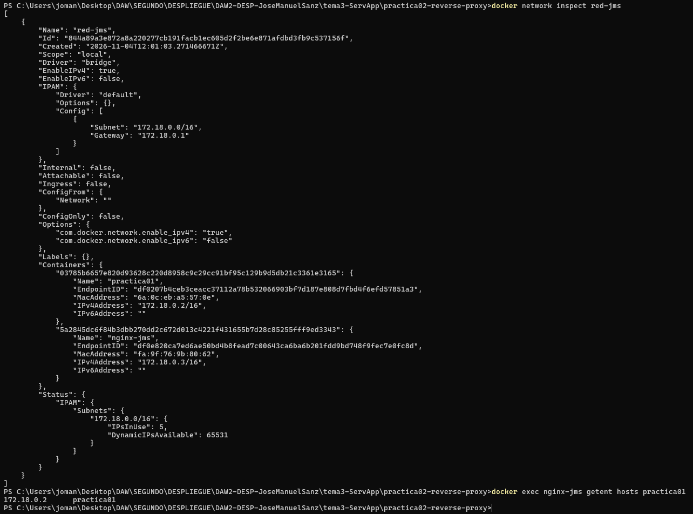

**Recorrido completo de una petición** a `http://localhost/HolaTomcatJMS/`:

1. El navegador envía una petición HTTP a `localhost:80`.
2. Docker Desktop redirige el puerto 80 del anfitrión al contenedor `nginx-jms` (`-p 80:80`).
3. **Nginx recibe la petición inicial.** Busca el `location` que coincide (`/HolaTomcatJMS`) y aplica `proxy_pass`.
4. Nginx resuelve el nombre `practica01` mediante el DNS interno de Docker y abre una conexión HTTP a `practica01:8080` por la red `red-jms`, añadiendo las cabeceras `Host`, `X-Real-IP` y `X-Forwarded-*`.
5. En Tomcat, el conector Coyote recibe la petición. Catalina la dirige al contexto `/HolaTomcatJMS`, donde Jasper ejecuta `index.jsp`.
6. **Tomcat ejecuta la aplicación** y devuelve la respuesta HTML a Nginx.
7. Nginx devuelve la respuesta al navegador.

Respuestas a las preguntas de la tarea:

- **¿Qué servidor recibe la petición inicial?** Nginx, en el puerto 80.
- **¿Qué servidor ejecuta la aplicación?** Tomcat (contenedor `practica01`), que es quien ejecuta el JSP.
- **¿Cómo se comunican?** Mediante HTTP sobre la red Docker `red-jms`, con Nginx como cliente y Tomcat escuchando en el puerto interno 8080. Nginx localiza a Tomcat por el nombre del contenedor.

### 3.8 Análisis de registros (Tarea 7)

Se generó tráfico refrescando la aplicación varias veces y probando la ruta `/manager/html`, y se consultaron los registros:

```powershell
docker logs nginx-jms
docker exec practica01 ls -l /usr/local/tomcat/logs
docker exec practica01 bash -c "tail -n 10 /usr/local/tomcat/logs/localhost_access_log.*.txt"
```

- **Registros de Nginx:** el `access.log` de la imagen oficial se redirige a la salida estándar, por lo que se consulta con `docker logs`. Muestra las peticiones `GET /HolaTomcatJMS/` con su código de respuesta y el intento a `/manager/html`, que devuelve 404.

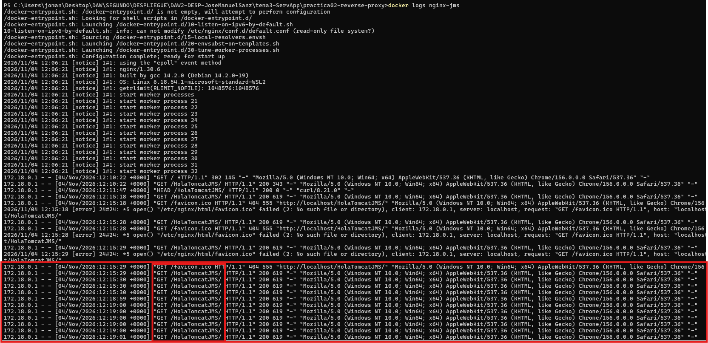

- **Registros de Tomcat:** el fichero `localhost_access_log.<fecha>.txt` registra las peticiones recibidas. La IP de origen que aparece es la del contenedor Nginx y no la del cliente, evidencia de que las peticiones llegan a través del proxy.

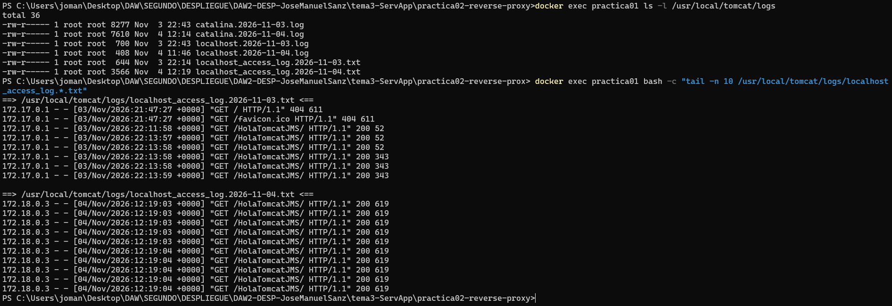

### 3.9 Seguridad de la arquitectura (Tarea 8)

**Acceso controlado.** Se comparó el acceso a una ruta sensible de Tomcat:

```powershell
curl.exe -I http://localhost:8080/manager/html
curl.exe -I http://localhost/manager/html
```

Directamente a Tomcat se obtiene un 403 (la aplicación existe, aunque restringida). A través de Nginx se obtiene un 404, ya que el proxy solo publica `/HolaTomcatJMS`.

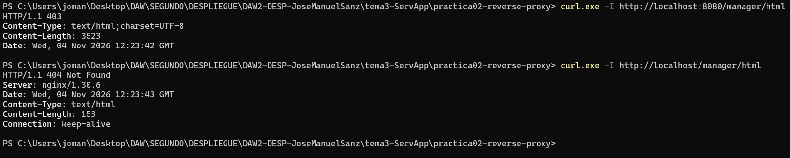

**Arquitectura final.** Para que Nginx sea el único punto de entrada, se recreó el contenedor Tomcat sin publicar su puerto 8080 (el código se conserva en el volumen `proyecto/`):

```powershell
docker stop practica01
docker rm practica01
docker run -d --name practica01 --network red-jms -v "${PWD}\..\proyecto:/workspace" daw-tomcat
docker exec practica01 cp /workspace/HolaTomcatJMS/target/HolaTomcatJMS.war /usr/local/tomcat/webapps/
docker restart nginx-jms
```

Se reinició Nginx porque resuelve la IP de `practica01` al arrancar y esta puede cambiar al recrear el contenedor.

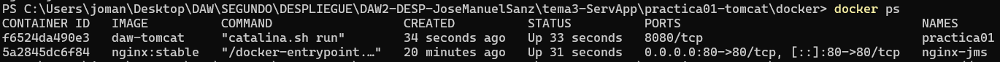

Comprobación: el acceso directo a Tomcat (`localhost:8080`) falla, mientras que el acceso a través de Nginx (`localhost`) funciona.

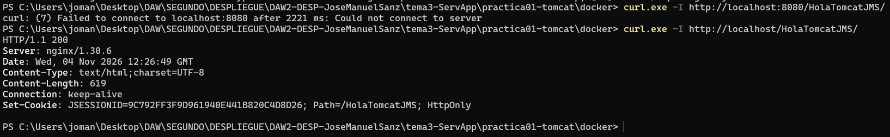
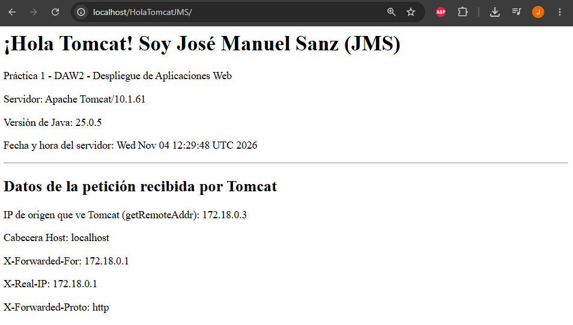

**Respuestas a las cuestiones de la tarea:**

1. **¿Por qué se utiliza un servidor web frontal?** 
    Porque separa responsabilidades. El servidor web atiende al público: HTTP, ficheros estáticos, redirecciones y filtrado. El servidor de aplicaciones se dedica solo a ejecutar la lógica Java. Además, permite no exponer Tomcat directamente.
2. **¿Qué ventajas aporta un Reverse Proxy?**
   - Punto único de entrada: un solo puerto público.
   - Oculta la topología interna (puertos, rutas, tecnología).
   - Permite exponer solo las rutas deseadas.
   - Centraliza el TLS/HTTPS, los logs y los límites de peticiones.
   - Permite cachear contenido y balancear carga entre varios Tomcat.
   - Facilita cambiar o escalar el backend sin que el cliente lo note.
3. **¿Qué problemas podrían surgir si Tomcat fuese accesible directamente por todos los usuarios?**
   - Mayor superficie de ataque: se exponen aplicaciones administrativas (`/manager`, `/host-manager`) y rutas no previstas, como se vio con el 403 frente al 404.
   - Se revelan datos de la tecnología (versión, páginas de error).
   - No hay una capa que filtre, limite peticiones o cifre.
   - Cada cambio de puerto o de servidor afecta directamente a los usuarios.
   - Tomcat se encarga de tareas para las que no es el más eficiente (estáticos, TLS), lo que penaliza el rendimiento.
   - Es más difícil auditar y controlar el acceso desde un único sitio.

---

## 4. Evidencias obtenidas

| Evidencia mínima exigida | Captura |
|---|---|
| Contenedor Tomcat funcionando | `01-verificacion-tomcat.png`, `07-docker-ps-ambos.png`, `17-arquitectura-final-docker-ps.png` |
| Contenedor Nginx funcionando | `06-docker-run-nginx.png`, `07-docker-ps-ambos.png` |
| Configuración del Reverse Proxy | `05-config-nginx.png`, `08-nginx-config-test.png` |
| Aplicación accesible mediante Nginx | `09-app-via-nginx.png`, `12-cabeceras-via-nginx.png`, `19-app-final-via-nginx.png` |
| Evidencias en los logs | `14-log-nginx.png`, `15-log-tomcat.png` |
| Arquitectura final de la solución | `arquitectura_nginx_tomcat.png`, `17-arquitectura-final-docker-ps.png` |

Otras comprobaciones: red y DNS interno (`04`, `13`), diferencias de cabeceras (`10`, `11`, `12`), acceso controlado (`16`) y acceso directo bloqueado (`18`).

---

## Repositorio en GitHub después de terminar la práctica 2
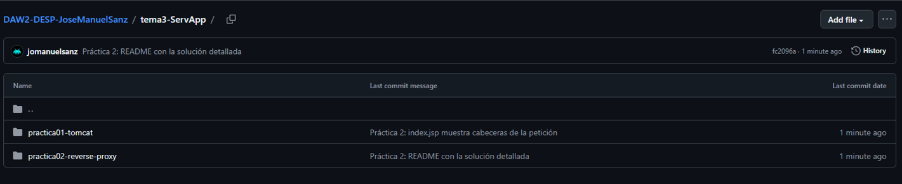

---

## 5. Problemas encontrados

1. **Nginx no resolvía el nombre `practica01`** (`host not found in upstream`) y el contenedor se detenía.
2. **Puerto 80 ocupado** en el equipo anfitrión.
3. **`curl` en PowerShell** no mostraba las cabeceras, porque es un alias de `Invoke-WebRequest`.
4. **Tras recrear Tomcat, Nginx devolvía error 502** (Bad Gateway).
5. **Contenedor `practica01` parado** al iniciar la práctica.
6. **Las cabeceras no cambiaban** en el navegador tras redesplegar el WAR.

---

## 6. Soluciones aplicadas

1. Crear la red `red-jms` y conectar `practica01` a ella antes de arrancar Nginx. La red por defecto no resuelve nombres de contenedores.
2. Liberar el puerto 80 o publicar Nginx en otro puerto (`-p 8081:80`) y acceder por `http://localhost:8081`.
3. Usar `curl.exe` en lugar de `curl`.
4. Reiniciar Nginx con `docker restart nginx-jms`, ya que conserva la IP resuelta al arrancar y esta cambia al recrear el contenedor.
5. Arrancarlo con `docker start practica01` y comprobar con `docker ps`.
6. Esperar unos segundos al redespliegue de Tomcat y refrescar con `Ctrl+F5` para evitar la caché del navegador.

---

## 7. Conclusiones

- Un Reverse Proxy permite separar la capa de presentación (servidor web) de la de aplicación (Tomcat), con una arquitectura multicapa más segura y flexible.
- La directiva `proxy_pass`, junto con las cabeceras `X-Forwarded-*`, es la pieza central de la integración y permite que Tomcat conozca los datos de la petición original aunque no hable directamente con el cliente.
- Docker facilita construir esta arquitectura: una red definida por el usuario proporciona DNS interno por nombre de contenedor, y los volúmenes permiten gestionar la configuración desde el repositorio.
- No publicar el puerto de Tomcat y exponer solo las rutas necesarias en Nginx reduce la superficie de ataque. Se comprobó con el 403 frente al 404 de `/manager/html`.
- Los logs de ambos servidores permiten trazar una petición de extremo a extremo.
- Se han cubierto los criterios de evaluación c y e.

---

## 8. Cuestiones finales

**1. ¿Qué diferencia existe entre un servidor web y un servidor de aplicaciones?**
Un servidor web (Nginx, Apache HTTP Server) atiende peticiones HTTP y sirve principalmente contenido estático (HTML, CSS, imágenes), además de redirigir, balancear y actuar como proxy. Un servidor de aplicaciones (Tomcat) ejecuta lógica de aplicación (servlets, JSP) y genera contenido dinámico. En esta práctica, Nginx recibe las peticiones y Tomcat ejecuta la aplicación Java.

**2. ¿Qué función realiza el Reverse Proxy?**
Recibe las peticiones de los clientes en nombre de los servidores internos, las reenvía al servidor adecuado (Tomcat) y devuelve la respuesta al cliente. El cliente solo conoce al proxy y no sabe qué hay detrás.

**3. ¿Por qué se utiliza Nginx delante de Tomcat?**
Porque Nginx es muy eficiente atendiendo conexiones, sirviendo estáticos y gestionando TLS, mientras que Tomcat se centra en ejecutar la aplicación. Además permite ocultar y proteger Tomcat, exponer solo las rutas necesarias, centralizar logs y, en el futuro, balancear carga o cachear.

**4. ¿Cuáles son las principales ventajas de esta arquitectura?**
- Mayor seguridad, con un único punto de entrada y Tomcat no expuesto.
- Control de acceso a nivel de rutas.
- Escalabilidad: se pueden añadir más instancias de Tomcat detrás del proxy.
- Rendimiento: estáticos, caché y compresión en el proxy.
- Mantenimiento más sencillo: se puede cambiar el backend sin afectar a los usuarios.
- Centralización de HTTPS, registros y límites.

**5. ¿Qué mejoras podrían añadirse en un entorno real?**
- Activar **HTTPS/TLS** en Nginx (certificados, por ejemplo con Let's Encrypt) y redirigir HTTP a HTTPS.
- **Balanceo de carga** con varias instancias de Tomcat (`upstream`).
- **Caché** y compresión de contenido estático en Nginx.
- **Límites de peticiones** (`limit_req`) y cabeceras de seguridad.
- Configurar `RemoteIpValve` en Tomcat para que registre en sus logs la IP real del cliente a partir de `X-Forwarded-For`.
- Usar **Docker Compose** para definir y levantar los dos servicios y la red de forma reproducible.
- Sustituir los usuarios y credenciales por defecto y asegurar o deshabilitar las aplicaciones de administración.
- Monitorización y centralización de logs.
- Un firewall o WAF delante del proxy.