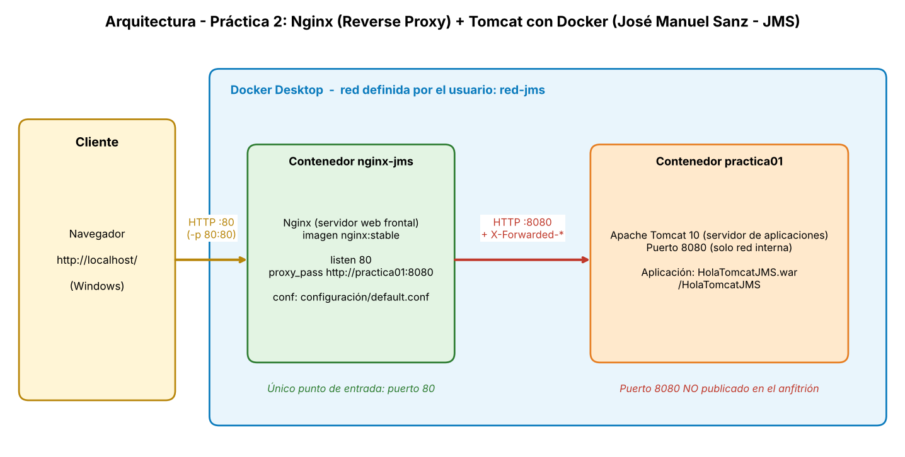

# Práctica 2. Integración Nginx + Tomcat mediante Reverse Proxy

## Resultado de aprendizaje

Configurar un servidor web frontal que coopere con un servidor de aplicaciones para proporcionar acceso controlado a una aplicación web desplegada.

---

# Criterios de evaluación

- c) Configurar el servidor de aplicaciones para cooperar con el servidor web.
- e) Configurar y utilizar los componentes web del servidor de aplicaciones.

---

# Contexto

En la práctica anterior se desplegó una aplicación Java sobre Tomcat utilizando Docker en la que los usuarios acceden directamente al servidor de aplicaciones:

```text
Cliente
   │
   ▼
 Tomcat
   │
   ▼
 Aplicación Web
```

En entornos reales suele utilizarse un servidor web frontal que recibe las peticiones de los usuarios y las reenvía al servidor de aplicaciones.

## Arquitectura




---

# Objetivos

Al finalizar la práctica el alumnado será capaz de:

- Comprender la función de un servidor web.
- Comprender la función de un servidor de aplicaciones.
- Configurar un servidor Nginx.
- Implementar un Reverse Proxy.
- Integrar Nginx y Tomcat.
- Verificar el flujo completo de una petición web.
- Identificar las ventajas de una arquitectura multicapa.

---
# Requisitos previos

Antes de comenzar esta práctica debe verificarse que:

- Docker Desktop está instalado y funcionando.
- El contenedor Tomcat de la práctica anterior está operativo.
- La aplicación Java desarrollada en la práctica 1 está desplegada correctamente.
- El acceso a la aplicación mediante Tomcat funciona correctamente.

---

# Tareas a realizar

## Tarea 1. Verificación del entorno

Comprobar que:

- El contenedor Tomcat está en ejecución.
- La aplicación sigue siendo accesible.
- No existen errores en el despliegue realizado en la práctica anterior.

---

## Tarea 2. Preparación de la estructura de trabajo

Crear dentro del repositorio la carpeta correspondiente a la práctica:

```text
tema3-ServApp/
└── practica02-reverse-proxy/
```

Organizar adecuadamente los ficheros necesarios para la práctica.

---

## Tarea 3. Despliegue de Nginx

Instalar y configurar un servidor web Nginx mediante Docker.

La configuración deberá permitir:

- Escuchar peticiones HTTP.
- Reenviar dichas peticiones al servidor Tomcat.
- Mantener la comunicación entre ambos servicios.

---

## Tarea 4. Configuración del Reverse Proxy

Investigar e implementar la directiva necesaria para:

- Reenviar peticiones web desde Nginx a Tomcat.
- Conservar la información básica de la petición original.
- Permitir el acceso a la aplicación a través del servidor web.

---

## Tarea 5. Verificación del acceso

Comprobar que la aplicación puede ser utilizada mediante:

```text
http://localhost
```

o mediante la dirección que corresponda a vuestra configuración.

Verificar igualmente que las peticiones alcanzan correctamente al servidor Tomcat.

---

## Tarea 6. Análisis del tráfico

Investigar:

- Qué servidor recibe la petición inicial.
- Qué servidor ejecuta la aplicación.
- Cómo se comunican ambos servicios.

Explicar el recorrido completo de una petición desde el navegador hasta la aplicación.

---

## Tarea 7. Análisis de registros

Localizar y examinar:

- Los registros generados por Nginx.
- Los registros generados por Tomcat.

Identificar evidencias de las peticiones realizadas durante las pruebas.

---

## Tarea 8. Seguridad de la arquitectura

Analizar los riesgos de permitir el acceso directo a Tomcat.

Responder a las siguientes cuestiones:

1. ¿Por qué se utiliza un servidor web frontal?
2. ¿Qué ventajas aporta un Reverse Proxy?
3. ¿Qué problemas podrían surgir si Tomcat fuese accesible directamente por todos los usuarios?

---

# Entregables

## Repositorio Git

El repositorio deberá incluir:

```text
practica02-reverse-proxy/
│
├── requisitos.md (md proporcionado por el profesor con los requisitos)
├── README.md (solución detallada)
├── capturas/
└── configuración/
```

---

## README.md

El README de la práctica deberá contener:

- Objetivo de la práctica.
- Arquitectura implementada.
- Descripción de la solución.
- Evidencias obtenidas (pantallazos y comprobaciones)
- Problemas encontrados.
- Soluciones aplicadas.
- Conclusiones.

---

## Evidencias mínimas

Las capturas entregadas deberán mostrar, al menos:

- Contenedor Tomcat funcionando.
- Contenedor Nginx funcionando.
- Configuración del Reverse Proxy.
- Aplicación accesible mediante Nginx.
- Evidencias de funcionamiento en los logs.
- Arquitectura final de la solución.

---

# Cuestiones finales

Responder brevemente:

1. ¿Qué diferencia existe entre un servidor web y un servidor de aplicaciones?
2. ¿Qué función realiza el Reverse Proxy?
3. ¿Por qué se utiliza Nginx delante de Tomcat?
4. ¿Cuáles son las principales ventajas de esta arquitectura?
5. ¿Qué mejoras podrían añadirse en un entorno real?

---

