# Práctica 3. Despliegue de una aplicación Flask con Gunicorn y Nginx

**Alumno:** José Manuel Sanz (JMS)
**Módulo:** Despliegue de Aplicaciones Web (DAW2) · **Tema 3:** Servidores de Aplicaciones
**Aplicación:** `FlaskJMS`

---

## Índice

1. [Objetivo de la práctica](#1-objetivo-de-la-práctica)
2. [Arquitectura implementada](#2-arquitectura-implementada)
3. [Descripción de la solución](#3-descripción-de-la-solución)
4. [Evidencias obtenidas](#4-evidencias-obtenidas)
5. [Problemas encontrados](#5-problemas-encontrados)
6. [Soluciones aplicadas](#6-soluciones-aplicadas)
7. [Conclusiones](#7-conclusiones)
8. [Cuestiones finales](#8-cuestiones-finales)

---

## 1. Objetivo de la práctica

Configurar y desplegar una aplicación web Python utilizando un servidor de aplicaciones (**Gunicorn**) y un servidor web (**Nginx**), con una arquitectura similar a la de entornos profesionales. La aplicación está desarrollada con **Flask**, se ejecuta con Gunicorn, se publica a través de Nginx como Reverse Proxy y se gestiona como servicio de **systemd**.

En las prácticas anteriores se trabajó con Tomcat y con la integración Nginx + Tomcat. Aquí se usa una arquitectura muy parecida, basada en tecnologías Python:

```text
Usuario → Nginx → Gunicorn → Flask
```

**Criterios de evaluación trabajados:**

| Criterio | Descripción | Dónde se trata |
|---|---|---|
| c | Configurar el servidor de aplicaciones para cooperar con el servidor web | Apartados 3.6, 3.7 y 3.8 |
| e | Configurar y utilizar los componentes web del servidor de aplicaciones | Apartados 3.5, 3.6 y 3.9 |
| f | Realizar los ajustes necesarios para el despliegue de aplicaciones | Apartados 3.3, 3.4, 3.10, 3.11 y 3.12 |

---

## 2. Arquitectura implementada

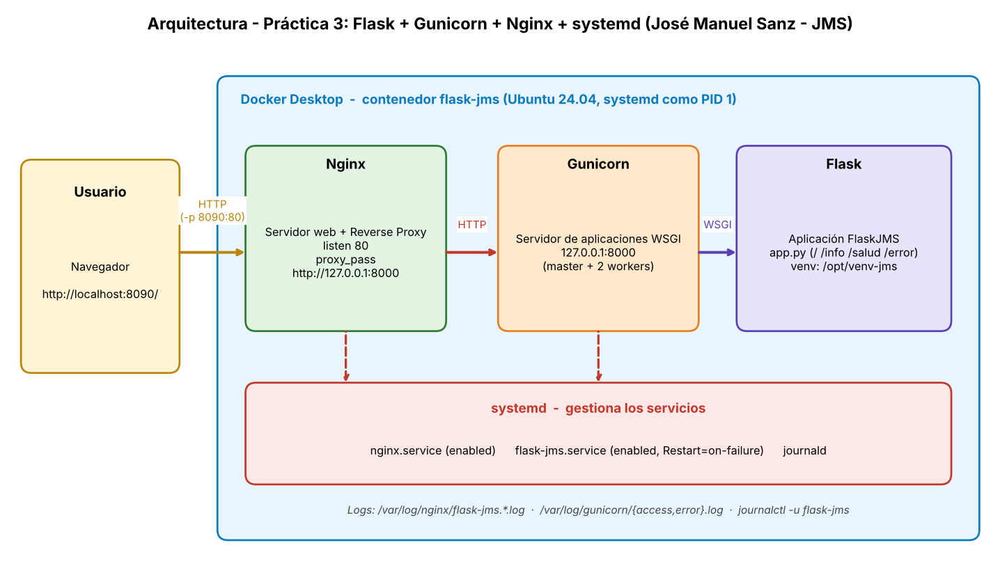

La solución consiste en un contenedor Docker (`flask-jms`) basado en Ubuntu 24.04 que arranca con **systemd como PID 1**. Así se comporta como un servidor Linux real, donde se pueden crear y gestionar servicios. Dentro del contenedor:

- **Nginx** escucha en el puerto 80 (publicado en el anfitrión como `8090`) y actúa como servidor web frontal y Reverse Proxy.
- **Gunicorn** escucha solo en `127.0.0.1:8000` (no accesible desde fuera) y ejecuta la aplicación Flask con un proceso maestro y 2 workers.
- **Flask** contiene la lógica de la aplicación (`aplicacion/app.py`), en un entorno virtual `/opt/venv-jms`.
- **systemd** gestiona `nginx.service` y `flask-jms.service` (arranque automático, reinicio ante fallos y ciclo de vida).

Flujo de una petición: *navegador → `localhost:8090` → Nginx (80) → Gunicorn (127.0.0.1:8000) → Flask → respuesta por el mismo camino*.

Decisión de diseño: en la práctica 2, Nginx y Tomcat estaban en contenedores distintos unidos por una red Docker. Aquí la Tarea 7 exige un servicio systemd, que requiere un sistema con init, por lo que todos los componentes comparten un único "servidor" (contenedor con systemd) y se comunican por la interfaz local.

---

## 3. Descripción de la solución

### 3.1 Verificación de requisitos y estructura (Tarea 1)

Se comprobó que Docker Desktop y Git funcionaban y que el repositorio estaba actualizado:

```powershell
docker --version
git --version
git pull
git status
```

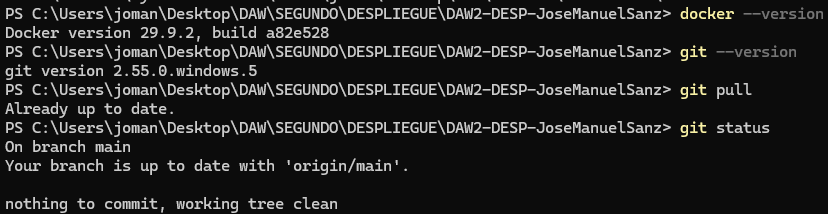

Estructura creada dentro del repositorio (nombres sin tilde, según el enunciado):

```text
tema3-ServApp/
└── practica03-flask-gunicorn/
    ├── requisitos.md          (enunciado del profesor)
    ├── README.md              (solución detallada)
    ├── memoria.md             (análisis de componentes y comparación con Tomcat)
    ├── .gitignore
    ├── aplicacion/
    │   ├── app.py
    │   └── requirements.txt
    ├── configuracion/
    │   ├── Dockerfile
    │   ├── gunicorn.conf.py
    │   ├── nginx-flask.conf
    │   └── flask-jms.service
    └── capturas/
```

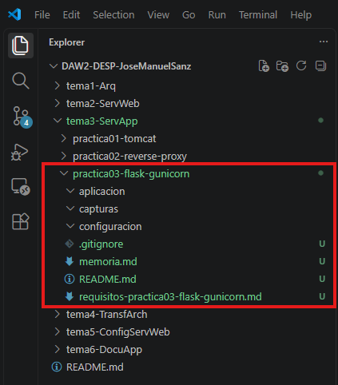

### 3.2 Aplicación Flask (Tarea 2)

El fichero `aplicacion/app.py` define la aplicación **FlaskJMS**, que cumple los requisitos de la tarea:

| Ruta | Función |
|---|---|
| `/` | Página de bienvenida: identifica al alumno (José Manuel Sanz, JMS), la práctica, el módulo, datos del servidor y de la petición recibida. |
| `/info` | Mismos datos en formato JSON. |
| `/salud` | Responde `OK` (comprobación rápida de que la aplicación vive). |
| `/error` | Genera un error 500 a propósito para analizar los logs. |

La página muestra las cabeceras `X-Forwarded-For`, `X-Real-IP` y `X-Forwarded-Proto`, que permiten comprobar qué información recibe Flask cuando hay un proxy delante. Las dependencias están en `aplicacion/requirements.txt` (`flask` y `gunicorn`).

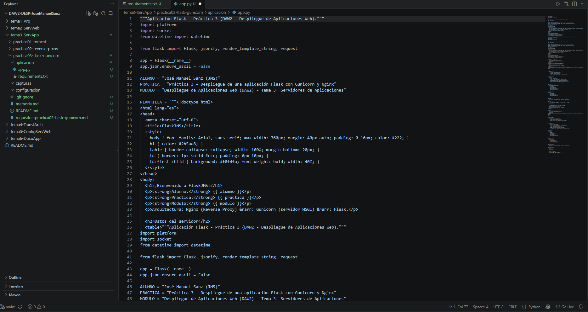

### 3.3 Entorno Docker con systemd

Fichero `configuracion/Dockerfile`:

```dockerfile
FROM ubuntu:24.04

ENV DEBIAN_FRONTEND=noninteractive

RUN apt-get update && \
    apt-get install -y --no-install-recommends \
        systemd systemd-sysv dbus \
        nginx \
        python3 python3-venv python3-pip \
        curl iproute2 procps nano less ca-certificates && \
    rm -rf /var/lib/apt/lists/* && \
    mkdir -p /var/log/journal && \
    systemctl mask getty.target console-getty.service

STOPSIGNAL SIGRTMIN+3

CMD ["/sbin/init"]
```

Construcción de la imagen y ejecución del contenedor:

```powershell
docker build -t servidor-flask-jms .
docker run -d --name flask-jms --privileged --cgroupns=host --tmpfs /tmp --tmpfs /run --tmpfs /run/lock -v /sys/fs/cgroup:/sys/fs/cgroup:rw -v "${PWD}:/proyecto" -p 8090:80 servidor-flask-jms
```

| Opción | Función |
|---|---|
| `--privileged`, `--cgroupns=host`, `-v /sys/fs/cgroup...`, `--tmpfs` | Necesarias para que systemd funcione dentro del contenedor. |
| `-v "${PWD}:/proyecto"` | Monta la carpeta de la práctica en `/proyecto`. |
| `-p 8090:80` | Publica el puerto 80 del contenedor (Nginx) en el 8090 del anfitrión. |

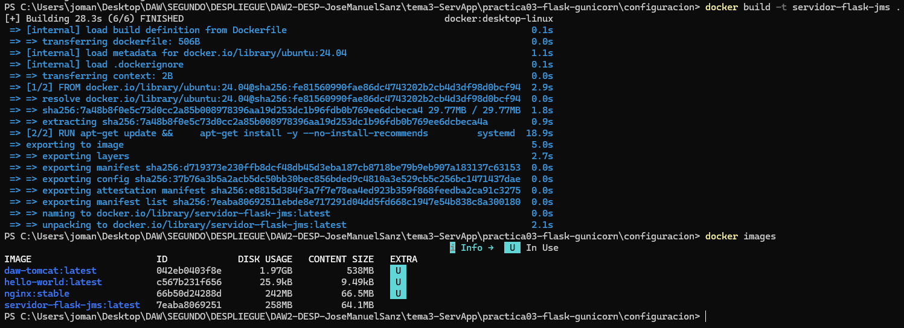
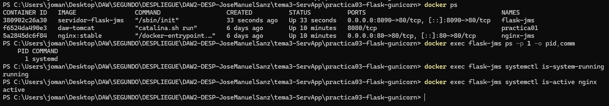

Nginx arranca por defecto con su página de bienvenida (que más adelante se sustituye por el proxy):

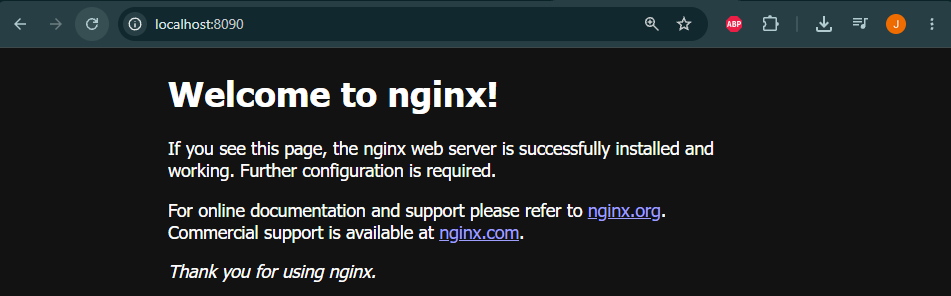

### 3.4 Entorno Python

Dentro del contenedor se creó un entorno virtual (en `/opt`, fuera del volumen de Windows) y se instalaron las dependencias:

```bash
python3 -m venv /opt/venv-jms
/opt/venv-jms/bin/pip install -r /proyecto/aplicacion/requirements.txt
```

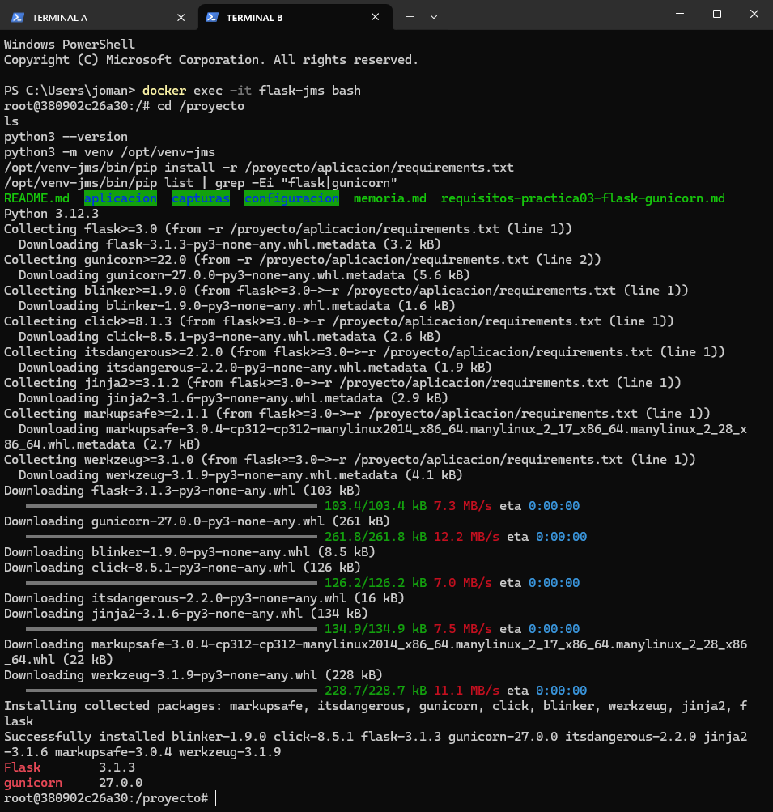

### 3.5 Prueba con el servidor de desarrollo de Flask

```bash
cd /proyecto/aplicacion
/opt/venv-jms/bin/python app.py
```

La aplicación responde correctamente a las peticiones HTTP, pero Flask muestra una advertencia: el servidor integrado es solo para desarrollo y no debe usarse en producción.

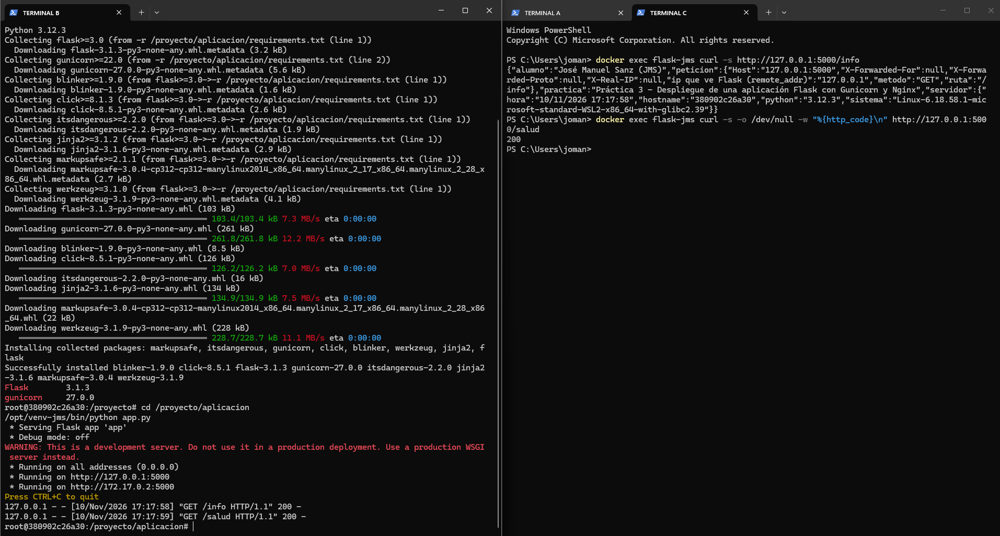

### 3.6 Configuración de Gunicorn (Tarea 3)

Primero se ejecutó la aplicación manualmente con Gunicorn:

```bash
/opt/venv-jms/bin/gunicorn --workers 2 --bind 127.0.0.1:8000 --access-logfile - app:app
```

Gunicorn arranca un proceso maestro y 2 workers, y queda escuchando en `127.0.0.1:8000`. Se comprobó con `curl`, `ss -tlnp` y `ps`:

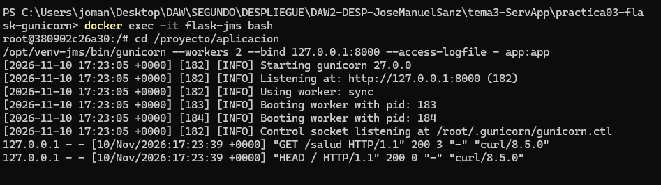
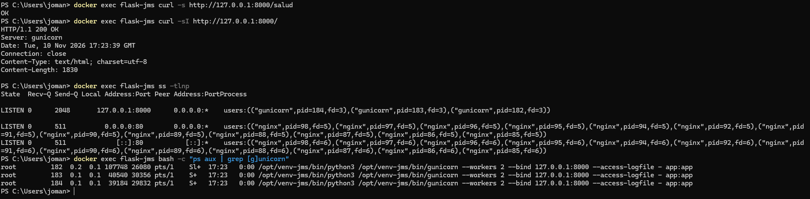

Fichero `configuracion/gunicorn.conf.py` (usado después por el servicio systemd):

```python
bind = "127.0.0.1:8000"
workers = 2
worker_class = "sync"
timeout = 30
loglevel = "info"

accesslog = "/var/log/gunicorn/access.log"
errorlog = "/var/log/gunicorn/error.log"
access_log_format = '%({x-forwarded-for}i)s %(h)s %(l)s %(u)s %(t)s "%(r)s" %(s)s %(b)s "%(f)s" "%(a)s"'
```

| Parámetro | Función |
|---|---|
| `bind` | Dirección y puerto de escucha. Solo en `127.0.0.1`, de modo que Gunicorn no es accesible desde fuera. |
| `workers` | Número de procesos que atienden peticiones. |
| `accesslog`, `errorlog` | Ficheros de registro de accesos y de errores. |
| `access_log_format` | Incluye como primer campo la IP real del cliente (`X-Forwarded-For`). |

### 3.7 Configuración de Nginx como Reverse Proxy (Tarea 4)

Fichero `configuracion/nginx-flask.conf`:

```nginx
server {
    listen 80 default_server;
    server_name localhost;

    access_log /var/log/nginx/flask-jms.access.log;
    error_log  /var/log/nginx/flask-jms.error.log;

    location / {
        proxy_pass http://127.0.0.1:8000;
        proxy_http_version 1.1;

        proxy_set_header Host              $http_host;
        proxy_set_header X-Real-IP         $remote_addr;
        proxy_set_header X-Forwarded-For   $proxy_add_x_forwarded_for;
        proxy_set_header X-Forwarded-Proto $scheme;
        proxy_set_header X-Forwarded-Host  $host;
    }
}
```

| Directiva | Función |
|---|---|
| `listen 80` | Nginx recibe peticiones HTTP. |
| **`proxy_pass http://127.0.0.1:8000`** | Reenvía las peticiones a Gunicorn. |
| `proxy_set_header ...` | Conserva la información del cliente original (host, IP, protocolo). |
| `access_log`, `error_log` | Registros propios de este sitio. |

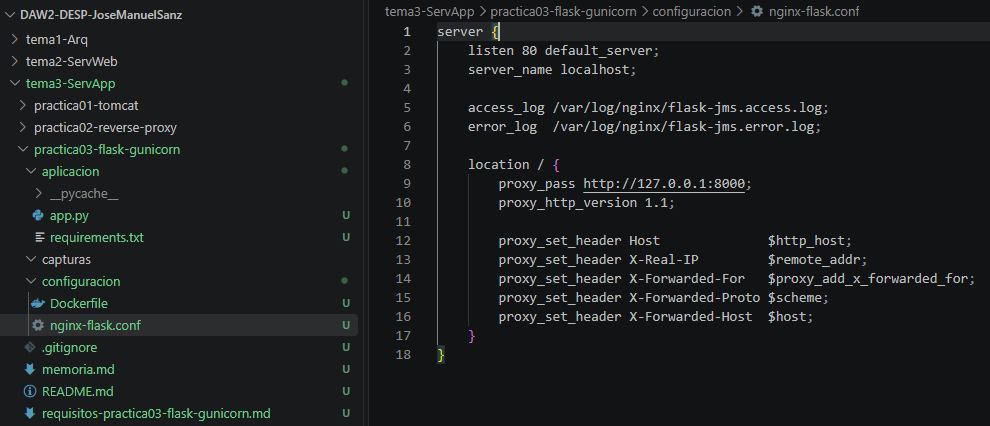

Instalación de la configuración y comprobación:

```bash
cp /proyecto/configuracion/nginx-flask.conf /etc/nginx/sites-available/flask-jms
ln -s /etc/nginx/sites-available/flask-jms /etc/nginx/sites-enabled/flask-jms
rm /etc/nginx/sites-enabled/default
nginx -t
systemctl reload nginx
```

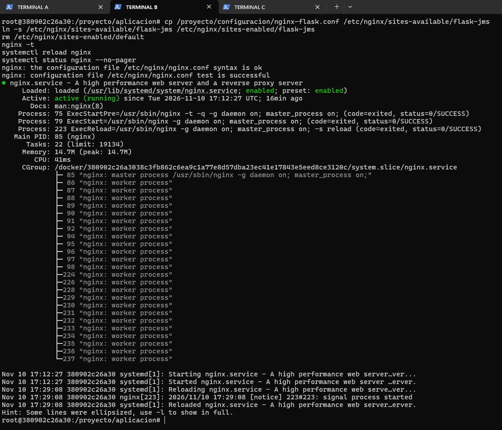

### 3.8 Verificación del flujo completo (Tarea 5)

La aplicación es accesible a través del servidor web en `http://localhost:8090`:

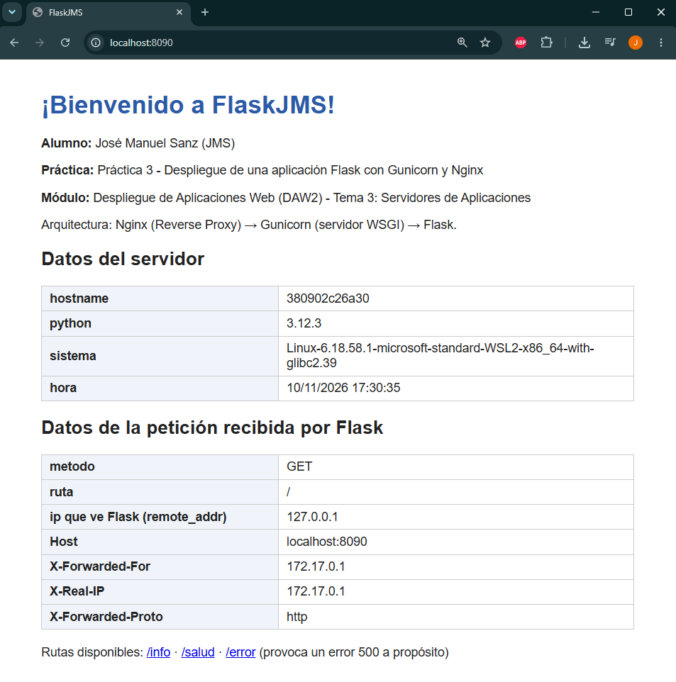

La comparación de cabeceras demuestra quién responde en cada punto: Gunicorn directamente (`Server: gunicorn`) y Nginx al cliente (`Server: nginx`).

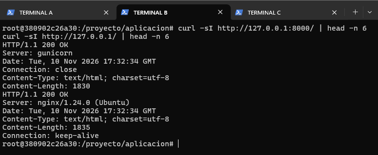
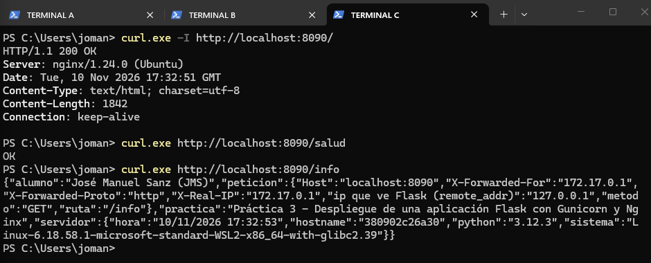

El log de Gunicorn en primer plano muestra las peticiones que llegan desde Nginx, lo que confirma el flujo **Usuario → Nginx → Gunicorn → Flask**:

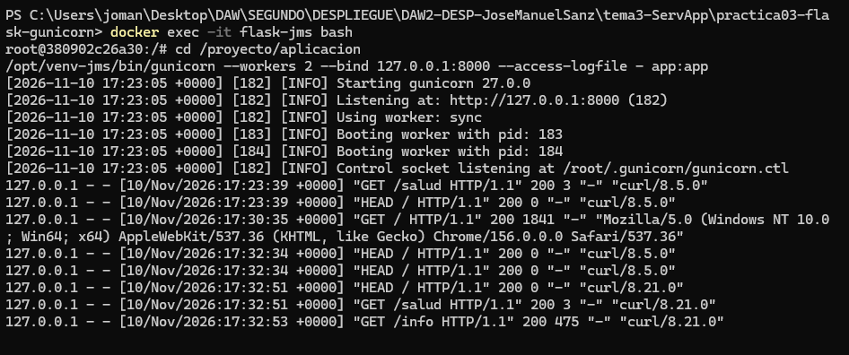

En la página de la aplicación, `ip que ve Flask` es `127.0.0.1` (la de Nginx) y la IP real del cliente llega en `X-Forwarded-For`, igual que ocurría con Tomcat en la práctica 2.

### 3.9 Análisis de componentes (Tarea 6)

(El análisis completo está en [`memoria.md`](memoria.md).)

| Componente | Función principal | Papel en la arquitectura |
|---|---|---|
| **Flask** | Microframework web de Python: define rutas y genera las respuestas. | Contiene la lógica de la aplicación (`app.py`). |
| **Gunicorn** | Servidor HTTP WSGI para Python: gestiona procesos (workers) y ejecuta la aplicación Flask. | Servidor de aplicaciones; recibe las peticiones de Nginx y las pasa a Flask mediante WSGI. |
| **Nginx** | Servidor web de alto rendimiento y Reverse Proxy. | Frontal que recibe a los usuarios y reenvía a Gunicorn. |

Diferencia Flask / Gunicorn: Flask es la aplicación (qué hacer con cada ruta); Gunicorn es quien la ejecuta de forma robusta (varios procesos, gestión de conexiones, logs). Ventajas de usar un Reverse Proxy: punto único de entrada, aislamiento del servidor de aplicaciones, TLS, estáticos, caché y balanceo.

### 3.10 Servicio systemd (Tarea 7)

**systemd** es el gestor de servicios del sistema (init) en Linux moderno. Arranca los servicios al iniciar el sistema, los supervisa, los reinicia si fallan y centraliza sus logs en `journald`. Un servicio se define con un fichero *unit* (`.service`).

Fichero `configuracion/flask-jms.service`:

```ini
[Unit]
Description=Gunicorn - Aplicacion Flask FlaskJMS (Jose Manuel Sanz)
After=network.target

[Service]
Type=simple
User=www-data
Group=www-data
WorkingDirectory=/proyecto/aplicacion
Environment="PYTHONDONTWRITEBYTECODE=1"
LogsDirectory=gunicorn
ExecStart=/opt/venv-jms/bin/gunicorn --config /proyecto/configuracion/gunicorn.conf.py app:app
ExecReload=/bin/kill -s HUP $MAINPID
Restart=on-failure
RestartSec=3

[Install]
WantedBy=multi-user.target
```

| Directiva | Función |
|---|---|
| `After=network.target` | Arranca cuando la red está disponible. |
| `User=www-data` | Gunicorn se ejecuta sin privilegios de root. |
| `WorkingDirectory` | Directorio desde el que se carga `app:app`. |
| `LogsDirectory=gunicorn` | systemd crea `/var/log/gunicorn` con los permisos adecuados. |
| `ExecStart` | Comando que inicia Gunicorn con su fichero de configuración. |
| `ExecReload` | Recarga la configuración de Gunicorn sin cortar el servicio (señal HUP). |
| `Restart=on-failure`, `RestartSec=3` | Reinicia el servicio si termina con fallo, tras 3 segundos. |
| `WantedBy=multi-user.target` | Permite arrancarlo automáticamente con `systemctl enable`. |

Instalación e inicio del servicio:

```bash
cp /proyecto/configuracion/flask-jms.service /etc/systemd/system/flask-jms.service
systemctl daemon-reload
systemctl start flask-jms
systemctl status flask-jms --no-pager
```

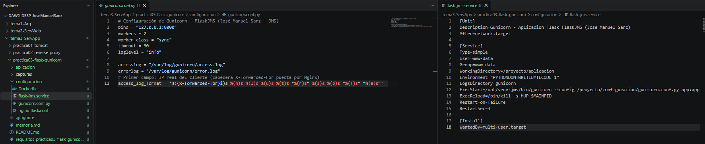
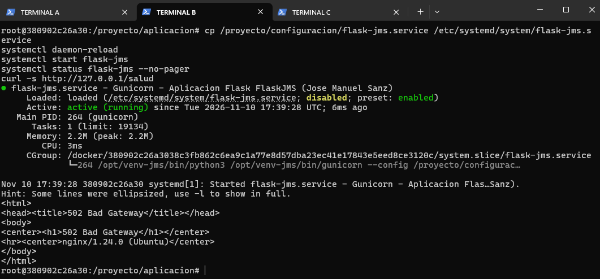

**Parada del servicio.** Al parar `flask-jms`, Nginx sigue vivo pero no tiene backend y responde `502 Bad Gateway`:

```bash
systemctl stop flask-jms
```

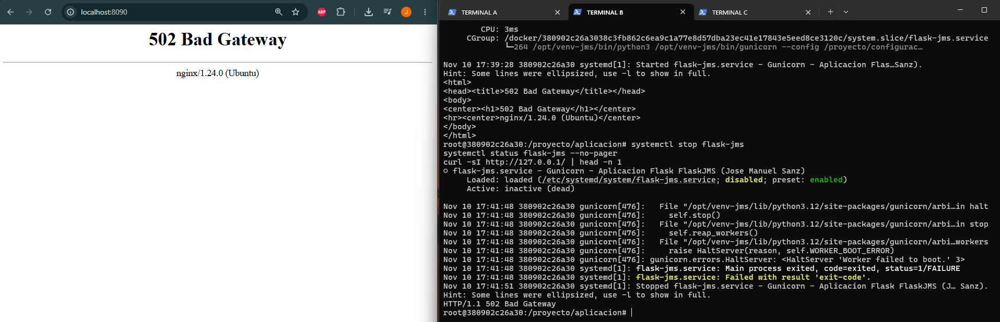

**Inicio, reinicio y recarga:**

```bash
systemctl start flask-jms
systemctl restart flask-jms
systemctl reload flask-jms
```

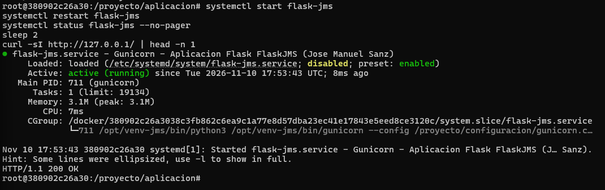

**Reinicio automático ante fallo.** Se mató el proceso maestro con `kill -9` y systemd lo volvió a levantar con un PID nuevo, dejando constancia en el journal:

```bash
kill -9 $(systemctl show -p MainPID --value flask-jms)
journalctl -u flask-jms -n 15 --no-pager
```

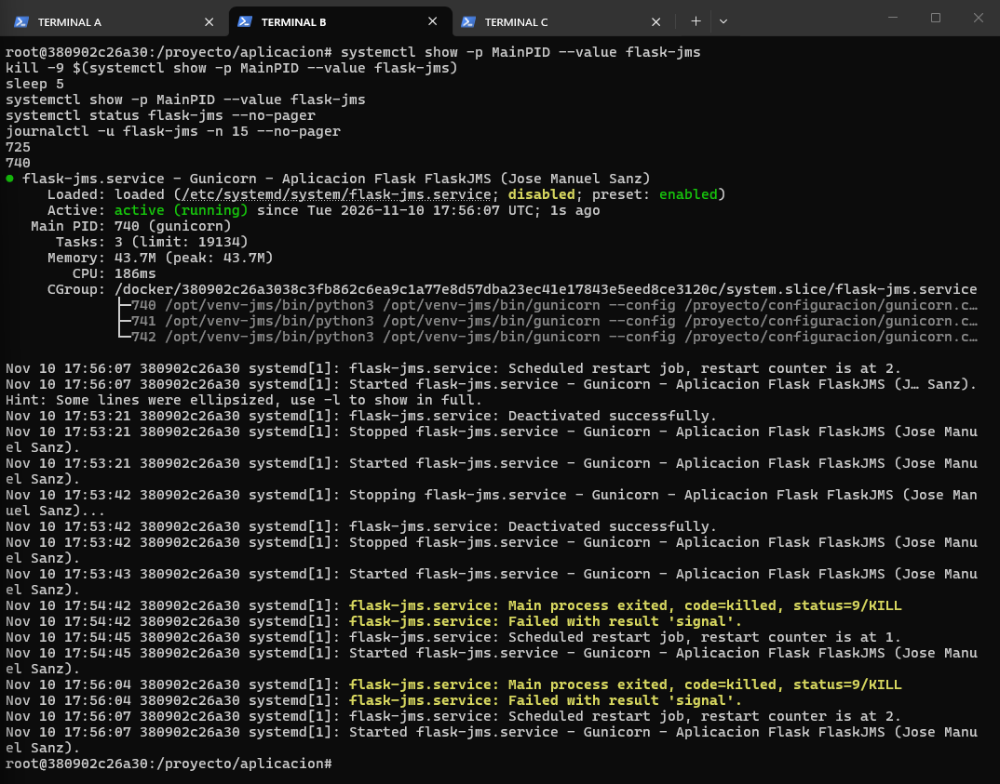

### 3.11 Verificación de persistencia (Tarea 8)

Se habilitó el arranque automático y se simuló el reinicio del servidor reiniciando el contenedor (systemd arranca de nuevo desde cero):

```bash
systemctl enable flask-jms
systemctl is-enabled flask-jms nginx
```

```powershell
docker restart flask-jms
docker exec flask-jms systemctl is-active flask-jms nginx
docker exec flask-jms journalctl -u flask-jms -b --no-pager
```

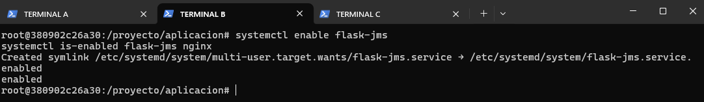

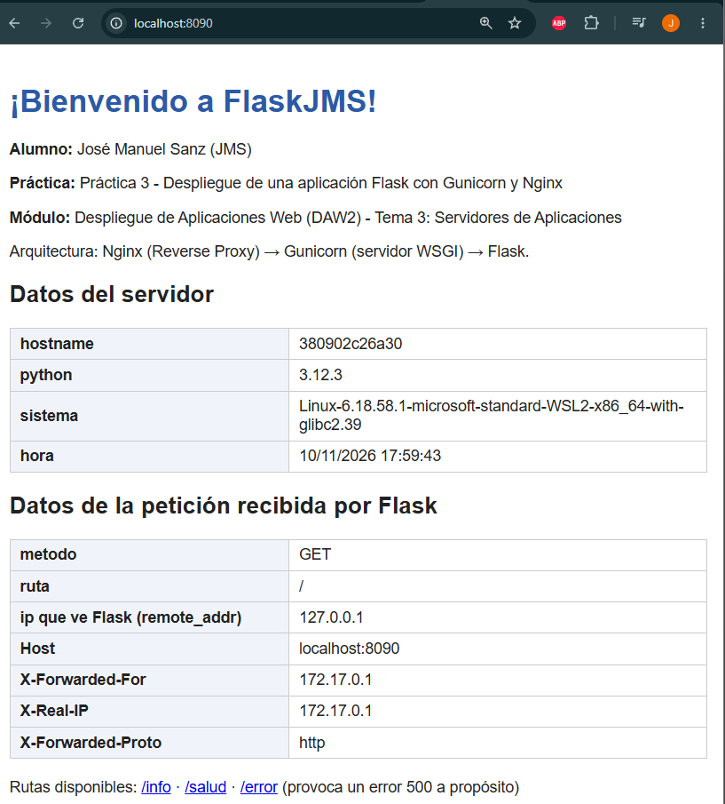

Resultado:

- El servicio se inicia automáticamente (`enable`) sin intervención manual.
- La aplicación sigue accesible tras el reinicio.
- El sistema registra la información del servicio en el journal (`journalctl -u flask-jms`).

### 3.12 Análisis de registros (Tarea 9)

Se generó tráfico variado (accesos correctos, `/info`, `/salud`, una ruta inexistente que da 404 y `/error` que da 500) y se consultaron los registros.

**Logs de Gunicorn** (`/var/log/gunicorn/`):

```powershell
docker exec flask-jms tail -n 20 /var/log/gunicorn/error.log
docker exec flask-jms tail -n 15 /var/log/gunicorn/access.log
```

- `error.log`: inicio de la aplicación (`Starting gunicorn`, `Listening at`, `Booting worker`), el reinicio provocado en las pruebas y la traza del error intencionado (`ZeroDivisionError`).
- `access.log`: peticiones procesadas con la IP real del cliente, la ruta y el código de estado (200, 404, 500).

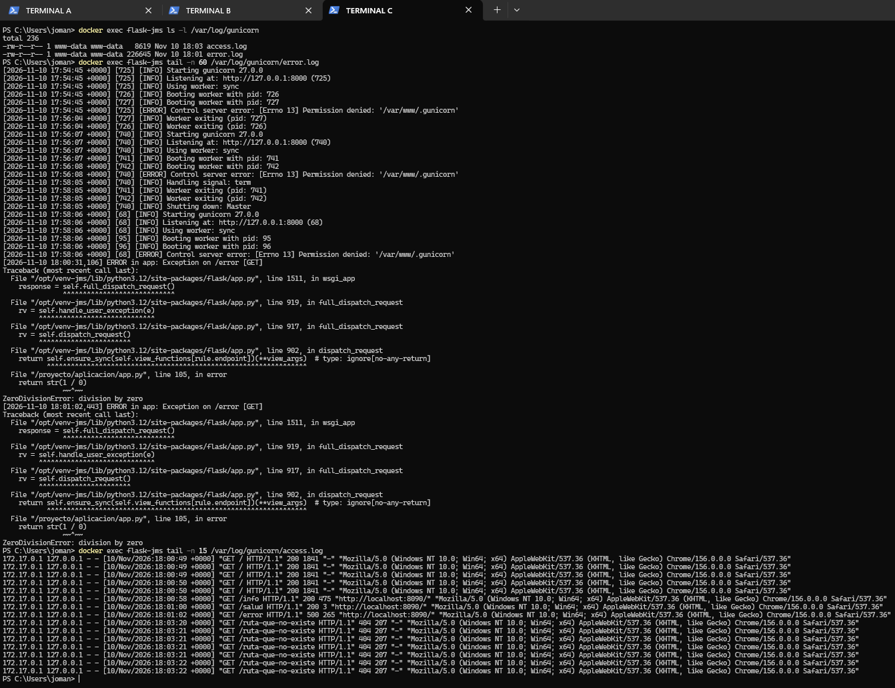

**Logs de Nginx** (`/var/log/nginx/`):

```powershell
docker exec flask-jms tail -n 15 /var/log/nginx/flask-jms.access.log
docker exec flask-jms tail -n 10 /var/log/nginx/flask-jms.error.log
```

- `flask-jms.access.log`: accesos con la dirección cliente (la que entrega Docker Desktop), la petición y el código de respuesta.
- `flask-jms.error.log`: errores `connect() failed ... Connection refused` de cuando se paró Gunicorn (origen del 502).

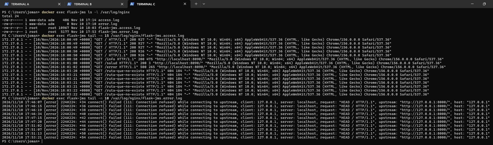

### 3.13 Comparación con Tomcat (Tarea 10)

(Versión ampliada en [`memoria.md`](memoria.md).)

```text
Práctica 2:   Cliente → Nginx → Tomcat   → Aplicación Java
Práctica 3:   Cliente → Nginx → Gunicorn → Flask
```

| Aspecto | Nginx + Tomcat | Nginx + Gunicorn |
|---|---|---|
| Lenguaje | Java | Python |
| Servidor web frontal | Nginx (Reverse Proxy) | Nginx (Reverse Proxy) |
| Servidor de aplicaciones | Tomcat (contenedor de servlets/JSP) | Gunicorn (servidor WSGI) |
| Aplicación | WAR (JSP/servlets) | Aplicación Flask (código Python) |
| Estándar | Jakarta Servlet / JSP | WSGI |
| Despliegue | Copiar el WAR a `webapps` (despliegue en caliente) | Ejecutar el código con Gunicorn desde un servicio |
| Concurrencia | Hilos dentro de un proceso JVM | Varios procesos *worker* |
| Configuración | `server.xml`, `web.xml`... | `gunicorn.conf.py` / parámetros |
| Gestión del ciclo de vida | Scripts de Tomcat (en la práctica, Docker) | systemd |
| Puerto interno | 8080 | 8000 |
| Logs | `logs/` de Tomcat | `/var/log/gunicorn` + journal |

**Similitudes:** el esquema de capas es idéntico; Nginx recibe y reenvía con `proxy_pass` y las mismas cabeceras `X-Forwarded-*`; el servidor de aplicaciones no se expone al exterior; los logs se analizan en ambas capas.

**Diferencias:** el lenguaje y el estándar (Servlet/JSP frente a WSGI); Tomcat es un contenedor completo que gestiona el despliegue de aplicaciones empaquetadas, mientras que Gunicorn es un servidor de procesos que ejecuta un módulo Python; y la gestión del servicio (aquí con systemd, configurado explícitamente).

**Ventajas:** Tomcat ofrece un ecosistema Java maduro, despliegue por WAR con redespliegue en caliente y manejo de múltiples aplicaciones en el mismo servidor. Gunicorn es ligero y sencillo de configurar y encaja de forma natural con aplicaciones Python.

---

## 4. Evidencias obtenidas

| Evidencia exigida | Captura |
|---|---|
| Aplicación Flask funcionando | `08-flask-servidor-desarrollo.png`, `13-app-via-nginx.png` |
| Gunicorn ejecutándose | `09-gunicorn-manual.png`, `10-gunicorn-escuchando.png`, `18-systemd-start-status.png` |
| Configuración de Nginx | `11-config-nginx.png`, `12-nginx-instalacion-test.png` |
| Flujo completo de funcionamiento | `13-app-via-nginx.png`, `14-cabeceras-gunicorn-vs-nginx.png`, `15-curl-desde-windows.png`, `16-gunicorn-recibe-peticiones.png` |
| Servicio systemd | `17` a `22` (`17-config-gunicorn-systemd.png` … `22-systemd-enable.png`) |
| Persistencia tras reinicio | `23-reinicio-contenedor.png`, `24-app-tras-reinicio.png` |
| Logs generados | `25-logs-gunicorn.png`, `26-logs-nginx.png`, `21-systemd-autorestart.png` |

## Repositorio en GitHub después de terminar la práctica 3
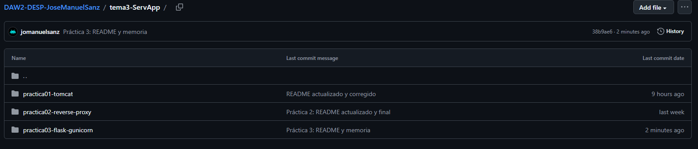

---

## 5. Problemas encontrados

1. **El contenedor con systemd se detenía al arrancar** (o `systemctl` no funcionaba dentro del contenedor).
2. **Puerto 8090 ocupado** en el equipo anfitrión.
3. **Nginx mostraba "Welcome to nginx!"** en lugar de la aplicación, o devolvía **502 Bad Gateway**.
4. **`Address already in use`** al arrancar el servicio, porque el Gunicorn manual seguía en ejecución.
5. **El servicio `flask-jms` fallaba** (`status=203/EXEC` o `Permission denied`).
6. **Las tildes se veían mal** al ejecutar `curl.exe` en PowerShell.
7. **Cambios en la configuración sin efecto**, porque los ficheros se copian al sistema y no se leen directamente de `/proyecto`.

---

## 6. Soluciones aplicadas

1. Arrancar el contenedor con las opciones de systemd (`--privileged`, `--cgroupns=host`, montajes `tmpfs` y de `/sys/fs/cgroup`) y revisar `docker logs flask-jms`.
2. Cambiar el puerto publicado (por ejemplo `-p 8091:80`) y acceder por ese puerto.
3. Eliminar el sitio por defecto (`rm /etc/nginx/sites-enabled/default`), enlazar `flask-jms`, comprobar con `nginx -t` y recargar. Un 502 indica que Gunicorn no estaba en marcha: se solucionó arrancando `flask-jms`.
4. Parar el Gunicorn manual (Ctrl+C) antes de iniciar el servicio.
5. Comprobar con `journalctl -u flask-jms` la ruta de `ExecStart` y que el entorno virtual existe en `/opt/venv-jms`; si hay problemas de permisos con el usuario `www-data`, revisar los permisos o ejecutar el servicio como `root` temporalmente.
6. Es solo un problema de codificación de la consola; la aplicación responde correctamente en UTF-8 en el navegador.
7. Volver a copiar el fichero al sistema (`cp`) y ejecutar `systemctl daemon-reload` / `systemctl reload nginx` / `systemctl restart flask-jms` según corresponda.

---

## 7. Conclusiones

- La arquitectura **Nginx → Gunicorn → Flask** es el equivalente Python de **Nginx → Tomcat → aplicación Java**: un servidor web frontal con Reverse Proxy y un servidor de aplicaciones que ejecuta el código.
- Flask no debe usarse por sí solo en producción: su servidor integrado es de desarrollo. Gunicorn aporta procesos, estabilidad y gestión de conexiones.
- Dejar Gunicorn escuchando solo en `127.0.0.1` y exponer únicamente Nginx reduce la superficie de ataque.
- systemd convierte Gunicorn en un servicio de verdad: arranque automático, reinicio ante fallos (comprobado con `kill -9`), control del ciclo de vida y registros centralizados.
- Los logs de Nginx, de Gunicorn y de systemd permiten trazar una petición de extremo a extremo y diagnosticar errores como el 502.
- Se han cubierto los criterios de evaluación c, e y f.

---

## 8. Cuestiones finales

**1. ¿Cuál es la función de Flask?**
Es un microframework web de Python. Define las rutas de la aplicación y genera las respuestas (HTML, JSON...). Contiene la lógica de negocio.

**2. ¿Cuál es la función de Gunicorn?**
Es un servidor HTTP WSGI para Python. Ejecuta la aplicación Flask, gestiona varios procesos *worker* para atender peticiones en paralelo y actúa como servidor de aplicaciones entre Nginx y Flask.

**3. ¿Por qué no se utiliza Flask directamente en producción?**
Porque su servidor integrado está pensado solo para desarrollo: no es robusto, no gestiona bien la concurrencia ni la carga, y no ofrece supervisión de procesos. El propio Flask lo advierte al arrancar.

**4. ¿Qué ventajas proporciona Gunicorn?**
Múltiples workers (concurrencia y mejor uso de CPU), estabilidad, reinicio de workers que fallan, gestión de timeouts, logs configurables, recarga con señales y facilidad para integrarse con systemd y Nginx.

**5. ¿Qué función realiza Nginx?**
Actúa como servidor web frontal y Reverse Proxy: recibe las peticiones de los usuarios, las reenvía a Gunicorn y devuelve la respuesta. También puede servir estáticos, gestionar TLS, cachear y balancear carga.

**6. ¿Qué es un Reverse Proxy?**
Un servidor intermedio que recibe las peticiones de los clientes en nombre de los servidores internos, las reenvía al servidor adecuado y devuelve la respuesta. El cliente solo conoce al proxy.

**7. ¿Qué ventajas aporta systemd?**
Arranque automático del servicio al iniciar el sistema, reinicio automático ante fallos (`Restart=on-failure`), control del ciclo de vida (`start`, `stop`, `restart`, `reload`, `status`), gestión de usuarios y directorios de logs, dependencias entre servicios y registros centralizados con `journalctl`.

**8. ¿Qué diferencias existen entre Tomcat y Gunicorn?**
Tomcat es un contenedor de servlets/JSP para Java (estándar Servlet/Jakarta EE) que despliega aplicaciones empaquetadas (WAR) y atiende con hilos dentro de la JVM. Gunicorn es un servidor WSGI para Python que ejecuta un módulo de código con varios procesos *worker*, sin concepto de WAR ni de despliegue en caliente por carpeta. La configuración también difiere (`server.xml` frente a `gunicorn.conf.py`).

**9. ¿Qué similitudes existen entre Nginx + Tomcat y Nginx + Gunicorn?**
Misma estructura multicapa: Nginx como frontal y Reverse Proxy mediante `proxy_pass`, reenvío de las cabeceras `X-Forwarded-*`, servidor de aplicaciones no expuesto al exterior, separación de responsabilidades y análisis de logs en ambas capas.

**10. ¿Qué mejoras podrían realizarse sobre la arquitectura implementada?**
- HTTPS/TLS en Nginx (certificados, redirección de HTTP a HTTPS).
- Comunicación Nginx ↔ Gunicorn mediante socket Unix.
- `ProxyFix` en Flask para que `remote_addr` refleje la IP real del cliente.
- Nginx sirviendo ficheros estáticos y cacheando contenido.
- Más workers según la CPU, y balanceo de carga entre varias instancias.
- Rotación de logs (`logrotate`) y monitorización.
- Limitación de peticiones (`limit_req`) y cabeceras de seguridad.
- Contenedores separados con Docker Compose y despliegue automatizado (CI/CD).
- Fichero de dependencias con versiones fijadas.