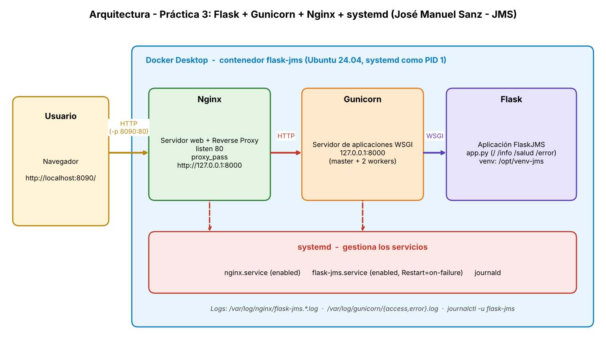

# Práctica 3. Despliegue de una aplicación Flask con Gunicorn y Nginx

## Resultado de aprendizaje

Configurar y desplegar una aplicación web Python utilizando un servidor de aplicaciones (Gunicorn) y un servidor web (Nginx), implementando una arquitectura similar a la utilizada en entornos profesionales.

---

# Criterios de evaluación

- c) Configurar el servidor de aplicaciones para cooperar con el servidor web.
- e) Configurar y utilizar los componentes web del servidor de aplicaciones.
- f) Realizar los ajustes necesarios para el despliegue de aplicaciones sobre el servidor de aplicaciones.

---

# Contexto

En las prácticas anteriores se ha trabajado con:

- Servidores de aplicaciones Java (Tomcat).
- Integración entre Nginx y Tomcat mediante Reverse Proxy.

En esta práctica se utilizará una arquitectura muy similar, pero basada en tecnologías Python.

La aplicación será desarrollada utilizando Flask y ejecutada mediante Gunicorn.

Nginx se utilizará como servidor web frontal y Reverse Proxy.

---

# Arquitectura objetivo


 

---

# Objetivos

Al finalizar la práctica el alumnado será capaz de:

- Comprender el funcionamiento de Flask.
- Comprender la función de Gunicorn.
- Configurar Gunicorn como servidor de aplicaciones Python.
- Configurar Nginx como Reverse Proxy.
- Implementar una arquitectura multicapa.
- Publicar una aplicación web Python.
- Documentar el proceso de despliegue.

---

# Requisitos previos

Antes de comenzar esta práctica debe verificarse que:

- Docker Desktop está instalado y funcionando.
- Visual Studio Code está correctamente configurado.
- Git está disponible.
- El repositorio de prácticas está actualizado.
- Las prácticas anteriores se encuentran completadas.

---

# Tareas a realizar

## Tarea 1. Preparación de la estructura de trabajo

Crear dentro del repositorio:

```text
tema3-ServApp/
└── practica03-flask-gunicorn/
```

Organizar adecuadamente:

- Código fuente.
- Configuración.
- Capturas.
- Documentación.

---

## Tarea 2. Creación de una aplicación Flask

Desarrollar una aplicación web Flask sencilla.

La aplicación deberá:

- Mostrar una página de bienvenida.
- Identificar al alumno.
- Mostrar información de la práctica.
- Responder correctamente a peticiones HTTP.

---

## Tarea 3. Configuración de Gunicorn

Investigar la función de Gunicorn y utilizarlo para ejecutar la aplicación Flask.

Comprobar:

- Que la aplicación funciona mediante Gunicorn.
- Que es accesible localmente.
- Que Gunicorn permanece escuchando peticiones.

---

## Tarea 4. Configuración de Nginx

Configurar Nginx para actuar como Reverse Proxy.

La configuración deberá permitir:

- Recibir peticiones HTTP.
- Reenviar dichas peticiones a Gunicorn.
- Mantener la comunicación entre cliente y aplicación.

---

## Tarea 5. Verificación del flujo completo

Comprobar que el flujo de peticiones es:

```text
Usuario
   │
   ▼
 Nginx
   │
   ▼
 Gunicorn
   │
   ▼
 Flask
```

Verificar que la aplicación es accesible a través del servidor web.

---

## Tarea 6. Análisis de componentes

Identificar y explicar la función de:

### Flask

- Función principal.
- Uso dentro de la arquitectura.

### Gunicorn

- Función principal.
- Diferencias respecto a Flask.

### Nginx

- Función principal.
- Ventajas de utilizar un Reverse Proxy.

---

## Tarea 7. Creación de un servicio systemd

Investigar qué es un servicio systemd.

Crear un servicio que permita:

- Arrancar automáticamente Gunicorn.
- Reiniciar Gunicorn en caso de fallo.
- Gestionar el ciclo de vida del servicio.

Comprobar:

- Inicio del servicio.
- Parada del servicio.
- Reinicio del servicio.

---

## Tarea 8. Verificación de persistencia

Comprobar que:

- El servicio puede iniciarse automáticamente.
- La aplicación permanece accesible tras reinicios.
- El sistema registra correctamente la información del servicio.

---

## Tarea 9. Análisis de registros

Localizar e inspeccionar:

### Logs de Gunicorn

Identificar:

- Inicio de la aplicación.
- Peticiones procesadas.
- Posibles errores.

### Logs de Nginx

Identificar:

- Accesos realizados.
- Direcciones cliente.
- Peticiones atendidas.

---

## Tarea 10. Comparación con Tomcat

Comparar la arquitectura utilizada en la práctica anterior:

```text
Cliente
   │
   ▼
 Nginx
   │
   ▼
 Tomcat
   │
   ▼
 Aplicación Java
```

con la arquitectura actual:

```text
Cliente
   │
   ▼
 Nginx
   │
   ▼
 Gunicorn
   │
   ▼
 Flask
```

Explicar:

- Similitudes.
- Diferencias.
- Ventajas de cada tecnología.

---

# Estructura mínima esperada

```text
practica03-flask-gunicorn/
│
├── requisitos.md
├── README.md
├── aplicacion/
├── configuracion/
├── capturas/
└── memoria.md
```

---

# Entregables

## Código fuente

Aplicación Flask completamente funcional.

---

## Configuración

Archivos utilizados para:

- Gunicorn.
- Nginx.
- systemd.

---

## Documentación

README.md explicando:

- Arquitectura.
- Despliegue realizado.
- Configuración empleada.
- Problemas encontrados.
- Soluciones aplicadas.

---

## Capturas

Las evidencias deben mostrar, al menos:

- Aplicación Flask funcionando.
- Gunicorn ejecutándose.
- Configuración de Nginx.
- Flujo completo de funcionamiento.
- Servicio systemd.
- Logs generados.

---

# Cuestiones finales

Responder brevemente:

1. ¿Cuál es la función de Flask?
2. ¿Cuál es la función de Gunicorn?
3. ¿Por qué no se utiliza Flask directamente en producción?
4. ¿Qué ventajas proporciona Gunicorn?
5. ¿Qué función realiza Nginx?
6. ¿Qué es un Reverse Proxy?
7. ¿Qué ventajas aporta systemd?
8. ¿Qué diferencias existen entre Tomcat y Gunicorn?
9. ¿Qué similitudes existen entre Nginx + Tomcat y Nginx + Gunicorn?
10. ¿Qué mejoras podrían realizarse sobre la arquitectura implementada?

---

