# Práctica 04. Despliegue en AWS EC2 con HTTPS y certificados SSL/TLS de una aplicación Flask con Gunicorn y Nginx

**Alumno:** José Manuel Sanz (JMS)
**Módulo:** Despliegue de Aplicaciones Web (DAW2) · **Tema 3:** Servidores de Aplicaciones
**Aplicación:** `FlaskJMS`

---

## Índice

1. [Introducción](#1-introducción)
2. [Objetivos](#2-objetivos)
3. [Arquitectura utilizada](#3-arquitectura-utilizada)
4. [AWS EC2](#4-aws-ec2)
5. [User Data](#5-user-data)
6. [Flask](#6-flask)
7. [Gunicorn](#7-gunicorn)
8. [Nginx](#8-nginx)
9. [HTTPS](#9-https)
10. [Evidencias obtenidas](#10-evidencias-obtenidas)
11. [Problemas encontrados](#11-problemas-encontrados)
12. [Soluciones aplicadas](#12-soluciones-aplicadas)
13. [Conclusiones](#13-conclusiones)

---

## 1. Introducción

En las prácticas anteriores se trabajó con Tomcat, con la integración Nginx + Tomcat (práctica 2) y con una aplicación Flask ejecutada con Gunicorn y Nginx dentro de un contenedor con systemd (práctica 3). En esta práctica se lleva esa arquitectura a **Internet**: se despliega la aplicación Flask en una instancia **AWS EC2**, se automatiza la preparación del servidor con **User Data**, se ejecuta Flask con Gunicorn dentro de un **contenedor Docker**, se publica mediante **Nginx** como Reverse Proxy y se protege el tráfico con **HTTPS** (certificado SSL/TLS).

**Criterios de evaluación trabajados:**

| Criterio | Descripción | Dónde se trata |
|---|---|---|
| d | Configurar y gestionar mecanismos de seguridad | Apartados 4 (Security Group, clave SSH), 8 y 9 (HTTPS), cierre de seguridad |
| f | Realizar el despliegue de aplicaciones sobre el servidor de aplicaciones | Apartados 6, 7 y 8 |
| i | Aplicar procedimientos de despliegue utilizando tecnologías de virtualización y contenedores | Apartados 4 (EC2), 5 (User Data) y 7 (Docker) |

---

## 2. Objetivos

- Crear una instancia EC2 en AWS y configurar su grupo de seguridad.
- Automatizar la configuración inicial con **User Data** (`user-data.sh`).
- Conectarse mediante **SSH** y subir ficheros con **scp**.
- Desplegar una aplicación **Flask** con **Gunicorn** como servidor WSGI en un contenedor Docker.
- Configurar **Nginx** como Reverse Proxy.
- Implementar **HTTPS** con certificados SSL/TLS.
- Analizar los logs de Nginx y Gunicorn.
- Documentar un despliegue profesional.

---

## 3. Arquitectura utilizada

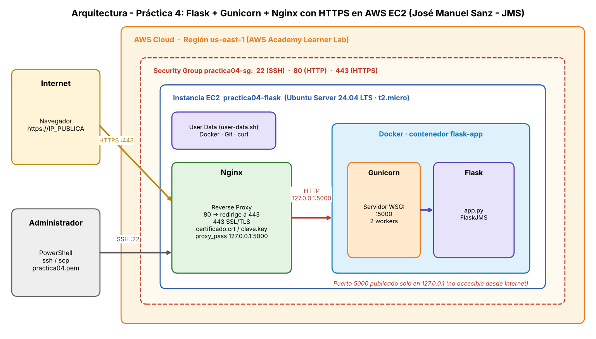

```text
Internet → (HTTPS 443) → Nginx (Reverse Proxy) → Gunicorn → Flask
```

Componentes:

- **Instancia EC2 `practica04-flask`** (Ubuntu Server 24.04 LTS, `t2.micro`), en AWS Academy (región us-east-1).
- **Security Group `practica04-sg`**: permite 22 (SSH), 80 (HTTP) y 443 (HTTPS).
- **User Data**: instala Docker, Git y curl en el primer arranque.
- **Nginx** (instalado en la instancia): escucha en 80 (redirige a HTTPS) y en 443 (SSL/TLS), y reenvía a `127.0.0.1:5000`.
- **Contenedor Docker `flask-app`**: ejecuta Gunicorn (2 workers) con la aplicación Flask. Su puerto 5000 se publica solo en `127.0.0.1`, por lo que no es accesible desde Internet.

Estructura del repositorio:

```text
practica04-aws-https/
├── requisitos.md          (enunciado del profesor)
├── README.md              (solución detallada)
├── aplicacion/
│   ├── app.py
│   ├── requirements.txt
│   └── Dockerfile
├── configuracion/
│   ├── user-data.sh
│   ├── nginx.conf
│   ├── certificado.crt
│   ├── clave.key
│   └── instrucciones.txt
├── capturas/
└── docs/
    └── arquitectura.png
```

---

## 4. AWS EC2

**Amazon EC2 (Elastic Compute Cloud)** es el servicio de AWS que ofrece **máquinas virtuales en la nube** (IaaS). La instancia es el "servidor": tiene su sistema operativo, CPU, memoria, disco e IP, y se paga por uso (en este caso, el crédito de AWS Academy). Permite crear servidores en minutos, sin hardware propio, accesibles desde Internet.

Conceptos usados:

| Concepto | Uso en la práctica |
|---|---|
| **AMI** | Plantilla del sistema: Ubuntu Server 24.04 LTS. |
| **Tipo de instancia** | `t2.micro` (1 vCPU, 1 GiB de RAM). |
| **Key pair** | Par de claves `practica04` (RSA, `.pem`) para acceder por SSH sin contraseña. |
| **Security Group** | Cortafuegos virtual de la instancia. Solo se abren los puertos necesarios. |
| **IP pública** | Dirección para acceder desde Internet. En Learner Lab cambia al detener y reanudar la instancia. |

### 4.1 Inicio del laboratorio

Se inició el Learner Lab de AWS Academy y se abrió la consola AWS:

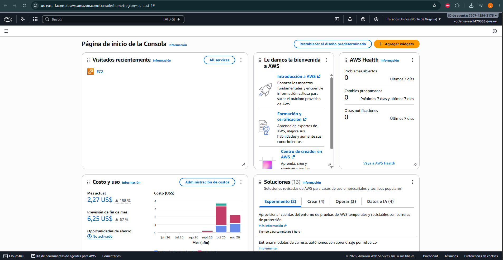

### 4.2 Creación de la instancia

Desde el panel de EC2 se pulsó **Launch instance** con la siguiente configuración:

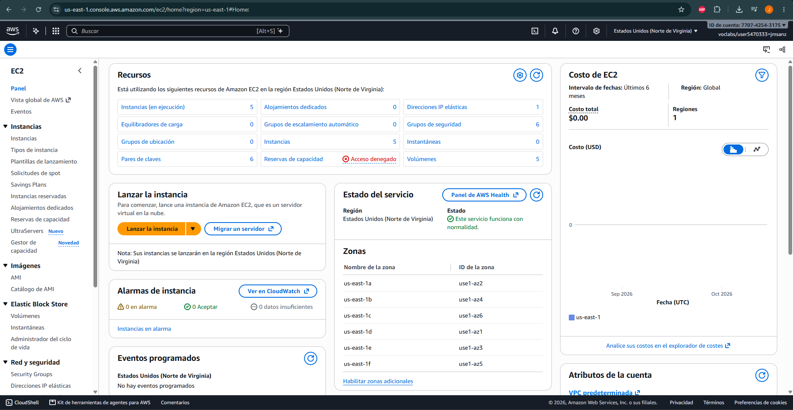

| Parámetro | Valor |
|---|---|
| Name | `practica04-flask` |
| AMI | Ubuntu Server 24.04 LTS (HVM), SSD |
| Instance type | `t2.micro` |
| Key pair | `practica04` (RSA, `.pem`) |
| Auto-assign public IP | Enable |
| Security group | `practica04-sg` |
| Storage | 8 GiB |
| User data | Contenido de `configuracion/user-data.sh` |

Creación de la clave SSH (el fichero `practica04.pem` se guardó fuera del repositorio y **no se sube a Git**):

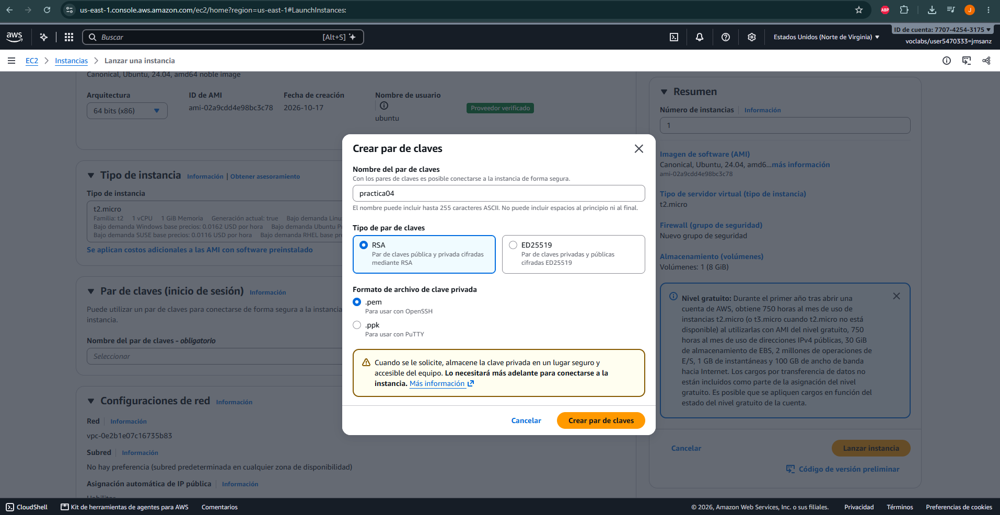

### 4.3 Security Group

| Tipo | Puerto | Origen | Motivo |
|---|---|---|---|
| SSH | 22 | Mi IP | Administración remota |
| HTTP | 80 | 0.0.0.0/0 | Acceso web (redirige a HTTPS) |
| HTTPS | 443 | 0.0.0.0/0 | Acceso web cifrado |
| Custom TCP | 5000 | 0.0.0.0/0 | **Temporal**: acceso directo a Flask (Tarea 11). Se eliminó al final. |

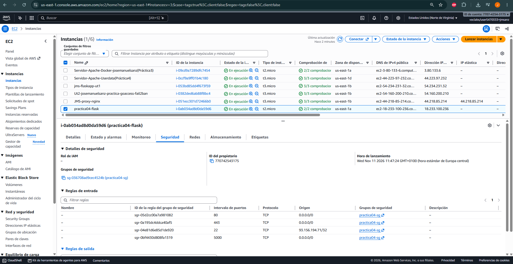

La instancia llegó al estado *Running*:

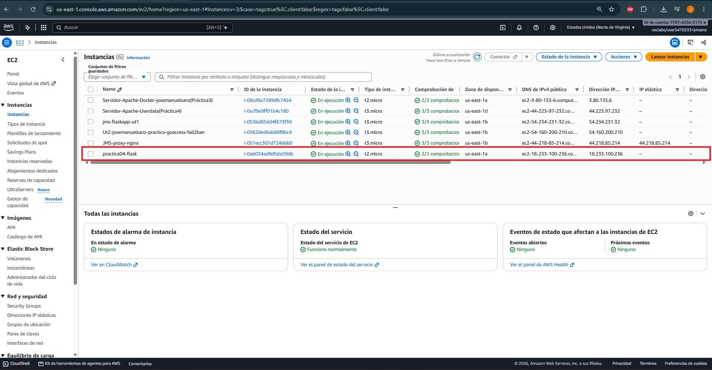

### 4.4 Conexión SSH

IP pública de la instancia:

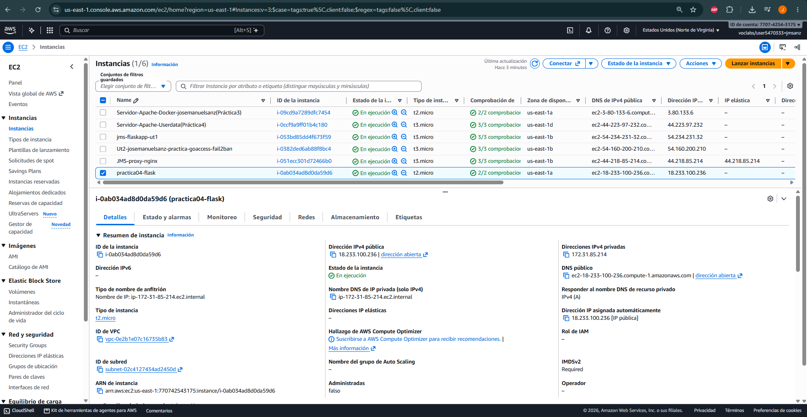

Conexión desde PowerShell (la clave se protegió con `icacls` para que OpenSSH la aceptara):

```powershell
ssh -i practica04.pem ubuntu@IP_PUBLICA
```

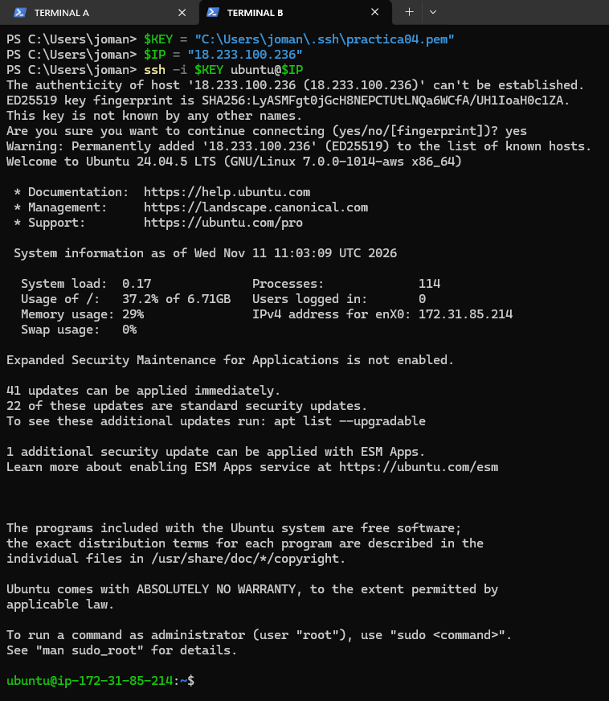

---

## 5. User Data

**User Data** es un script que AWS entrega a la instancia y que **cloud-init ejecuta como root en el primer arranque**. Permite dejar el servidor preparado sin intervención manual.

Fichero `configuracion/user-data.sh`:

```bash
#!/bin/bash
# user-data.sh - Practica 04 (Jose Manuel Sanz - JMS)
export DEBIAN_FRONTEND=noninteractive

apt update -y

apt install -y \
docker.io \
git \
curl

systemctl enable docker

systemctl start docker

mkdir -p /opt/practica04

# Anadido: permitir usar Docker sin sudo y subir ficheros por scp
usermod -aG docker ubuntu
chown ubuntu:ubuntu /opt/practica04
```

| Línea | Función |
|---|---|
| `apt update` | Actualiza el índice de paquetes. |
| `docker.io` | Motor de contenedores Docker. |
| `git` | Control de versiones. |
| `curl` | Cliente HTTP para pruebas. |
| `systemctl enable docker` | Docker arranca automáticamente en cada reinicio. |
| `systemctl start docker` | Arranca Docker ahora. |
| `mkdir -p /opt/practica04` | Crea el directorio de trabajo. |
| `usermod -aG docker ubuntu` *(añadido)* | Permite usar Docker sin `sudo`. |
| `chown ubuntu:ubuntu /opt/practica04` *(añadido)* | Permite subir ficheros por `scp` con el usuario `ubuntu`. |

El análisis completo está en `configuracion/instrucciones.txt`.

**Ventajas de la automatización con User Data:** servidores configurados sin pasos manuales, resultados reproducibles, menos errores humanos, ahorro de tiempo, facilidad para crear varias instancias idénticas (escalado) y "infraestructura como código" versionable en Git.

Script pegado en *Advanced details → User data*:

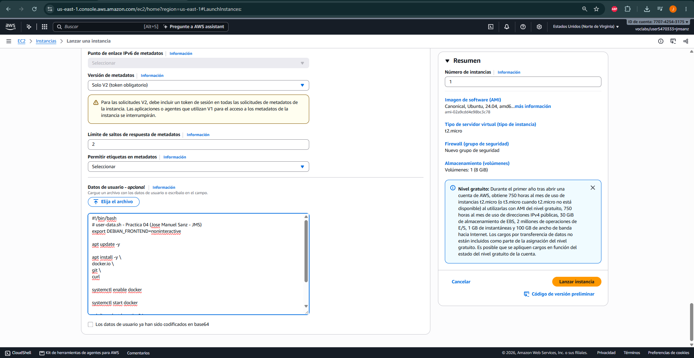

**Verificación de la automatización:** tras el arranque, Docker estaba instalado y activo, y existía `/opt/practica04`, sin haber instalado nada a mano:

```bash
cloud-init status --wait
docker --version
systemctl status docker --no-pager
ls /opt
```

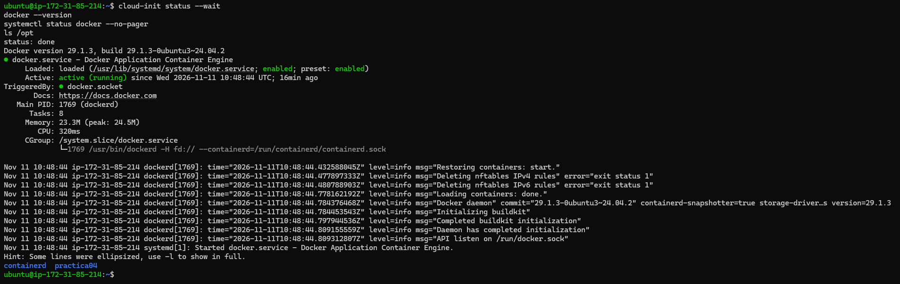
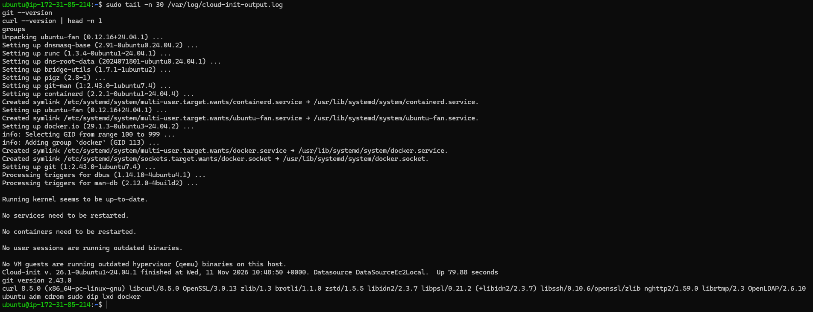

---

## 6. Flask

**Flask** es un microframework web de Python. Define las rutas de la aplicación y genera las respuestas. Es la **aplicación** (la lógica); no está pensado para atender tráfico de producción por sí solo.

La aplicación `aplicacion/app.py` es la de la práctica 3 adaptada. Identifica al alumno (José Manuel Sanz, JMS) y la práctica, y muestra los datos de la petición, entre ellos `X-Forwarded-For` y `X-Forwarded-Proto` (que permiten comprobar que hay un proxy y que se usa HTTPS).

| Ruta | Función |
|---|---|
| `/` | Página de bienvenida con datos del alumno, del servidor y de la petición. |
| `/info` | Los mismos datos en JSON. |
| `/salud` | Responde `OK`. |
| `/error` | Provoca un error 500 a propósito, para analizar logs. |

Subida de los ficheros a la instancia (`/opt/practica04`) mediante `scp`:

```powershell
scp -i $KEY .\aplicacion\app.py .\aplicacion\requirements.txt .\aplicacion\Dockerfile "ubuntu@${IP}:/opt/practica04/"
```

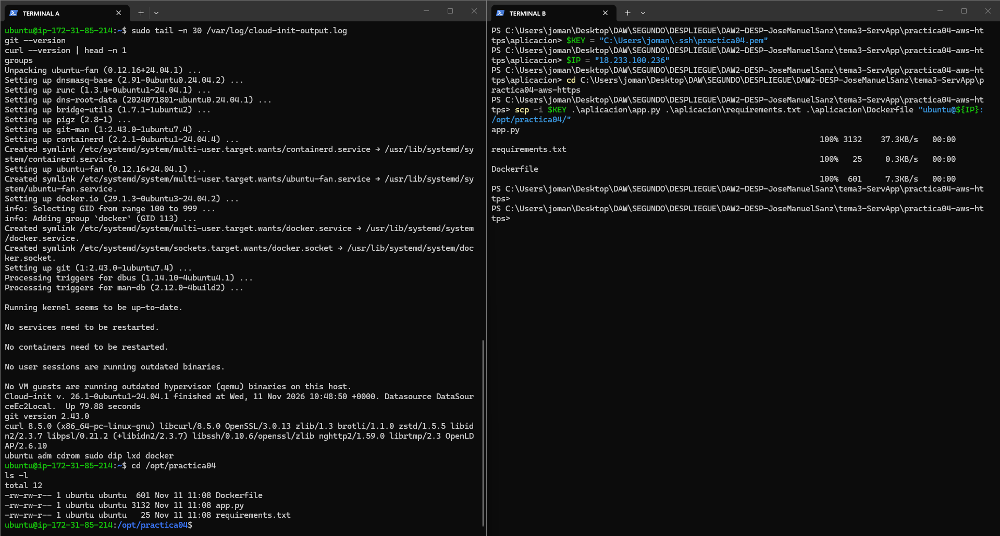

---

## 7. Gunicorn

**Gunicorn** es un servidor HTTP **WSGI** para Python. Ejecuta la aplicación Flask con un proceso maestro y varios *workers*, gestiona conexiones y concurrencia y ofrece logs configurables. Es el **servidor de aplicaciones**, el equivalente de Tomcat en el mundo Java. Flask define la aplicación y Gunicorn la sirve de forma robusta.

Gunicorn se ejecuta dentro de un contenedor Docker. Fichero `aplicacion/Dockerfile`:

```dockerfile
FROM python:3.12-slim

ENV PYTHONDONTWRITEBYTECODE=1 \
    PYTHONUNBUFFERED=1

WORKDIR /app

COPY requirements.txt .
RUN pip install --no-cache-dir -r requirements.txt

COPY app.py .

# Usuario sin privilegios
RUN useradd -m appuser
USER appuser

EXPOSE 5000

# Gunicorn escribe accesos y errores en la salida estandar (visibles con docker logs)
CMD ["gunicorn", "--bind", "0.0.0.0:5000", "--workers", "2", \
     "--access-logfile", "-", "--error-logfile", "-", \
     "--access-logformat", "%({x-forwarded-for}i)s %(h)s %(l)s %(u)s %(t)s \"%(r)s\" %(s)s %(b)s \"%(f)s\" \"%(a)s\"", \
     "app:app"]
```

Construcción de la imagen y ejecución del contenedor en la instancia:

```bash
cd /opt/practica04
docker build -t flask-app .
docker run -d -p 5000:5000 --name flask-app flask-app
docker ps
```

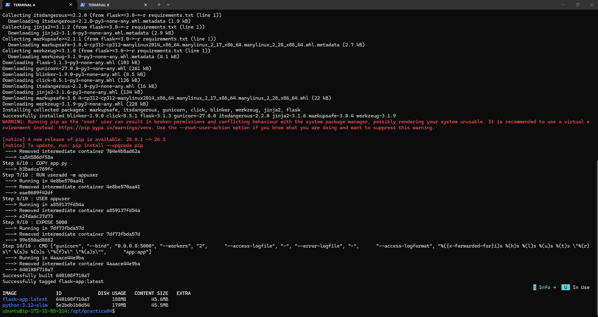
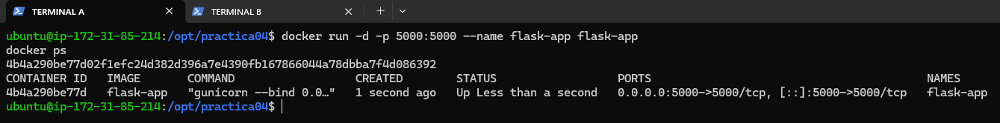

Los logs muestran el arranque de Gunicorn (`Starting gunicorn`, `Listening at`, `Using worker`, `Booting worker`):

```bash
docker logs flask-app
```

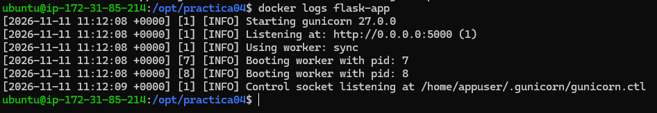

**Acceso directo a Flask** (puerto 5000, sin Nginx), posible temporalmente gracias a la regla del Security Group:

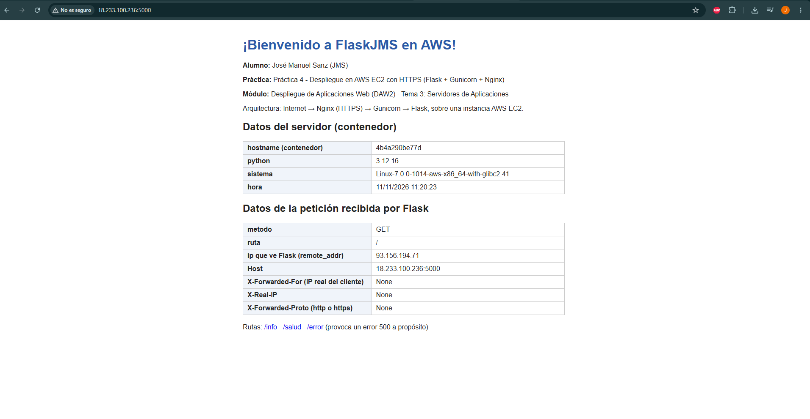

---

## 8. Nginx

**Nginx** es un servidor web de alto rendimiento. Aquí actúa como **servidor frontal y Reverse Proxy**: recibe las peticiones de Internet y las reenvía a Gunicorn, devolviendo la respuesta al cliente. El usuario solo conoce a Nginx. Aporta un punto único de entrada, oculta la infraestructura interna, gestiona SSL/TLS y puede servir estáticos, cachear y balancear carga.

Instalación y verificación:

```bash
sudo apt install nginx -y
systemctl status nginx --no-pager
```

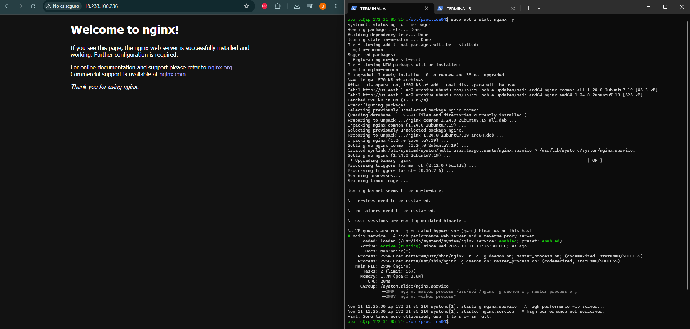

### 8.1 Reverse Proxy (fase HTTP)

Primera configuración (`/etc/nginx/sites-available/default`), solo HTTP:

```nginx
server {
    listen 80 default_server;
    listen [::]:80 default_server;
    server_name _;

    location / {
        proxy_pass http://127.0.0.1:5000;
        proxy_http_version 1.1;

        proxy_set_header Host              $http_host;
        proxy_set_header X-Real-IP         $remote_addr;
        proxy_set_header X-Forwarded-For   $proxy_add_x_forwarded_for;
        proxy_set_header X-Forwarded-Proto $scheme;
        proxy_set_header X-Forwarded-Host  $host;
    }
}
```

| Directiva | Función |
|---|---|
| `listen 80` | Recibe HTTP en el puerto 80. |
| **`proxy_pass http://127.0.0.1:5000`** | Reenvía las peticiones a Gunicorn (contenedor). Se usa `127.0.0.1` y no `localhost` para evitar que se intente conectar por IPv6. |
| `proxy_set_header ...` | Conserva la información de la petición original (host, IP del cliente, protocolo). |

La configuración se versionó en `configuracion/nginx.conf`, se subió con `scp`, se copió a `/etc/nginx/sites-available/default`, se validó con `nginx -t` y se reinició el servicio:

```bash
sudo cp /home/ubuntu/nginx.conf /etc/nginx/sites-available/default
sudo nginx -t
sudo systemctl restart nginx
```

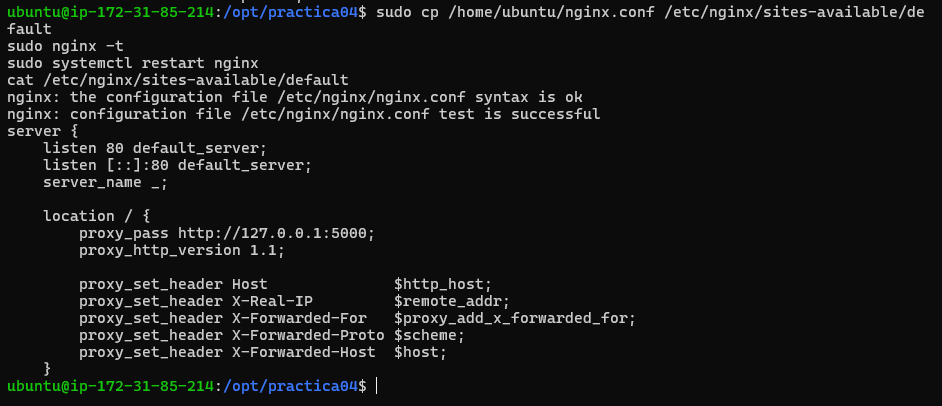

La aplicación pasó a ser accesible a través de Nginx, en `http://IP_PUBLICA` (puerto 80):

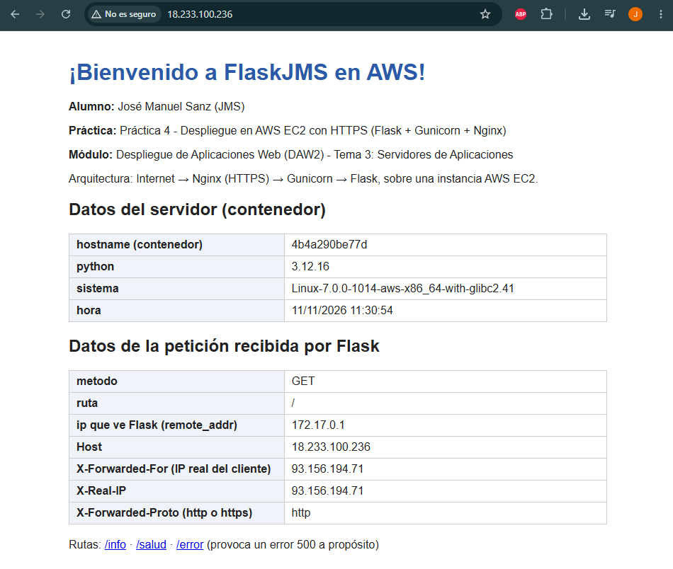

---

## 9. HTTPS

**HTTPS** es HTTP sobre **SSL/TLS**. Ventajas:

- **Confidencialidad:** el tráfico viaja cifrado; nadie en el camino puede leer contraseñas o datos.
- **Integridad:** se detecta si alguien modifica los datos en tránsito.
- **Autenticación:** el certificado permite comprobar que el servidor es quien dice ser (si lo firma una CA de confianza).
- Requisito de los navegadores modernos, de muchas APIs y positivo para el posicionamiento (SEO).

### 9.1 Generación del certificado

Se generó un certificado **autofirmado** (válido 365 días, RSA 2048) con OpenSSL:

```bash
mkdir ~/certificados
cd ~/certificados
openssl req -x509 -nodes -days 365 \
-newkey rsa:2048 \
-keyout clave.key \
-out certificado.crt \
-subj "/C=ES/ST=Madrid/L=Madrid/O=DAW2 JMS/CN=IP_PUBLICA" \
-addext "subjectAltName=IP:IP_PUBLICA"
```

| Opción | Función |
|---|---|
| `-x509` | Genera directamente un certificado autofirmado. |
| `-nodes` | La clave privada queda sin contraseña, para que Nginx pueda arrancar sin intervención. |
| `-days 365` | Validez de un año. |
| `-newkey rsa:2048` | Crea una clave RSA de 2048 bits. |
| `-keyout` / `-out` | Ficheros de la clave privada y del certificado. |
| `-subj`, `-addext` | Datos del sujeto y nombre alternativo (IP) sin preguntas interactivas. |

Se instalaron en `/etc/nginx/ssl/` (clave con permisos `600`) y se copiaron a `configuracion/` del repositorio:

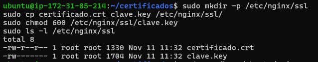

> **Nota de seguridad:** `clave.key` se incluye en el repositorio porque lo exige el enunciado. Es un certificado de práctica, autofirmado y vinculado a una instancia temporal. En un entorno real, una clave privada nunca debe subirse a un repositorio.

### 9.2 Configuración HTTPS en Nginx

Versión final de `configuracion/nginx.conf`:

```nginx
# Redireccion de HTTP a HTTPS
server {
    listen 80 default_server;
    listen [::]:80 default_server;
    server_name _;

    return 301 https://$host$request_uri;
}

# Servidor HTTPS + Reverse Proxy hacia Gunicorn
server {
    listen 443 ssl default_server;
    listen [::]:443 ssl default_server;
    server_name _;

    ssl_certificate     /etc/nginx/ssl/certificado.crt;
    ssl_certificate_key /etc/nginx/ssl/clave.key;
    ssl_protocols       TLSv1.2 TLSv1.3;
    ssl_ciphers         HIGH:!aNULL:!MD5;

    location / {
        proxy_pass http://127.0.0.1:5000;
        proxy_http_version 1.1;

        proxy_set_header Host              $http_host;
        proxy_set_header X-Real-IP         $remote_addr;
        proxy_set_header X-Forwarded-For   $proxy_add_x_forwarded_for;
        proxy_set_header X-Forwarded-Proto $scheme;
        proxy_set_header X-Forwarded-Host  $host;
    }
}
```

| Directiva | Función |
|---|---|
| `listen 443 ssl` | Nginx acepta conexiones cifradas en el puerto 443. |
| `ssl_certificate` | Certificado que se presenta al cliente. |
| `ssl_certificate_key` | Clave privada asociada. |
| `ssl_protocols` | Solo TLS 1.2 y 1.3 (versiones seguras). |
| `return 301 https://...` | Redirige todo el tráfico HTTP a HTTPS. |
| `X-Forwarded-Proto $scheme` | Informa a Flask de que la petición original era `https`. |

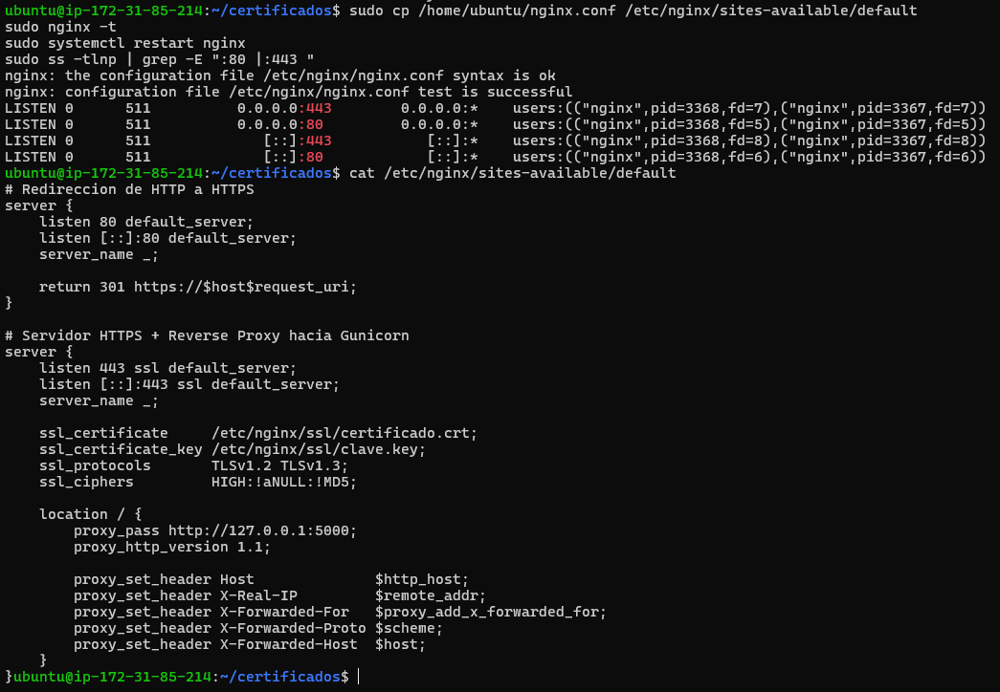

### 9.3 Verificación de HTTPS

La aplicación es accesible en `https://IP_PUBLICA`. El navegador muestra un aviso porque el certificado está **autofirmado** y no lo ha emitido una CA de confianza (`NET::ERR_CERT_AUTHORITY_INVALID`); el cifrado funciona igualmente. Tras aceptar el aviso, la app carga y `X-Forwarded-Proto` vale `https`:

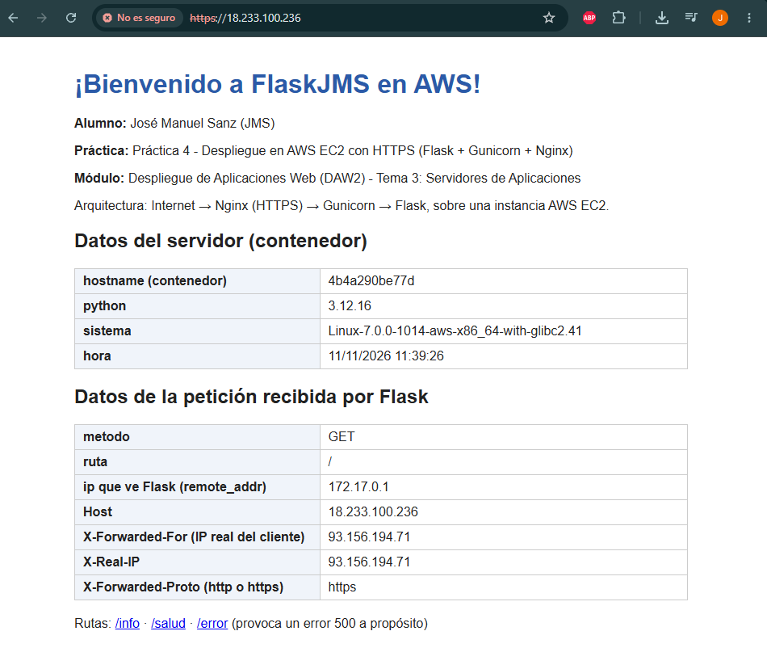
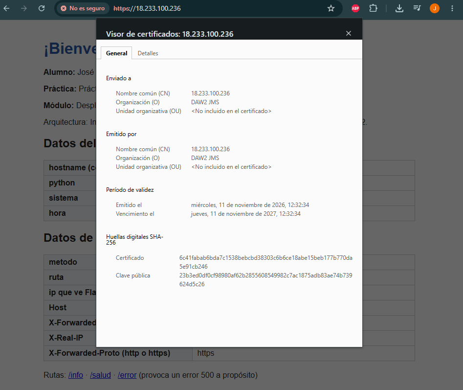

Comprobaciones por línea de comandos: HTTP redirige con `301` a HTTPS, el puerto 443 responde `200` y se negocia TLS (TLSv1.3):

```powershell
curl.exe -I http://IP_PUBLICA/
curl.exe -k -I https://IP_PUBLICA/
curl.exe -vk https://IP_PUBLICA/ 2>&1 | Select-String "TLS|subject:|issuer:|HTTP/"
```

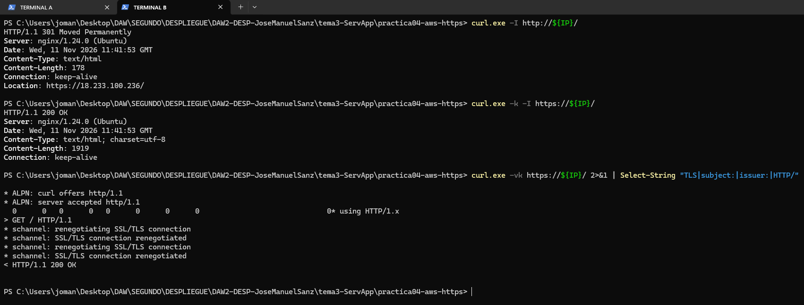

### 9.4 Análisis de logs (Tarea 18)

**Logs de Nginx** (`/var/log/nginx/access.log`): muestran las IP de los clientes, la fecha, el método, la ruta y el código de respuesta (200, 301, 404, 500).

```bash
sudo tail -n 25 /var/log/nginx/access.log
```

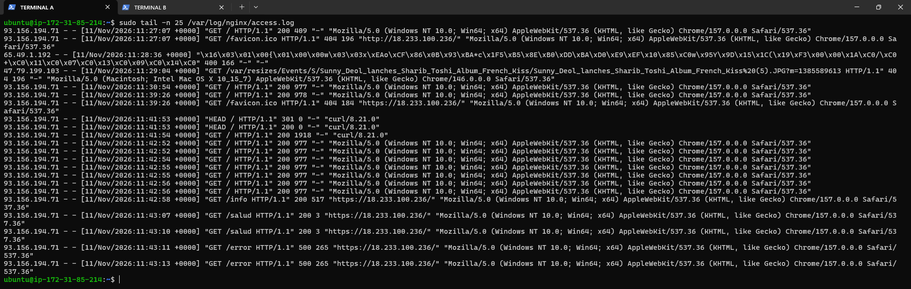

**Logs de Gunicorn** (`docker logs flask-app`): arranque de la aplicación, peticiones procesadas (con la IP real del cliente en el primer campo, gracias a `X-Forwarded-For`) y la traza del error intencionado de `/error`.

```bash
docker logs flask-app --tail 30
```

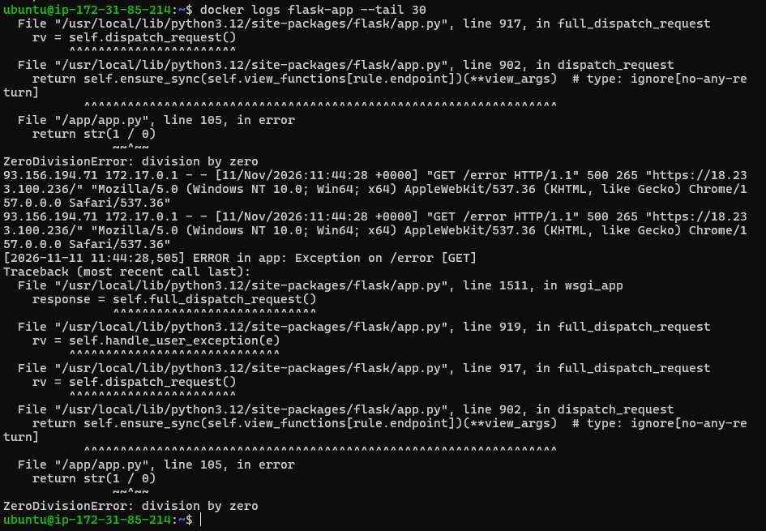

### 9.5 Cierre de seguridad

Una vez todo funcionaba, se eliminó el acceso directo a Flask:

1. El contenedor se recreó publicando el puerto solo en localhost y con reinicio automático:

```bash
docker stop flask-app
docker rm flask-app
docker run -d --name flask-app --restart unless-stopped -p 127.0.0.1:5000:5000 flask-app
```

2. Se eliminó la regla del puerto 5000 del Security Group.
3. Se comprobó que `http://IP_PUBLICA:5000` ya no responde, mientras que `https://IP_PUBLICA` sigue funcionando.

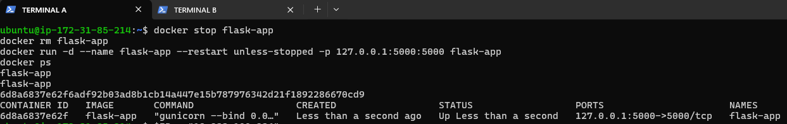
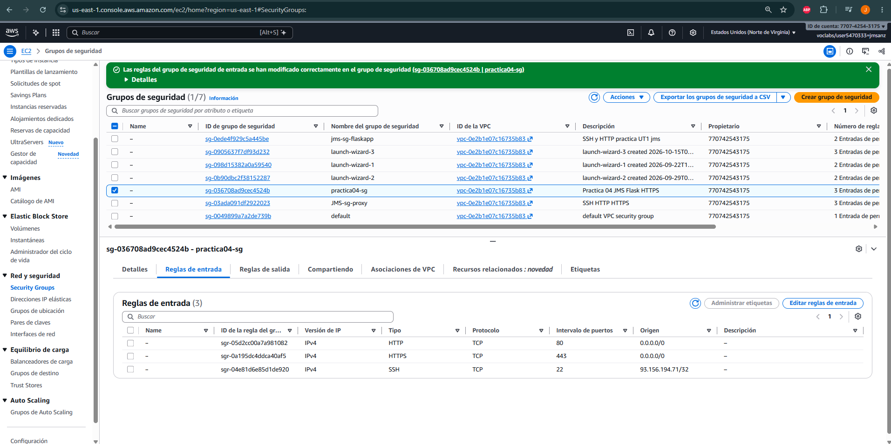

Arquitectura final: único punto de entrada por **80/443 (Nginx)**; Gunicorn y Flask son inaccesibles desde Internet.

---

## 10. Evidencias obtenidas

| Tarea | Evidencia | Captura |
|---|---|---|
| 1 | Laboratorio iniciado | `01-lab-iniciado.png` |
| 2 | Panel EC2 y key pair | `02-panel-ec2.png`, `03-keypair.png` |
| 3 | User Data configurado e instancia en ejecución | `04-user-data-configurado.png`, `05-instancia-running.png` |
| 4 | Security Group | `06-security-group.png` |
| 5 | IP pública y conexión SSH | `07-ip-publica.png`, `08-ssh-conectado.png` |
| 6 | Docker instalado automáticamente | `09-docker-instalado-automaticamente.png`, `23-cloud-init-log.png` |
| 7 | Aplicación subida | `10-aplicacion-subida.png` |
| 8 | Imagen Docker | `11-build-docker.png` |
| 9 | Contenedor Flask | `12-contenedor-flask.png` |
| 10 | Gunicorn operativo | `13-gunicorn-operativo.png` |
| 11 | Acceso directo a Flask | `14-flask-directo.png` |
| 12 | Nginx instalado | `15-nginx-instalado.png` |
| 13 | Reverse Proxy | `16-reverse-proxy.png` |
| 14 | Acceso vía Nginx | `17-nginx-flask.png` |
| 15 | Certificados generados | `18-certificados-generados.png` |
| 16 | Configuración HTTPS | `19-configuracion-https.png` |
| 17 | HTTPS funcionando | `20-https-funcionando.png`, `24-certificado-navegador.png`, `25-redireccion-http-https.png` |
| 18 | Logs de Nginx y Gunicorn | `21-logs-nginx.png`, `22-logs-gunicorn.png` |
| Extra | Cierre de seguridad | `26-cierre-puerto-5000.png`, `27-security-group-final.png` |
| Extra | Repositorio | `28-github-repo.png` |


## Repositorio en GitHub después de terminar la práctica 4
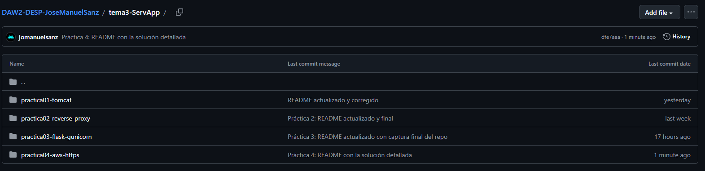

---

## 11. Problemas encontrados

1. **`UNPROTECTED PRIVATE KEY FILE`** al conectar por SSH desde Windows con la clave `.pem`.
2. **`Connection timed out`** en SSH, por cambio de la IP pública o por restringir el puerto 22 a una IP distinta.
3. **Docker no estaba instalado** o daba `permission denied` al conectar justo tras el arranque (el User Data todavía no había terminado).
4. **`IP_PUBLICA:5000` no cargaba en el navegador** al escribir la dirección sin el protocolo: el navegador intentaba abrirla por HTTPS, pero Flask/Gunicorn solo habla HTTP.
5. **El navegador mostraba un aviso de seguridad** al abrir `https://IP_PUBLICA`.
6. **Nginx devolvía `502 Bad Gateway`**.
7. **`scp` fallaba con `Permission denied`** al subir a `/opt/practica04`.
8. **La IP pública cambió** al reanudar el laboratorio.

---

## 12. Soluciones aplicadas

1. Quitar los permisos heredados del `.pem` con `icacls $KEY /inheritance:r` y concederse solo lectura a uno mismo.
2. Comprobar la IP actual en la consola de AWS y, si la IP de origen había cambiado, editar la regla del puerto 22.
3. Esperar a `cloud-init status --wait` y, si no aparecía el grupo `docker`, cerrar y volver a abrir la sesión SSH.
4. Escribir la URL completa con el protocolo, `http://IP_PUBLICA:5000`. Antes se comprobó que el contenedor estaba en marcha, que el puerto 5000 estaba publicado (`docker ps`) y que el Security Group permitía el tráfico TCP 5000.
5. Es el comportamiento esperado de un certificado **autofirmado**, que no está firmado por una CA de confianza. Se acepta el riesgo en el navegador (*Avanzado → Continuar*). En producción se usaría un certificado de una CA (por ejemplo, Let's Encrypt).
6. Comprobar que el contenedor estaba en marcha (`docker ps`) y usar `127.0.0.1:5000` en `proxy_pass`.
7. El `chown ubuntu:ubuntu /opt/practica04` añadido al `user-data.sh` da permisos al usuario `ubuntu`.
8. Consultar de nuevo la IP en la consola AWS y redefinir `$IP` en PowerShell.

---

## 13. Conclusiones

- **User Data** convierte la creación del servidor en un proceso automático y reproducible: la instancia arranca con Docker, Git y curl instalados sin intervenir.
- La arquitectura **Internet → Nginx → Gunicorn → Flask** es la misma de la práctica 3, pero desplegada en la nube y con Gunicorn en un contenedor Docker, lo que simplifica el despliegue y aísla la aplicación.
- **HTTPS** con SSL/TLS protege la confidencialidad e integridad del tráfico. Un certificado autofirmado cifra igual que uno de una CA, pero los navegadores no lo consideran de confianza.
- La seguridad se aplica por capas: Security Group con solo los puertos necesarios, acceso SSH con clave (no contraseña), Gunicorn publicado solo en `127.0.0.1` y Nginx como único punto de entrada.
- Los logs de Nginx y de Gunicorn permiten trazar una petición de extremo a extremo e identificar el origen de los errores.
- Mejoras posibles: dominio propio con certificado de Let's Encrypt, Elastic IP, HSTS y cabeceras de seguridad, Docker Compose, balanceador (ALB) con varias instancias, CI/CD y monitorización.
- Se han cubierto los criterios de evaluación d, f e i.