# Práctica 05. Docker Compose, MariaDB, persistencia y copias de seguridad

**Alumno:** José Manuel Sanz (JMS)
**Módulo:** Despliegue de Aplicaciones Web (DAW2) · **Tema 3:** Servidores de Aplicaciones
**Base de datos:** `practica05JMS` · **Aplicación:** lista de tareas (Flask + MariaDB)

---

## Índice

1. [Introducción](#1-introducción)
2. [Arquitectura](#2-arquitectura)
3. [Docker Compose](#3-docker-compose)
4. [Flask](#4-flask)
5. [MariaDB](#5-mariadb)
6. [Docker Volume](#6-docker-volume)
7. [Persistencia](#7-persistencia)
8. [Backup](#8-backup)
9. [Restore](#9-restore)
10. [Análisis de la arquitectura (Tarea 14)](#10-análisis-de-la-arquitectura-tarea-14)
11. [Evidencias obtenidas](#11-evidencias-obtenidas)
12. [Problemas encontrados](#12-problemas-encontrados)
13. [Soluciones aplicadas](#13-soluciones-aplicadas)
14. [Conclusiones](#14-conclusiones)

---

## 1. Introducción

En la práctica 4 se desplegó una aplicación Flask en una instancia AWS EC2 con Gunicorn y un Nginx instalado en el sistema. En esta práctica se **reutiliza la misma instancia** (`practica04-flask`) para evolucionar el despliegue a una arquitectura multi-contenedor con **Docker Compose**, que incluye:

- **Nginx** como Reverse Proxy con HTTPS.
- **Flask** (con Gunicorn) como aplicación.
- **MariaDB** como base de datos, con **volumen persistente**.

Además se realiza una **copia de seguridad**, se simula una **pérdida de datos** y se **restaura** la información.

**Criterios de evaluación trabajados:**

| Criterio | Descripción | Dónde se trata |
|---|---|---|
| e | Configurar y utilizar los componentes web del servidor de aplicaciones | Apartados 3 y 4 |
| f | Realizar los ajustes necesarios para el despliegue de aplicaciones | Apartados 3, 5, 7, 8 y 9 |
| i | Aplicar procedimientos de despliegue utilizando tecnologías de virtualización y contenedores | Apartados 2, 3 y 6 |

---

## 2. Arquitectura

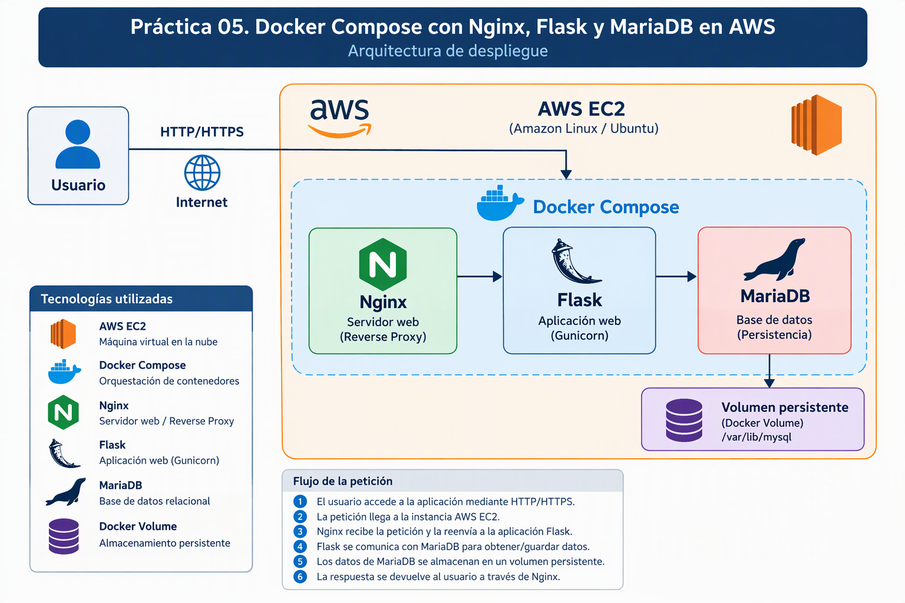

```text
Usuario → HTTPS → AWS EC2 → Docker Compose → Nginx → Flask → MariaDB → Volumen persistente
```

| Componente | Descripción |
|---|---|
| **Instancia EC2** | `practica04-flask` (Ubuntu Server 24.04 LTS). Security Group con 22, 80 y 443. **El puerto 3306 no está abierto.** |
| **Contenedor `nginx`** | Imagen `nginx:stable`. Único servicio publicado (80 → redirige a 443, 443 con TLS). |
| **Contenedor `flask`** | Imagen construida desde `app/Dockerfile`: Flask + Gunicorn (puerto 5000, solo interno). |
| **Contenedor `mariadb`** | Imagen `mariadb:11.4`, puerto 3306 solo interno, datos en el volumen `mariadb_data`. |
| **Red `red-practica05`** | Red bridge interna que conecta los tres contenedores; se resuelven por nombre de servicio. |
| **Volumen `mariadb_data`** | Almacenamiento persistente de `/var/lib/mysql`. |

Estructura del repositorio:

```text
practica05-compose-mariadb/
├── requisitos.md
├── README.md
├── docker-compose.yml
├── app/
│   ├── app.py
│   ├── requirements.txt
│   └── Dockerfile
├── nginx/
│   └── nginx.conf
├── database/
│   ├── schema.sql
│   └── datos.sql
├── backups/
│   └── backup.sql
├── capturas/
└── docs/
    └── arquitectura-practica05.png
```

La carpeta `certs/` (certificado autofirmado de esta práctica) existe solo en el servidor y no se versiona.

---

## 3. Docker Compose

**Docker Compose** permite definir en un solo fichero (`docker-compose.yml`) una aplicación formada por varios contenedores, con sus redes, volúmenes y dependencias, y gestionarla con un único comando. En Ubuntu 24.04 se instala el paquete `docker-compose-v2`, cuyo comando es `docker compose` (sucesor de `docker-compose`, con los mismos subcomandos).

### 3.1 Estructura del proyecto (Tarea 1)

Se creó la estructura exigida por el enunciado:

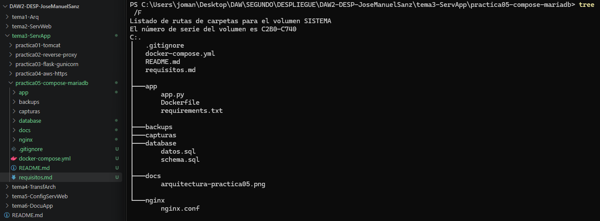

### 3.2 Nginx (Tarea 4)

Fichero `nginx/nginx.conf`:

```nginx
# Redireccion de HTTP a HTTPS
server {
    listen 80;
    server_name _;

    return 301 https://$host$request_uri;
}

# HTTPS + Reverse Proxy hacia el servicio flask de Docker Compose
server {
    listen 443 ssl;
    server_name _;

    ssl_certificate     /etc/nginx/certs/certificado.crt;
    ssl_certificate_key /etc/nginx/certs/clave.key;
    ssl_protocols       TLSv1.2 TLSv1.3;
    ssl_ciphers         HIGH:!aNULL:!MD5;

    # DNS interno de Docker: se resuelve el nombre "flask" en cada peticion
    resolver 127.0.0.11 valid=10s;

    location / {
        set $flask_upstream http://flask:5000;
        proxy_pass $flask_upstream;
        proxy_http_version 1.1;

        proxy_set_header Host              $http_host;
        proxy_set_header X-Real-IP         $remote_addr;
        proxy_set_header X-Forwarded-For   $proxy_add_x_forwarded_for;
        proxy_set_header X-Forwarded-Proto $scheme;
        proxy_set_header X-Forwarded-Host  $host;
    }
}
```

| Directiva | Función |
|---|---|
| `return 301 https://...` | Redirige HTTP a HTTPS. |
| `listen 443 ssl` + `ssl_certificate(_key)` | HTTPS con el certificado autofirmado. |
| `resolver 127.0.0.11` | DNS interno de Docker, para resolver el nombre del servicio. |
| **`proxy_pass http://flask:5000`** | Reenvía al servicio `flask` por su **nombre**, no por IP. |
| `proxy_set_header ...` | Conserva la información de la petición original. |

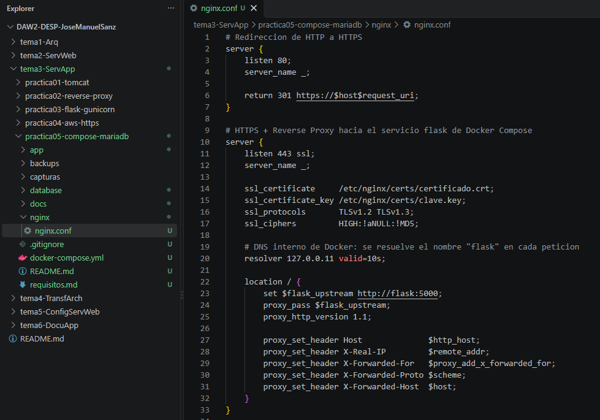

### 3.3 `docker-compose.yml` (Tarea 5)

```yaml
name: practica05

services:
  mariadb:
    image: mariadb:11.4
    container_name: mariadb
    restart: unless-stopped
    command: --character-set-server=utf8mb4 --collation-server=utf8mb4_unicode_ci
    environment:
      MARIADB_ROOT_PASSWORD: RootJMS05
      MARIADB_DATABASE: practica05JMS
      MARIADB_USER: jms_user
      MARIADB_PASSWORD: JmsPass05
      TZ: Europe/Madrid
    volumes:
      - mariadb_data:/var/lib/mysql
      - ./database/schema.sql:/docker-entrypoint-initdb.d/01-schema.sql:ro
      - ./database/datos.sql:/docker-entrypoint-initdb.d/02-datos.sql:ro
    networks:
      - red-practica05
    healthcheck:
      test: ["CMD-SHELL", "mariadb-admin ping -h 127.0.0.1 -u root -p$$MARIADB_ROOT_PASSWORD --silent"]
      interval: 10s
      timeout: 5s
      retries: 10
      start_period: 20s

  flask:
    build: ./app
    image: flask-practica05-jms
    container_name: flask
    restart: unless-stopped
    environment:
      DB_HOST: mariadb
      DB_PORT: "3306"
      DB_NAME: practica05JMS
      DB_USER: jms_user
      DB_PASSWORD: JmsPass05
      TZ: Europe/Madrid
    depends_on:
      mariadb:
        condition: service_healthy
    networks:
      - red-practica05

  nginx:
    image: nginx:stable
    container_name: nginx
    restart: unless-stopped
    ports:
      - "80:80"
      - "443:443"
    volumes:
      - ./nginx/nginx.conf:/etc/nginx/conf.d/default.conf:ro
      - ./certs:/etc/nginx/certs:ro
    depends_on:
      - flask
    networks:
      - red-practica05

networks:
  red-practica05:
    driver: bridge

volumes:
  mariadb_data:
```

| Elemento | Función |
|---|---|
| `services` (`nginx`, `flask`, `mariadb`) | Los tres servicios de la solución. |
| `networks: red-practica05` | **Red interna**: todos los contenedores se comunican por nombre de servicio. |
| `volumes: mariadb_data` | **Volumen persistente** de MariaDB. |
| `ports` (solo en `nginx`) | Único punto de entrada desde Internet; MariaDB y Flask no se publican. |
| `healthcheck` + `depends_on: service_healthy` | Flask no arranca hasta que MariaDB está lista para aceptar conexiones. |
| `docker-entrypoint-initdb.d` | MariaDB ejecuta `schema.sql` y `datos.sql` al inicializar un volumen vacío. |
| `restart: unless-stopped` | Los contenedores se levantan solos tras un reinicio de la instancia. |

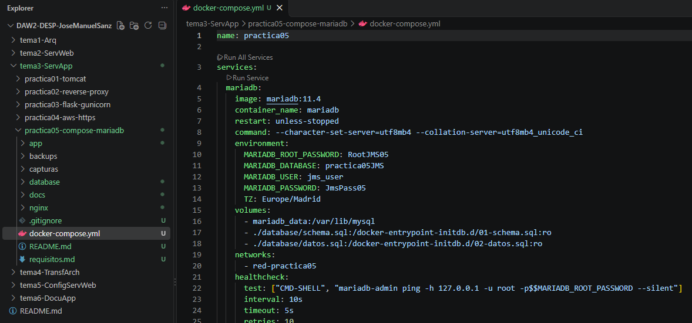

### 3.4 Preparación de la instancia y transferencia (Tarea 6)

Se arrancó la instancia `practica04-flask` de la práctica anterior:

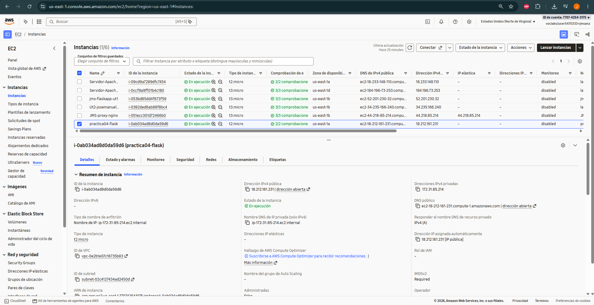

Se preparó el servidor: se instaló Docker Compose, se liberaron los puertos 80 y 443 (parando el Nginx del sistema y el contenedor `flask-app` de la práctica 4) y se creó la carpeta de trabajo con un certificado autofirmado para HTTPS:

```bash
sudo apt install -y docker-compose-v2 unzip
sudo systemctl stop nginx && sudo systemctl disable nginx
docker stop flask-app
sudo mkdir -p /opt/practica05 && sudo chown ubuntu:ubuntu /opt/practica05
mkdir -p /opt/practica05/certs /opt/practica05/backups
openssl req -x509 -nodes -days 365 -newkey rsa:2048 \
-keyout /opt/practica05/certs/clave.key -out /opt/practica05/certs/certificado.crt \
-subj "/C=ES/ST=Madrid/L=Madrid/O=DAW2 JMS/CN=IP_PUBLICA" -addext "subjectAltName=IP:IP_PUBLICA"
```

El proyecto se comprimió con `tar` (formato zip) y se transfirió con `scp`:

```powershell
tar -a -c -f practica05-compose-mariadb.zip docker-compose.yml app database nginx
scp -i practica04.pem .\practica05-compose-mariadb.zip ubuntu@IP_PUBLICA:/opt/practica05/
```

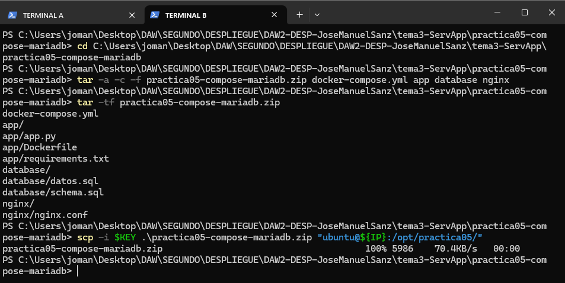
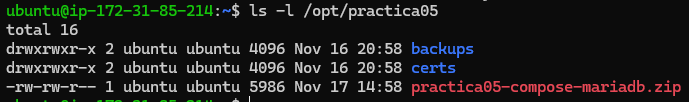

Descompresión en el servidor:

```bash
cd /opt/practica05
unzip practica05-compose-mariadb.zip
```

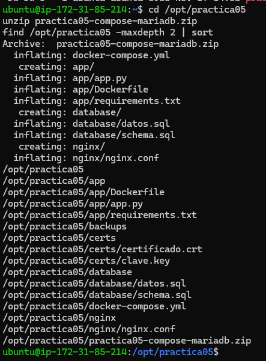

### 3.5 Construcción y despliegue (Tarea 7)

```bash
docker compose build
docker compose up -d
docker compose ps
```

`up -d` crea la red y el volumen y arranca los servicios en orden: MariaDB (hasta estar *healthy*), Flask y Nginx.

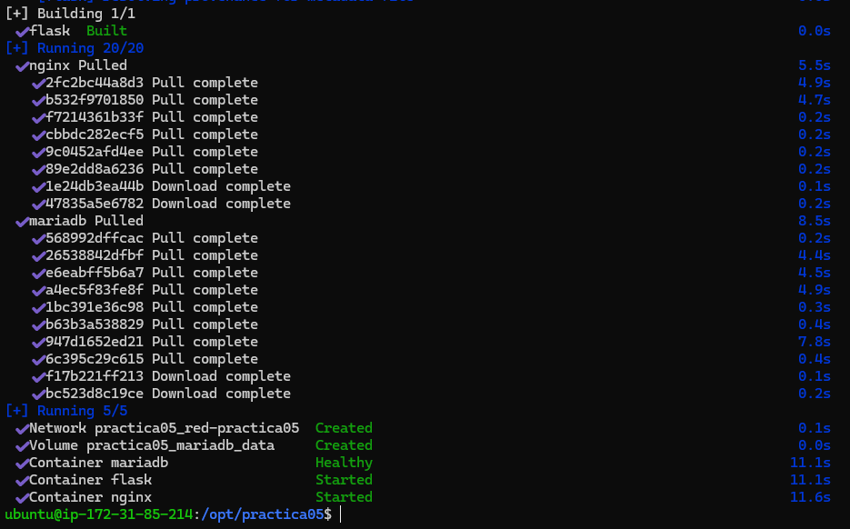
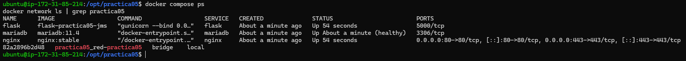

### 3.6 Comprobación del funcionamiento (Tarea 8)

Se accedió a `https://IP_PUBLICA`. El navegador avisa porque el certificado es autofirmado (comportamiento esperado). La aplicación muestra las tareas leídas de MariaDB y `Protocolo visto por Flask` vale `https`.

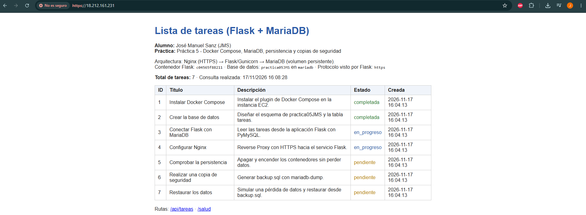

---

## 4. Flask

**Flask** es el microframework web de Python que contiene la lógica de la aplicación: recibe las peticiones (que le llegan de Nginx a través de Gunicorn), consulta la base de datos y genera la respuesta. Se ejecuta con **Gunicorn** (servidor WSGI) dentro de su contenedor.

Dependencias (`app/requirements.txt`):

```text
flask>=3.0
gunicorn>=22.0
PyMySQL>=1.1
```

**PyMySQL** es un conector de MariaDB/MySQL escrito en Python puro: no necesita compilar librerías de C, lo que simplifica la imagen Docker.

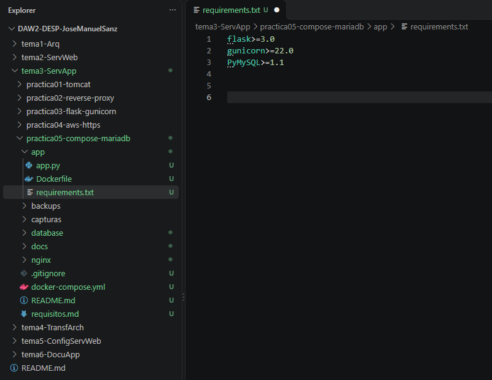

La aplicación (`app/app.py`) toma la configuración de **variables de entorno** definidas en el `docker-compose.yml`, con el host `mariadb` (nombre del servicio). Fragmento principal:

```python
DB_CONFIG = {
    "host": os.environ.get("DB_HOST", "mariadb"),
    "port": int(os.environ.get("DB_PORT", "3306")),
    "user": os.environ.get("DB_USER", "jms_user"),
    "password": os.environ.get("DB_PASSWORD", ""),
    "database": os.environ.get("DB_NAME", "practica05JMS"),
    "charset": "utf8mb4",
    "cursorclass": pymysql.cursors.DictCursor,
}

def obtener_tareas():
    conexion = conectar()          # pymysql.connect(**DB_CONFIG), con reintentos
    try:
        with conexion.cursor() as cursor:
            cursor.execute(
                "SELECT id, titulo, descripcion, estado, fecha_creacion FROM tareas ORDER BY id"
            )
            return cursor.fetchall()
    finally:
        conexion.close()
```

| Ruta | Función |
|---|---|
| `/` | Página HTML con la tabla de tareas y datos del alumno (José Manuel Sanz, JMS). |
| `/api/tareas` | Las tareas en formato JSON. |
| `/salud` | Comprueba la conexión con MariaDB (`OK` o error 503). |

Si la base de datos no está disponible, la aplicación no se rompe: devuelve una página de error con código **503**. Esto se usó en la prueba de pérdida de datos.

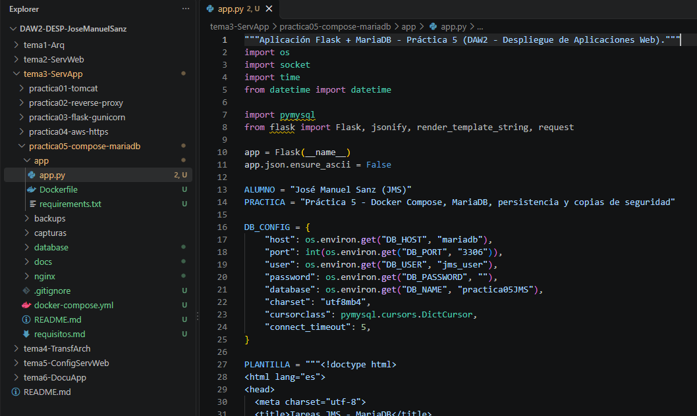

Fichero `app/Dockerfile`:

```dockerfile
FROM python:3.12-slim

ENV PYTHONDONTWRITEBYTECODE=1 \
    PYTHONUNBUFFERED=1

WORKDIR /app

COPY requirements.txt .
RUN pip install --no-cache-dir -r requirements.txt

COPY app.py .

# Usuario sin privilegios
RUN useradd -m appuser
USER appuser

EXPOSE 5000

# Gunicorn escribe accesos y errores en la salida estandar (visibles con docker compose logs)
CMD ["gunicorn", "--bind", "0.0.0.0:5000", "--workers", "2", \
     "--access-logfile", "-", "--error-logfile", "-", \
     "--access-logformat", "%({x-forwarded-for}i)s %(h)s %(l)s %(u)s %(t)s \"%(r)s\" %(s)s %(b)s \"%(f)s\" \"%(a)s\"", \
     "app:app"]
```

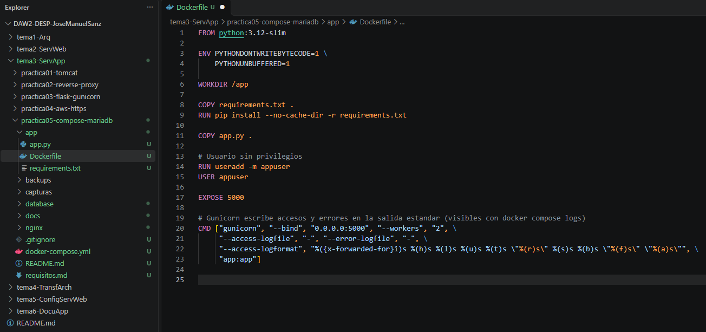

---

## 5. MariaDB

**MariaDB** es el sistema gestor de bases de datos relacional donde se almacenan las tareas. Se ejecuta en su propio contenedor (`mariadb:11.4`) y solo es accesible desde la red interna de Docker.

Las variables `MARIADB_*` del `docker-compose.yml` crean la base de datos `practica05JMS`, el usuario de la aplicación (`jms_user`, con permisos solo sobre esa base de datos) y la contraseña de `root`.

> **Nota:** las contraseñas están en el `docker-compose.yml` porque es una práctica. En un entorno real se usarían ficheros `.env` o *secrets* de Docker.

### 5.1 Esquema (Tarea 2)

Fichero `database/schema.sql`:

```sql
SET NAMES utf8mb4;

CREATE DATABASE IF NOT EXISTS practica05JMS
  CHARACTER SET utf8mb4
  COLLATE utf8mb4_unicode_ci;

USE practica05JMS;

CREATE TABLE IF NOT EXISTS tareas (
    id             INT UNSIGNED NOT NULL AUTO_INCREMENT,
    titulo         VARCHAR(100) NOT NULL,
    descripcion    TEXT NULL,
    estado         ENUM('pendiente','en_progreso','completada') NOT NULL DEFAULT 'pendiente',
    fecha_creacion TIMESTAMP NOT NULL DEFAULT CURRENT_TIMESTAMP,
    PRIMARY KEY (id)
) ENGINE=InnoDB DEFAULT CHARSET=utf8mb4 COLLATE=utf8mb4_unicode_ci;
```

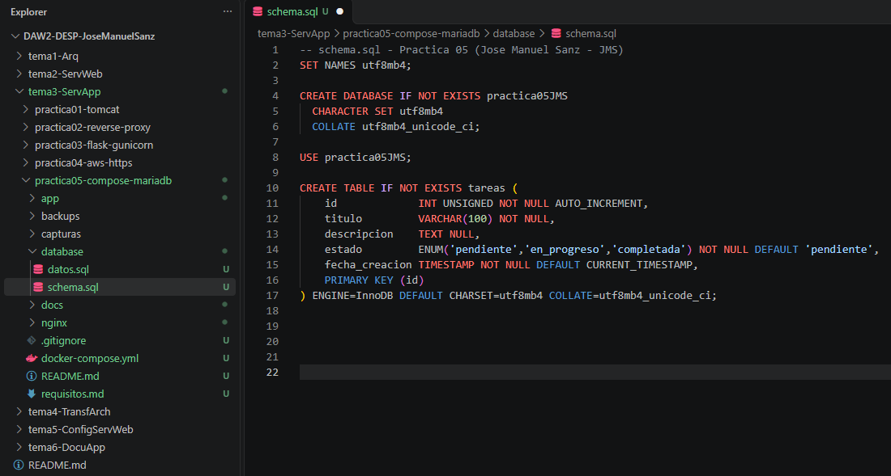

### 5.2 Datos de prueba

El fichero `database/datos.sql` inserta 7 tareas de prueba (con estados `completada`, `en_progreso` y `pendiente`):

```sql
SET NAMES utf8mb4;
USE practica05JMS;

INSERT INTO tareas (titulo, descripcion, estado) VALUES
('Instalar Docker Compose', 'Instalar el plugin de Docker Compose en la instancia EC2.', 'completada'),
('Crear la base de datos', 'Diseñar el esquema de practica05JMS y la tabla tareas.', 'completada'),
-- ... (resto de las 7 tareas, ver el fichero database/datos.sql)
```

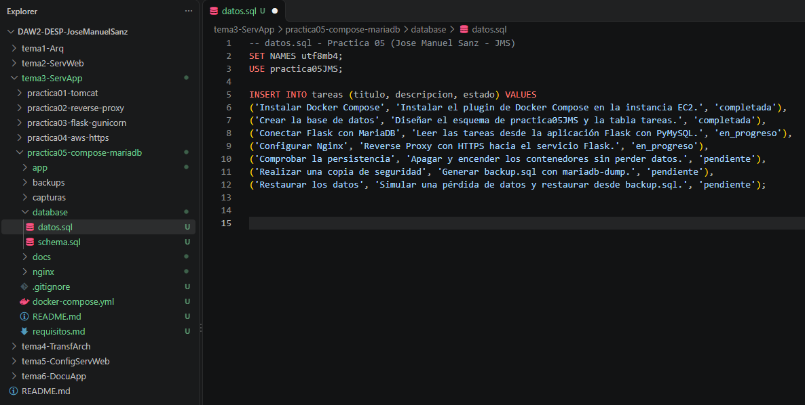

Ambos ficheros se montan en `/docker-entrypoint-initdb.d/` y se ejecutan automáticamente **solo la primera vez**, cuando el volumen está vacío.

### 5.3 Acceso a MariaDB (Tarea 9)

```bash
docker exec -it mariadb bash
mariadb -u root -p
```

```sql
USE practica05JMS;
SHOW TABLES;
SELECT * FROM tareas;
```

En la imagen `mariadb:11.4` el cliente se llama `mariadb` (y el volcado, `mariadb-dump`).

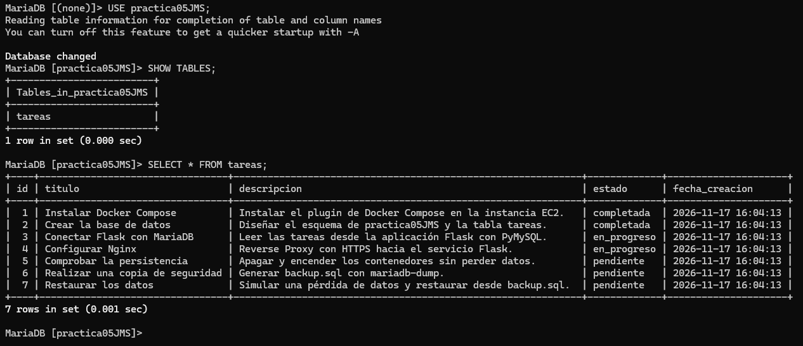

---

## 6. Docker Volume

Los contenedores son **efímeros**: lo que escriben en su sistema de ficheros se pierde al eliminarlos. Un **volumen** de Docker es un almacenamiento gestionado por Docker, independiente del ciclo de vida del contenedor.

En este proyecto, `mariadb_data` se monta en `/var/lib/mysql`, que es donde MariaDB guarda sus datos:

```yaml
volumes:
  - mariadb_data:/var/lib/mysql
...
volumes:
  mariadb_data:
```

Docker lo crea con el prefijo del proyecto: `practica05_mariadb_data`.

```bash
docker volume ls
docker volume inspect practica05_mariadb_data
```

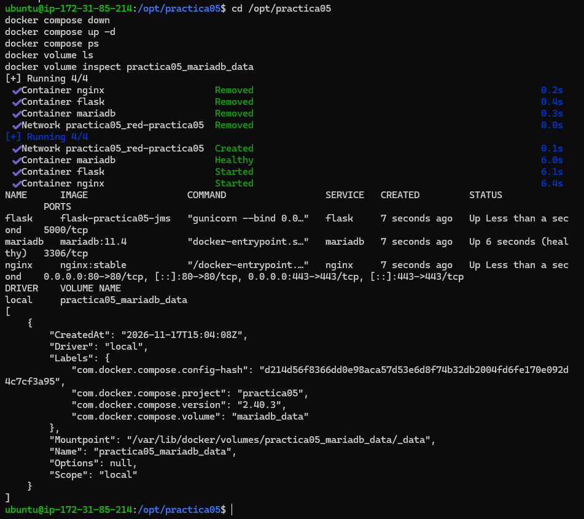

---

## 7. Persistencia

Se comprobó que los datos sobreviven a la eliminación de los contenedores (Tarea 10).

1. Se insertaron 3 tareas nuevas desde MariaDB (de 7 a **10** registros):

```sql
INSERT INTO tareas (titulo, descripcion, estado) VALUES
('Tarea nueva 1 - JMS', 'Insertada a mano para probar la persistencia', 'pendiente'),
('Tarea nueva 2 - JMS', 'Segunda tarea insertada desde MariaDB', 'en_progreso'),
('Tarea nueva 3 - JMS', 'Tercera tarea para la prueba de persistencia', 'pendiente');
```

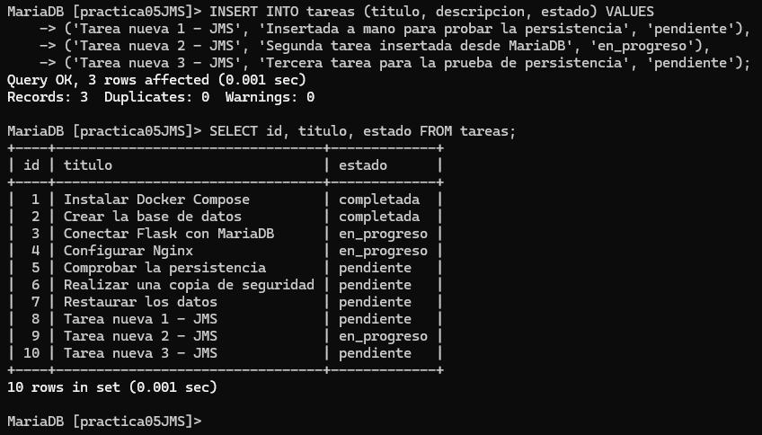

2. Se apagaron y se volvieron a encender los contenedores:

```bash
docker compose down
docker compose up -d
```

`docker compose down` elimina los contenedores y la red, pero **no el volumen** (`-v` sí lo borraría, por lo que no se usó).

3. Tras el arranque se comprobó que los 10 registros seguían ahí, tanto en MariaDB como en la aplicación:

```bash
docker exec mariadb sh -c 'mariadb -u root -p"$MARIADB_ROOT_PASSWORD" -e "SELECT COUNT(*) AS total_tareas FROM practica05JMS.tareas;"'
```

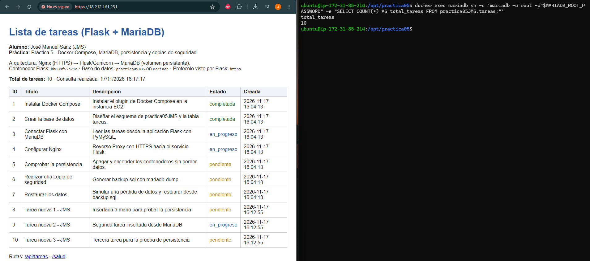

Los scripts `schema.sql` y `datos.sql` **no se volvieron a ejecutar** (el volumen ya tenía datos), por lo que no se duplicaron registros.

---

## 8. Backup

Una copia de seguridad permite recuperar los datos si se pierden o se corrompen. Se generó con `mariadb-dump` (Tarea 11), desde el servidor:

```bash
mkdir -p backups
docker exec mariadb sh -c 'mariadb-dump -u root -p"$MARIADB_ROOT_PASSWORD" --databases practica05JMS --single-transaction' > backups/backup.sql
```

| Opción | Función |
|---|---|
| `--databases practica05JMS` | Incluye `CREATE DATABASE` y `USE`, así se puede restaurar aunque la base de datos no exista. |
| `--single-transaction` | Copia consistente de las tablas InnoDB sin bloquear la base de datos. |
| `> backups/backup.sql` | El volcado se guarda en el servidor (la redirección la hace la shell del host). |
| `"$MARIADB_ROOT_PASSWORD"` | La contraseña se lee de la variable del contenedor, sin escribirla en el comando. |

Se comprobó que el volcado contenía las tres tareas nuevas (`grep -o "Tarea nueva [0-9] - JMS" backups/backup.sql`).

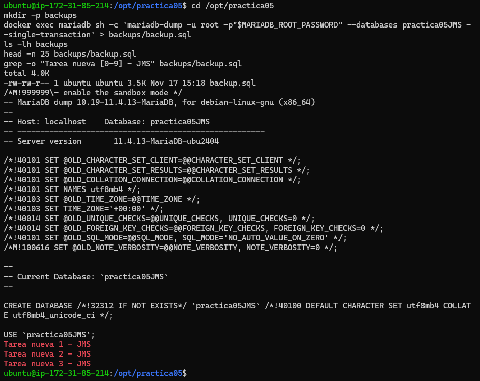

El fichero se descargó al repositorio (`backups/backup.sql`):

```powershell
scp -i practica04.pem ubuntu@IP_PUBLICA:/opt/practica05/backups/backup.sql .\backups\backup.sql
```

---

## 9. Restore

### 9.1 Simulación de la pérdida de datos (Tarea 12)

Se eliminó la base de datos completa:

```bash
docker exec -it mariadb bash
mariadb -u root -p
```

```sql
DROP DATABASE practica05JMS;
SHOW DATABASES;
```

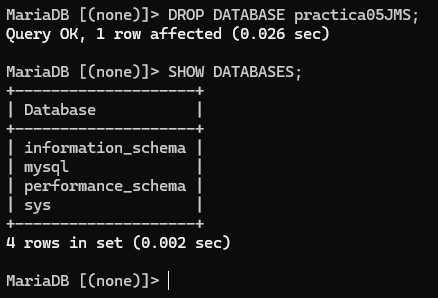

La aplicación dejó de mostrar tareas y devolvió el error 503 controlado (`Unknown database`):

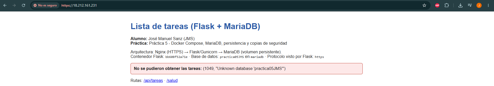

### 9.2 Restauración (Tarea 13)

Se restauró desde `backup.sql` enviándolo al cliente de MariaDB:

```bash
docker exec -i mariadb sh -c 'mariadb -u root -p"$MARIADB_ROOT_PASSWORD"' < backups/backup.sql
```

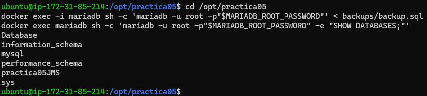

Verificación de tablas, registros y de la aplicación:

```bash
docker exec mariadb sh -c 'mariadb -u root -p"$MARIADB_ROOT_PASSWORD" -e "USE practica05JMS; SHOW TABLES; SELECT COUNT(*) AS total_tareas FROM tareas;"'
```

Volvieron la base de datos, la tabla `tareas` y los **10 registros**, y Flask volvió a mostrarlos sin tocar la aplicación ni reiniciar contenedores (cada petición abre una conexión nueva).

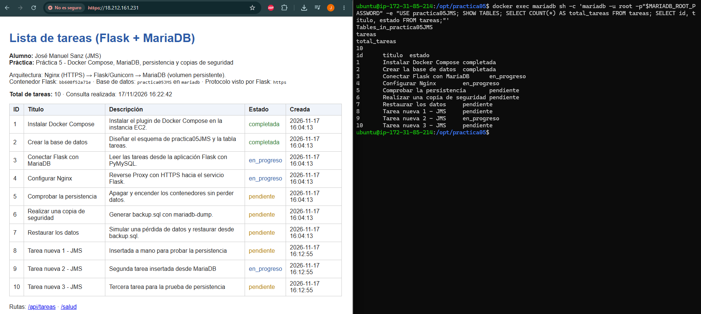

---

## 10. Análisis de la arquitectura (Tarea 14)

**Docker Compose: ¿qué problema resuelve?**
Evita lanzar y conectar a mano cada contenedor. Un solo fichero declara los servicios, la red, los volúmenes, las variables y las dependencias entre ellos, y con un comando (`up`/`down`) se levanta o se apaga todo el entorno. Hace el despliegue **reproducible** y sin pasos manuales.

**Flask: ¿qué función desempeña?**
Es la aplicación web: atiende las peticiones, consulta la base de datos y genera la página con las tareas. Es la capa de lógica de negocio.

**MariaDB: ¿qué función desempeña?**
Es la capa de datos: almacena de forma estructurada y duradera las tareas y responde a las consultas SQL de Flask.

**Docker Network: ¿por qué es necesaria?**
Para que los contenedores se comuniquen entre sí de forma privada. En una red definida por el usuario, Docker ofrece DNS interno, de modo que Flask encuentra a la base de datos por el nombre `mariadb` y Nginx a Flask por `flask`, sin depender de IPs que cambian. Además aísla los servicios: solo Nginx se publica; MariaDB y Flask no son accesibles desde Internet.

**Docker Volume: ¿por qué es necesario?**
Porque los contenedores son efímeros: sin volumen, los datos de MariaDB desaparecerían al eliminar o recrear el contenedor. El volumen separa los datos del ciclo de vida del contenedor, permitiendo actualizar imágenes y reiniciar el entorno sin perder información.

**Backup: ¿por qué es importante?**
Un volumen **no es una copia de seguridad**: sigue estando en el mismo disco y la misma máquina. Ante un borrado accidental (como el `DROP DATABASE` de la práctica), un error de la aplicación, un fallo de disco o un ataque, solo una copia independiente permite recuperar los datos. También sirve para migrar entre servidores.

**Restore: ¿por qué es importante?**
Porque una copia de seguridad solo vale si se puede restaurar. Probar la restauración demuestra que el backup es válido y completo, y permite medir cuánto se tarda en recuperar el servicio. En esta práctica se recuperaron la base de datos, las tablas y los 10 registros, y Flask volvió a funcionar.

---

## 11. Evidencias obtenidas

| Tarea | Evidencia | Captura |
|---|---|---|
| 1 | Estructura del proyecto | `01-estructura-proyecto.png` |
| 2 | `schema.sql` y `datos.sql` | `02-schema-sql.png`, `03-datos-sql.png` |
| 3 | `requirements.txt`, `app.py`, `Dockerfile` | `04-requirements.png`, `05-app-py.png`, `06-dockerfile.png` |
| 4 | `nginx.conf` | `07-nginx.png` |
| 5 | `docker-compose.yml` | `08-compose-yml.png` |
| 6 | Transferencia a EC2 | `22-instancia-ec2.png`, `09-transferencia-ec2.png`, `10-zip-transferido.png`, `11-transferencia-verificada.png` |
| 7 | Build y contenedores | `12-compose-up.png`, `13-compose-ps.png` |
| 8 | Aplicación funcionando | `14-aplicacion-funcionando.png` |
| 9 | Acceso a MariaDB | `15-acceso-mariadb.png` |
| 10 | Inserción, volúmenes y persistencia | `16-insert-mariadb.png`, `17-volumenes.png`, `23-persistencia-verificada.png` |
| 11 | Copia de seguridad | `18-backup-generado.png` |
| 12 | Pérdida de datos | `19-borrar-datos.png`, `24-app-sin-datos.png` |
| 13 | Restauración | `20-restaurar.png`, `21-datos-restaurados.png` |
| Extra | Repositorio | `25-github-repo.png` |


## Repositorio en GitHub después de terminar la práctica 5
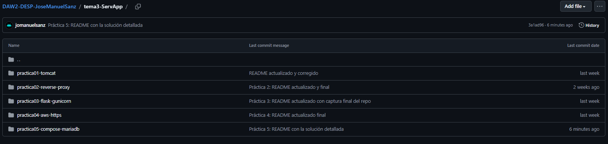

---

## 12. Problemas encontrados

1. **`docker: 'compose' is not a docker command`**: la instancia no tenía el plugin de Docker Compose, y el enunciado usa `docker-compose` (con guion).
2. **Nginx no arrancaba** (`port is already allocated` / `address already in use`): el Nginx del sistema de la práctica 4 seguía ocupando los puertos 80 y 443.
3. **`ssh` daba `Connection timed out`**: había cambiado la IP de origen permitida en el Security Group para el puerto 22.
4. **Flask no conectaba con MariaDB** al arrancar, porque la base de datos aún se estaba inicializando.
5. **`Unknown database 'practica05jms'`**: MariaDB distingue mayúsculas y minúsculas en los nombres de base de datos.
6. **El contenedor `nginx` se reiniciaba continuamente** por no encontrar el certificado.
7. **El comando `mysql` o `mysqldump` no existía** dentro del contenedor de MariaDB 11.
8. **Tras cambiar `schema.sql`, el cambio no se aplicaba.**
9. **La IP pública cambió** al volver a arrancar la instancia.

---

## 13. Soluciones aplicadas

1. Instalar el paquete `docker-compose-v2` y usar `docker compose` (mismos subcomandos).
2. Parar y deshabilitar el Nginx del sistema (`sudo systemctl stop nginx && sudo systemctl disable nginx`) y comprobar con `docker compose ps`.
3. Editar la regla SSH del Security Group con el origen **Mi IP**.
4. Añadir un `healthcheck` a MariaDB y `depends_on` con `condition: service_healthy` en Flask, además de reintentos de conexión en `app.py`.
5. Usar siempre el nombre exacto `practica05JMS`.
6. Generar los certificados en `/opt/practica05/certs` antes de ejecutar `docker compose up -d`.
7. En la imagen de MariaDB 11 se usan `mariadb` y `mariadb-dump`.
8. Los scripts de `docker-entrypoint-initdb.d` solo se ejecutan con el volumen vacío: se necesitaría `docker compose down -v` (que borra los datos) o aplicar el cambio a mano con SQL.
9. Consultar la nueva IP en la consola de AWS y redefinir `$IP` en PowerShell.

---

## 14. Conclusiones

- **Docker Compose** simplifica el despliegue de aplicaciones de varios contenedores: un fichero y un comando levantan Nginx, Flask y MariaDB, con la red y el volumen necesarios.
- La **red interna** de Docker permite comunicar los servicios por nombre y exponer solo Nginx, reduciendo la superficie de ataque. MariaDB nunca es accesible desde Internet.
- El **volumen persistente** separa los datos del ciclo de vida de los contenedores: se comprobó con `docker compose down` y `up -d` que los registros sobreviven.
- La persistencia **no sustituye a las copias de seguridad**. Se demostró con el borrado de la base de datos, recuperada con `mariadb-dump` y la restauración posterior desde `backup.sql`.
- El `healthcheck` y `depends_on` evitan errores de arranque entre Flask y la base de datos.
- Se ha evolucionado la arquitectura de la práctica 4, sustituyendo el Nginx del sistema y el único contenedor por una pila de tres servicios coordinados.
- Mejoras posibles: variables sensibles en `.env` o *secrets*, copias de seguridad automáticas y programadas (`cron`) y almacenadas fuera de la instancia (por ejemplo, en S3), certificado válido con Let's Encrypt y dominio propio, y despliegue automatizado (CI/CD).
- Se han cubierto los criterios de evaluación e, f e i.