# Práctica 05. Docker Compose, MariaDB, Persistencia y Copias de Seguridad

## Resultado de aprendizaje

Desplegar una aplicación web utilizando contenedores Docker coordinados mediante Docker Compose, integrando una base de datos MariaDB con persistencia, copias de seguridad y restauración de datos.

---

# Criterios de evaluación

- e) Configurar y utilizar los componentes web del servidor de aplicaciones.
- f) Realizar los ajustes necesarios para el despliegue de aplicaciones.
- i) Aplicar procedimientos de despliegue utilizando tecnologías de virtualización y contenedores.

---

# Contexto

En la práctica anterior se desplegó una aplicación Flask sobre AWS EC2 utilizando Flask, Gunicorn y Nginx.

En esta práctica se reutilizará la misma instancia AWS EC2 para evolucionar el despliegue hacia una arquitectura basada en Docker Compose e integrar una base de datos MariaDB.

---

# Arquitectura objetivo

```text
Usuario
   │
 HTTPS
   │
   ▼
 AWS EC2
   │
   ▼
 Docker Compose
 │
 ├── Nginx
 │
 ├── Flask
 │
 └── MariaDB
       │
       ▼
 Volumen Persistente
```

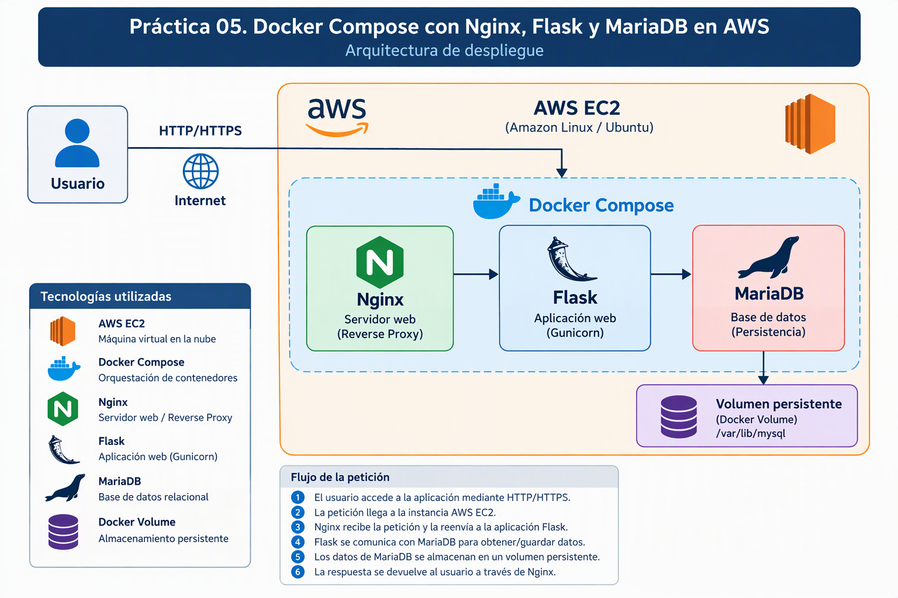

---

# Objetivos

Al finalizar la práctica el alumnado será capaz de:

- Crear despliegues multi-contenedor.
- Configurar redes Docker.
- Configurar MariaDB.
- Conectar Flask con MariaDB.
- Crear volúmenes persistentes.
- Utilizar Docker Compose.
- Realizar copias de seguridad.
- Restaurar información.
- Documentar despliegues profesionales.

---

# Requisitos previos

Antes de comenzar:

✅ AWS Academy operativo.

✅ Instancia EC2 de la práctica anterior disponible.

✅ Docker instalado.

✅ Docker Compose instalado.

✅ Acceso SSH mediante fichero `.pem`.

✅ Aplicación Flask de la práctica anterior funcionando.

---

# Estructura del repositorio

```text
practica05-compose-mariadb/
│
├── requisitos.md
├── README.md
├── docker-compose.yml
│
├── app/
│   ├── app.py
│   ├── requirements.txt
│   └── Dockerfile
│
├── nginx/
│   └── nginx.conf
│
├── database/
│   ├── schema.sql
│   └── datos.sql
│
├── backups/
│
├── capturas/
│
└── docs/
    └── arquitectura-practica05.png
```

---

# TAREA 1. Crear la estructura del proyecto

Crear todas las carpetas y archivos indicados anteriormente.

### Captura obligatoria

```text
capturas/01-estructura-proyecto.png
```

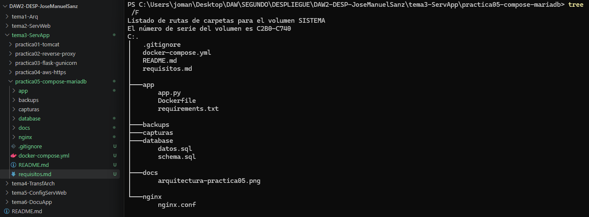

---

# TAREA 2. Crear la base de datos

## Paso 1. Crear schema.sql

Crear:

```text
database/schema.sql
```

Diseñar una base de datos llamada practica05XXX (cada uno su nombre):

```text
practica05XXX
```

que contenga una tabla:

```text
tareas
```

### Captura obligatoria

```text
capturas/02-schema-sql.png
```

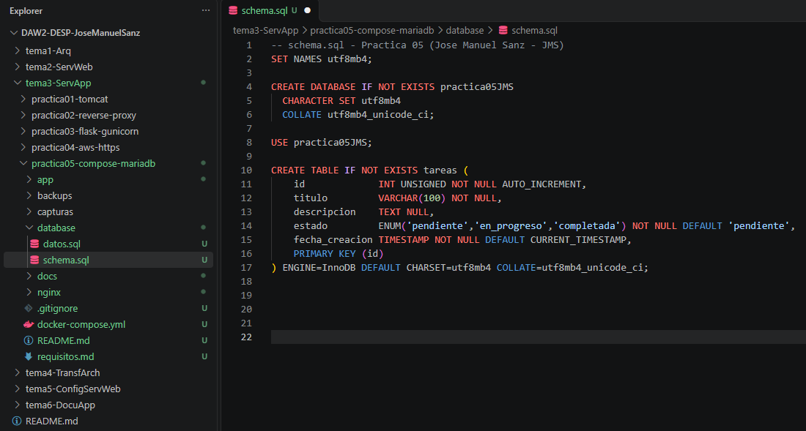

---

## Paso 2. Crear datos.sql

Crear:

```text
database/datos.sql
```

Incluir varios registros de prueba.

### Captura obligatoria

```text
capturas/03-datos-sql.png
```

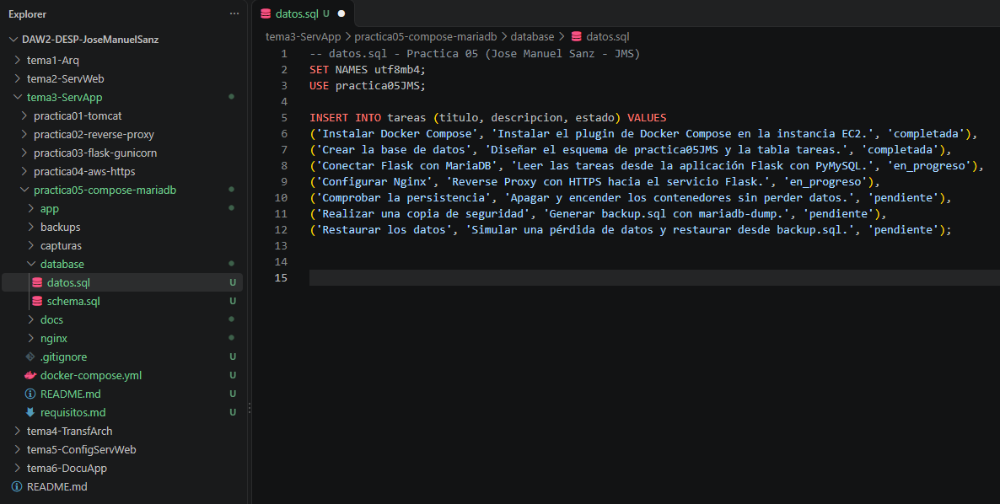

---

# TAREA 3. Crear la aplicación Flask

## Paso 1. Crear requirements.txt

Crear:

```text
app/requirements.txt
```

Incluyendo las dependencias necesarias para:

- Flask.
- MariaDB.

### Captura obligatoria

```text
capturas/04-requirements.png
```

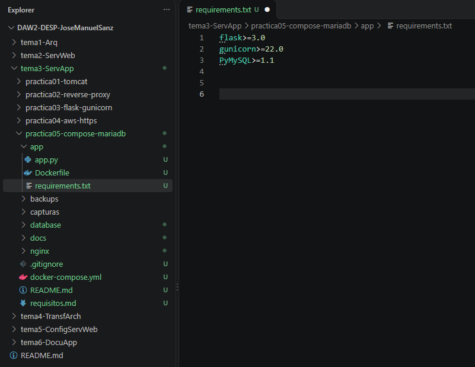

---

## Paso 2. Crear app.py

Crear:

```text
app/app.py
```

La aplicación deberá:

- Conectarse a MariaDB.
- Recuperar los datos de la tabla tareas.
- Mostrar la información en el navegador.

### Captura obligatoria

```text
capturas/05-app-py.png
```

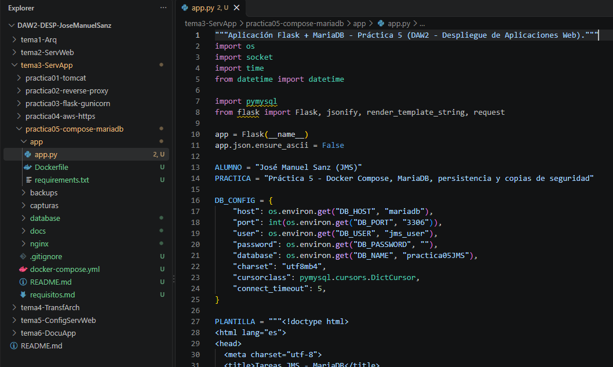

---

## Paso 3. Crear Dockerfile

Crear:

```text
app/Dockerfile
```

El Dockerfile deberá construir una imagen Flask.

### Captura obligatoria

```text
capturas/06-dockerfile.png
```

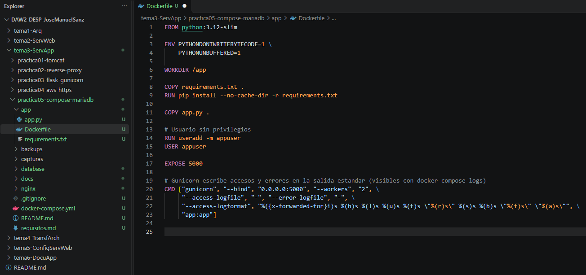

---

# TAREA 4. Configurar Nginx

## Paso 1. Crear nginx.conf

Crear:

```text
nginx/nginx.conf
```

Configurar Nginx para actuar como Reverse Proxy hacia Flask.

### Captura obligatoria

```text
capturas/07-nginx.png
```

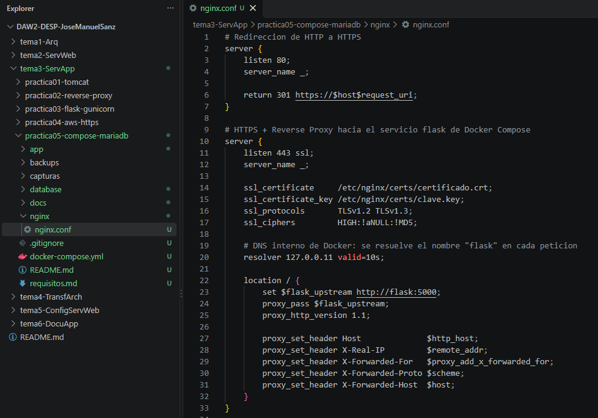

---

# TAREA 5. Crear docker-compose.yml

## Paso 1. Crear el archivo

Crear:

```text
docker-compose.yml
```

---

## Paso 2. Configurar servicios

La solución deberá incluir:

```text
nginx
flask
mariadb
```

---

## Paso 3. Configurar red interna

Todos los contenedores deberán comunicarse entre sí.

---

## Paso 4. Configurar volumen persistente

MariaDB deberá utilizar almacenamiento persistente.

### Captura obligatoria

```text
capturas/08-compose-yml.png
```

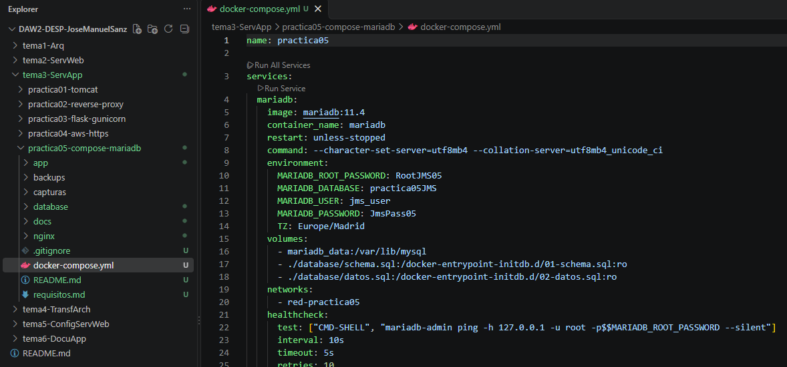

---

# TAREA 6. Transferir el proyecto a AWS EC2

## Paso 1. Comprimir el proyecto

Crear:

```text
practica05-compose-mariadb.zip
```

incluyendo:

```text
docker-compose.yml

app/

database/

nginx/
```

---

## Paso 2. Transferir mediante SCP

```bash
scp -i practica04.pem \
practica05-compose-mariadb.zip \
ubuntu@IP_PUBLICA:/opt/practica05/
```

### Captura obligatoria

```text
capturas/09-transferencia-ec2.png
```

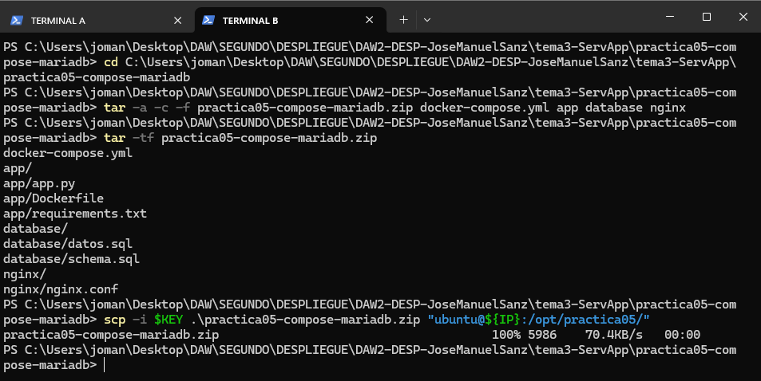

---

## Paso 3. Verificar transferencia

Comprobar que aparece:

```text
practica05-compose-mariadb.zip
```

en:

```text
/opt/practica05
```

### Captura obligatoria

```text
capturas/10-zip-transferido.png
```

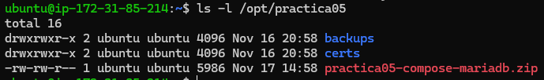

---

## Paso 4. Descomprimir

```bash
cd /opt/practica05

unzip practica05-compose-mariadb.zip
```

### Captura obligatoria

```text
capturas/11-transferencia-verificada.png
```

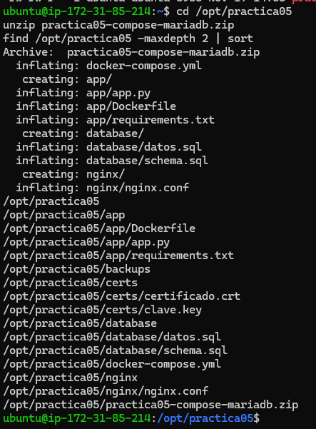

---

# TAREA 7. Construcción y despliegue

## Paso 1. Construir imágenes

```bash
cd /opt/practica05

sudo docker-compose build
```

### Captura obligatoria

```text
capturas/12-compose-up.png
```

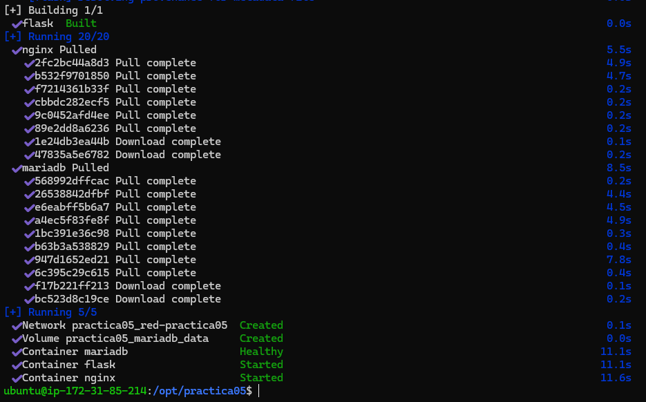

---

## Paso 2. Verificar contenedores

```bash
sudo docker-compose ps
```

### Captura obligatoria

```text
capturas/13-compose-ps.png
```

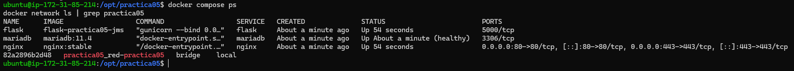

---

# TAREA 8. Comprobar funcionamiento

Abrir:

```text
https://IP_PUBLICA
```

o

```text
http://IP_PUBLICA
```

Verificar que Flask recupera correctamente los datos almacenados en MariaDB.

### Captura obligatoria

```text
capturas/14-aplicacion-funcionando.png
```

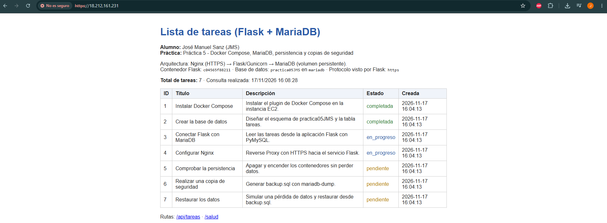

---

# TAREA 9. Acceder a MariaDB

Entrar al contenedor:

```bash
sudo docker exec -it mariadb bash
```

Conectarse:

```bash
mariadb -u root -p
```

Seleccionar la base de datos:

```sql
USE practica05XXX;
```

### Captura obligatoria

```text
capturas/15-acceso-mariadb.png
```

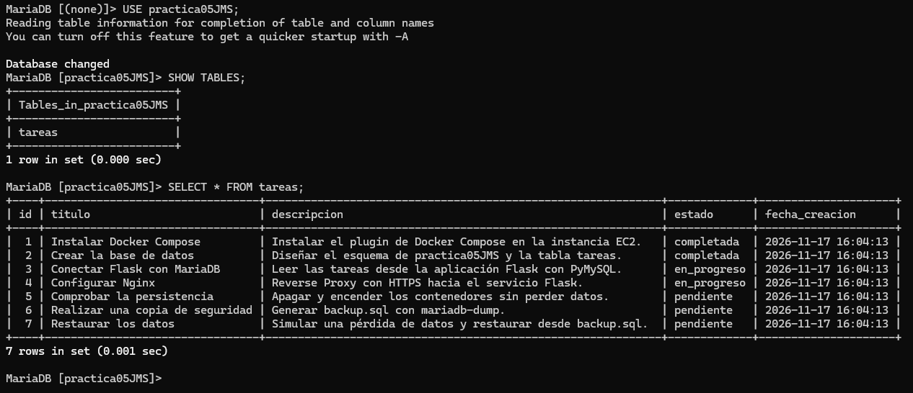

---

# TAREA 10. Comprobar persistencia

## Paso 1. Insertar nuevos registros

Insertar varias tareas nuevas en la tabla.

### Captura obligatoria

```text
capturas/16-insert-mariadb.png
```

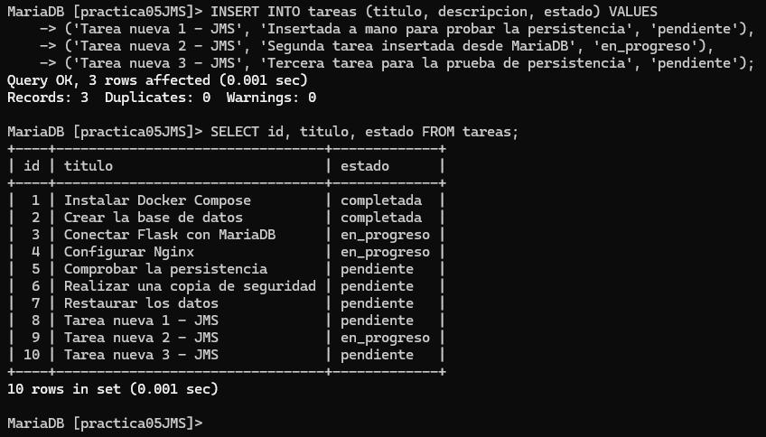

---

## Paso 2. Apagar contenedores

```bash
sudo docker-compose down
```

---

## Paso 3. Arrancar nuevamente

```bash
sudo docker-compose up -d
```

---

## Paso 4. Comprobar volúmenes

Mostrar:

```bash
docker volume ls
```

### Captura obligatoria

```text
capturas/17-volumenes.png
```

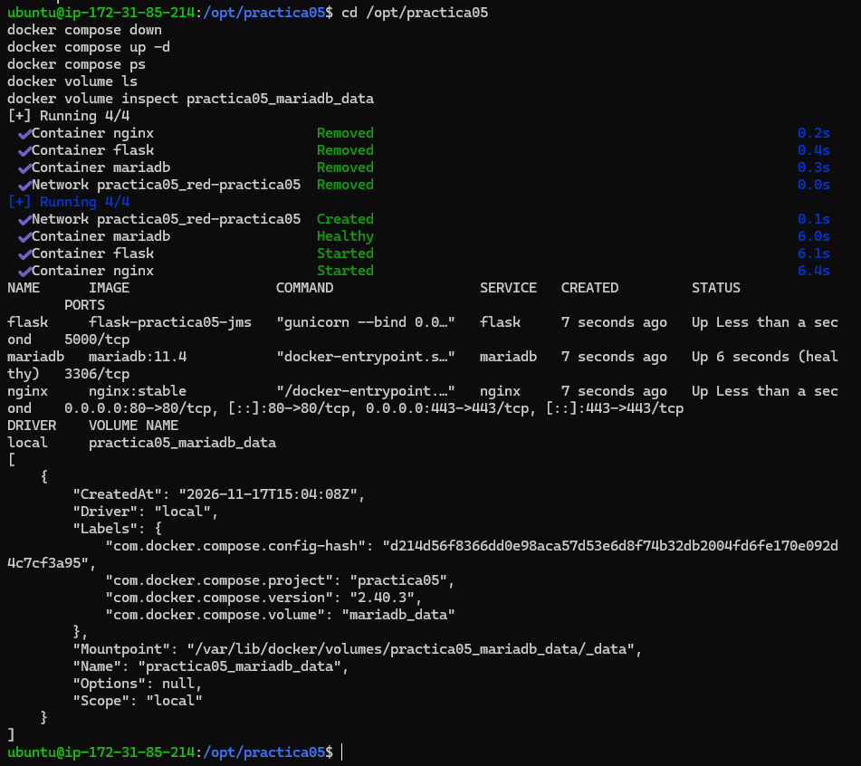

---

# TAREA 11. Generar una copia de seguridad

## Paso 1. Crear carpeta backups

Verificar:

```text
backups/
```

---

## Paso 2. Generar backup

Utilizar:

```bash
mariadb-dump
```

o

```bash
mysqldump
```

según la versión disponible.

Generar:

```text
backups/backup.sql
```

### Captura obligatoria

```text
capturas/18-backup-generado.png
```

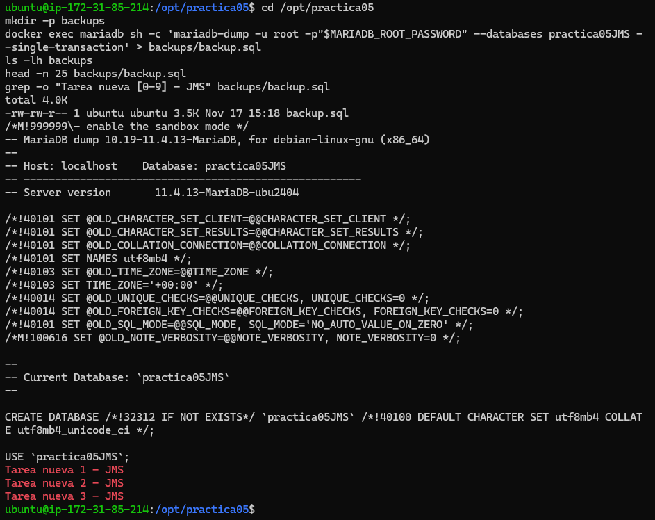

---

# TAREA 12. Simular pérdida de datos

Eliminar:

- registros,
- tablas,
- o la base de datos completa.

Documentar el procedimiento utilizado.

### Captura obligatoria

```text
capturas/19-borrar-datos.png
```

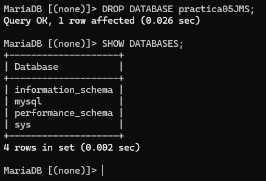

---

# TAREA 13. Restauración

## Paso 1. Restaurar

Utilizar:

```text
backup.sql
```

para recuperar la información.

### Captura obligatoria

```text
capturas/20-restaurar.png
```

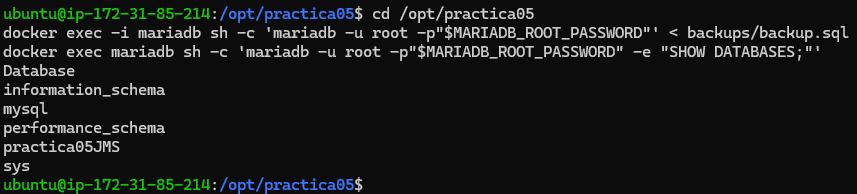

---

## Paso 2. Verificar

Comprobar que vuelven a aparecer:

```text
tablas

registros

datos
```

y que Flask vuelve a mostrar correctamente la información.

### Captura obligatoria

```text
capturas/21-datos-restaurados.png
```

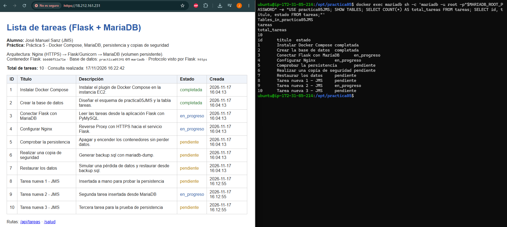

---

# TAREA 14. Análisis de la arquitectura

Responder:

## Docker Compose

- ¿Qué problema resuelve?

## Flask

- ¿Qué función desempeña?

## MariaDB

- ¿Qué función desempeña?

## Docker Network

- ¿Por qué es necesaria?

## Docker Volume

- ¿Por qué es necesario?

## Backup

- ¿Por qué es importante?

## Restore

- ¿Por qué es importante?

---

# README.md

El README deberá incluir:

```text
Introducción.

Arquitectura.

Docker Compose.

Flask.

MariaDB.

Docker Volume.

Persistencia.

Backup.

Restore.

Problemas encontrados.

Soluciones aplicadas.

Conclusiones.
```

---

# Estructura mínima obligatoria de entrega

```text
practica05-compose-mariadb/
│
├── requisitos.md
├── README.md
├── docker-compose.yml
│
├── app/
│   ├── app.py
│   ├── requirements.txt
│   └── Dockerfile
│
├── nginx/
│   └── nginx.conf
│
├── database/
│   ├── schema.sql
│   └── datos.sql
│
├── backups/
│   └── backup.sql
│
├── capturas/
│   ├── 01-estructura-proyecto.png
│   ├── 02-schema-sql.png
│   ├── 03-datos-sql.png
│   ├── 04-requirements.png
│   ├── 05-app-py.png
│   ├── 06-dockerfile.png
│   ├── 07-nginx.png
│   ├── 08-compose-yml.png
│   ├── 09-transferencia-ec2.png
│   ├── 10-zip-transferido.png
│   ├── 11-transferencia-verificada.png
│   ├── 12-compose-up.png
│   ├── 13-compose-ps.png
│   ├── 14-aplicacion-funcionando.png
│   ├── 15-acceso-mariadb.png
│   ├── 16-insert-mariadb.png
│   ├── 17-volumenes.png
│   ├── 18-backup-generado.png
│   ├── 19-borrar-datos.png
│   ├── 20-restaurar.png
│   └── 21-datos-restaurados.png
│
└── docs/
    └── arquitectura-practica05.png
```

---

# Archivos mínimos obligatorios

✅ docker-compose.yml

✅ app/app.py

✅ app/requirements.txt

✅ app/Dockerfile

✅ nginx/nginx.conf

✅ database/schema.sql

✅ database/datos.sql

✅ backups/backup.sql

✅ docs/arquitectura-practica05.png

✅ README.md

✅ 21 capturas obligatorias