# Práctica 06. Terraform + AWS EC2

**Alumno:** José Manuel Sanz (JMS)
**Módulo:** Despliegue de Aplicaciones Web (DAW2) · **Tema 3:** Servidores de Aplicaciones
**Instancia:** `practica06-terraform-jms` · **Herramienta:** Terraform + AWS (Learner Lab)

---

## Índice

1. [Introducción](#1-introducción)
2. [Terraform](#2-terraform)
3. [AWS](#3-aws)
4. [Infrastructure as Code](#4-infrastructure-as-code)
5. [Configuración realizada](#5-configuración-realizada)
6. [Recursos creados](#6-recursos-creados)
7. [Análisis final (Tarea 12)](#7-análisis-final-tarea-12)
8. [Evidencias obtenidas](#8-evidencias-obtenidas)
9. [Problemas encontrados](#9-problemas-encontrados)
10. [Soluciones aplicadas](#10-soluciones-aplicadas)
11. [Conclusiones](#11-conclusiones)

---

## 1. Introducción

Hasta la práctica anterior la infraestructura en AWS se creaba **manualmente**: entrar en AWS Academy, crear la instancia EC2, configurar el Security Group, asociar la clave SSH y preparar el servidor a mano. Ese enfoque es válido para aprender, pero es lento, difícil de reproducir, propenso a errores y complicado de mantener.

En esta práctica se automatiza el aprovisionamiento con **Terraform**, una herramienta de **Infrastructure as Code (IaC)**: la infraestructura se describe en ficheros de código (`main.tf`, `variables.tf`, `outputs.tf`) y Terraform se encarga de crear, modificar y eliminar los recursos en AWS.

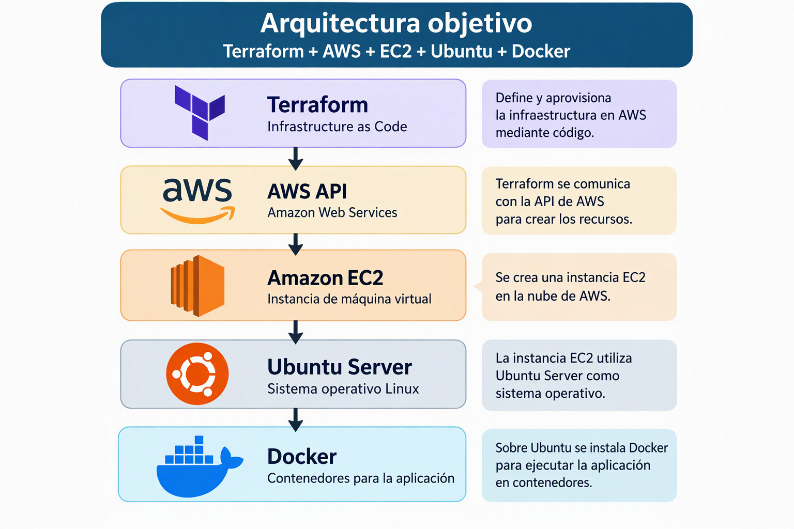

```text
Terraform → AWS API → EC2 → Ubuntu Server → Docker
```

**Criterios de evaluación trabajados:**

| Criterio | Dónde se trata |
|---|---|
| f) Realizar los ajustes necesarios para el despliegue de aplicaciones | Apartados 5.6 y 5.7 (Security Group, Key Pair y acceso SSH) |
| i) Aplicar procedimientos de despliegue utilizando tecnologías de virtualización y contenedores | Apartados 5.3, 6 y 5.7 (instancia EC2 con Docker instalado automáticamente) |
| Documentar la infraestructura desplegada | Apartados 5, 6 y 8 |
| Automatizar la creación de recursos cloud | Apartados 2, 4 y 5 |

Estructura del repositorio:

```text
practica06-terraform/
├── requisitos-practica06-terraform.md   (enunciado del profesor)
├── README.md                            (solución detallada)
├── .gitignore
├── terraform/
│   ├── main.tf
│   ├── variables.tf
│   ├── outputs.tf
│   ├── terraform.tfvars
│   └── .terraform.lock.hcl
├── capturas/
└── docs/
    └── arquitectura-practica06.png
```

El estado local de Terraform (`terraform.tfstate`), el directorio `.terraform/` y la clave `.pem` están excluidos mediante `.gitignore`.

---

## 2. Terraform

**Terraform** (HashiCorp) es una herramienta de código abierto para definir y gestionar infraestructura mediante ficheros de configuración escritos en **HCL** (*HashiCorp Configuration Language*). Su funcionamiento es **declarativo**: se describe el estado deseado ("quiero una instancia con este Security Group") y Terraform calcula qué debe hacer para alcanzarlo.

| Concepto | Descripción |
|---|---|
| **Provider** | Plugin que permite hablar con una plataforma. Aquí, `hashicorp/aws`. |
| **Resource** | Cada elemento de infraestructura (`aws_instance`, `aws_security_group`). |
| **Variable** | Parámetro configurable (`variables.tf`), con sus valores en `terraform.tfvars`. |
| **Output** | Dato que se muestra al terminar (IP pública, ID de instancia). |
| **State** | Fichero (`terraform.tfstate`) donde Terraform guarda lo que ha creado, para saber qué cambiar. |

Ficheros del proyecto:

| Fichero | Función |
|---|---|
| `main.tf` | Provider y recursos (qué se crea). |
| `variables.tf` | Declaración de las variables (AMI, tipo de instancia, región, nombre y Key Pair). |
| `terraform.tfvars` | Valores concretos de las variables. No contiene credenciales. |
| `outputs.tf` | Datos que se muestran al finalizar. |
| `.terraform.lock.hcl` | Versión exacta del provider utilizada (se versiona para que el resultado sea reproducible). |

Ciclo de trabajo:

```text
terraform init → terraform validate → terraform plan → terraform apply → (terraform destroy)
```

---

## 3. AWS

**Amazon Web Services (AWS)** ofrece infraestructura en la nube. En esta práctica se usa a través de **AWS Academy Learner Lab** (región `us-east-1`, Norte de Virginia).

| Concepto | Uso en la práctica |
|---|---|
| **EC2** | Servicio de máquinas virtuales. Se crea una instancia `t2.micro`. |
| **AMI** | Plantilla de sistema: `ami-02a9cdd4e98bc3c78` (Ubuntu Server 24.04 LTS), la misma de la instancia `practica04-flask`. |
| **Security Group** | Cortafuegos virtual de la instancia: define qué tráfico de entrada y de salida se permite. |
| **Key Pair** | Par de claves para acceder por SSH. Se reutiliza `practica04` (con la clave privada `practica04.pem`). |
| **AWS API** | Terraform no usa la consola web: llama directamente a la API de AWS con las credenciales. |

### Credenciales temporales de AWS Academy

Terraform necesita autenticarse contra la API de AWS. El Learner Lab proporciona tres valores **temporales**, que caducan al terminar la sesión del laboratorio:

```text
AWS_ACCESS_KEY_ID
AWS_SECRET_ACCESS_KEY
AWS_SESSION_TOKEN
```

Se configuran como **variables de entorno** en la sesión de PowerShell. De este modo no se guardan en ningún fichero del proyecto ni se suben a GitHub. Si se reinicia el laboratorio, hay que copiarlas de nuevo.

---

## 4. Infrastructure as Code

**Infrastructure as Code (IaC)** consiste en definir y gestionar la infraestructura (servidores, redes, reglas de seguridad...) mediante **código** en lugar de configurarla a mano desde una consola. Se basa en ideas como:

- **Declarativo:** se describe el resultado deseado, no los pasos para lograrlo.
- **Versionable:** el código se guarda en Git, con historial de cambios.
- **Reproducible:** el mismo código crea siempre la misma infraestructura.
- **Idempotente:** ejecutarlo varias veces no duplica recursos; solo se aplican las diferencias.
- **Documentación viva:** los ficheros describen exactamente lo que existe.

Es uno de los pilares de DevOps.

---

## 5. Configuración realizada

### 5.1 Verificación de AWS Academy (Tarea 1)

Se inició el Learner Lab y se comprobó que las credenciales temporales estaban disponibles (panel *AWS Details*):

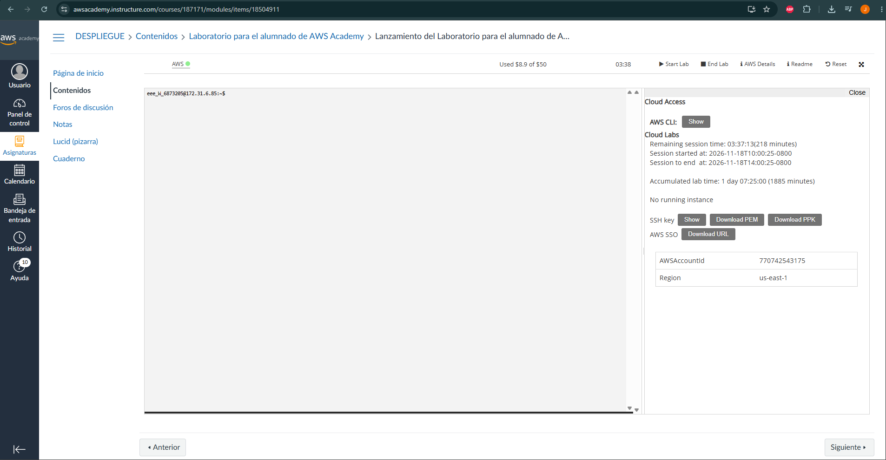

Se creó la carpeta de trabajo con la estructura inicial:

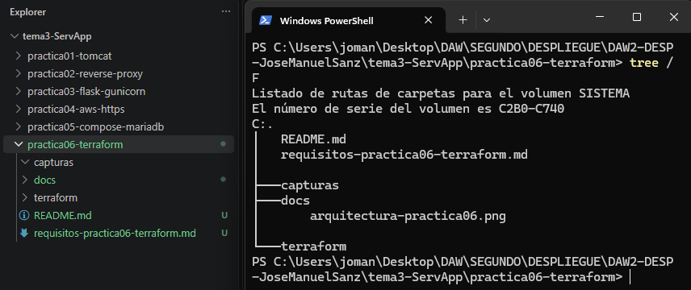

### 5.2 Instalación de Terraform (Tarea 2)

Terraform no estaba instalado. Se instaló con `winget` y se reabrió PowerShell para que se actualizara el PATH:

```powershell
winget install --id Hashicorp.Terraform -e
terraform version
```

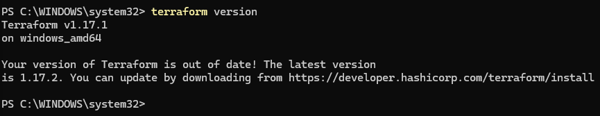

### 5.3 Credenciales de AWS (Tarea 3)

Los tres valores del Learner Lab se configuraron como variables de entorno en la sesión de PowerShell:

```powershell
$env:AWS_ACCESS_KEY_ID     = '...'
$env:AWS_SECRET_ACCESS_KEY = '...'
$env:AWS_SESSION_TOKEN     = '...'
```

(Los valores reales no se muestran en esta documentación). La captura muestra la comprobación con los valores ocultos:

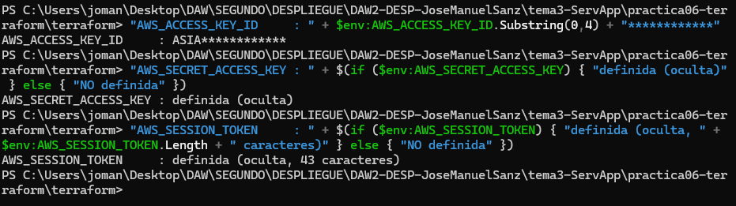

### 5.4 Proyecto Terraform (Tarea 4)

Primera versión de la infraestructura: **solo una instancia EC2**, con un `user_data` que instala Docker en el primer arranque (igual que se hizo manualmente en la práctica 4).

`terraform/main.tf` (versión inicial):

```hcl
terraform {
  required_version = ">= 1.5.0"

  required_providers {
    aws = {
      source  = "hashicorp/aws"
      version = "~> 5.0"
    }
  }
}

provider "aws" {
  region = var.region
}

resource "aws_instance" "practica06" {
  ami                         = var.ami
  instance_type               = var.instance_type
  associate_public_ip_address = true

  # Instala Docker en el primer arranque (igual que en la practica 4)
  user_data = <<-EOF
    #!/bin/bash
    export DEBIAN_FRONTEND=noninteractive
    apt update -y
    apt install -y docker.io git curl
    systemctl enable docker
    systemctl start docker
    usermod -aG docker ubuntu
  EOF

  tags = {
    Name   = var.instance_name
    Alumno = "JMS"
  }
}
```

`terraform/variables.tf`:

```hcl
variable "region" {
  description = "Region de AWS donde se crea la infraestructura"
  type        = string
  default     = "us-east-1"
}

variable "ami" {
  description = "ID de la AMI (Ubuntu Server 24.04 LTS en us-east-1)"
  type        = string
}

variable "instance_type" {
  description = "Tipo de instancia EC2"
  type        = string
  default     = "t2.micro"
}

variable "instance_name" {
  description = "Nombre (tag Name) de la instancia"
  type        = string
  default     = "practica06-terraform-jms"
}
```

`terraform/outputs.tf`:

```hcl
output "instance_id" {
  description = "ID de la instancia EC2"
  value       = aws_instance.practica06.id
}

output "public_ip" {
  description = "IP publica de la instancia EC2"
  value       = aws_instance.practica06.public_ip
}
```

`terraform/terraform.tfvars`:

```hcl
region        = "us-east-1"
ami           = "ami-02a9cdd4e98bc3c78"
instance_type = "t2.micro"
instance_name = "practica06-terraform-jms"
```

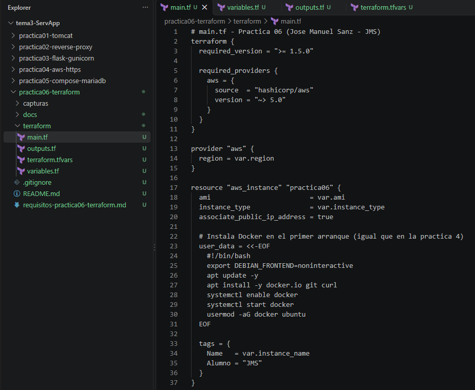

### 5.5 Inicialización, validación y plan (Tareas 5 y 6)

```powershell
terraform init
terraform validate
terraform plan
```

- **`terraform init`**: descargó el provider `hashicorp/aws` (plugins), creó el directorio `.terraform/` y el fichero `.terraform.lock.hcl`.
- **`terraform validate`**: comprobó que la sintaxis es correcta (`Success! The configuration is valid.`).
- **`terraform plan`**: mostró los recursos que se crearían (`Plan: 1 to add, 0 to change, 0 to destroy.`) sin crear nada. También verificó que las credenciales de AWS eran válidas.

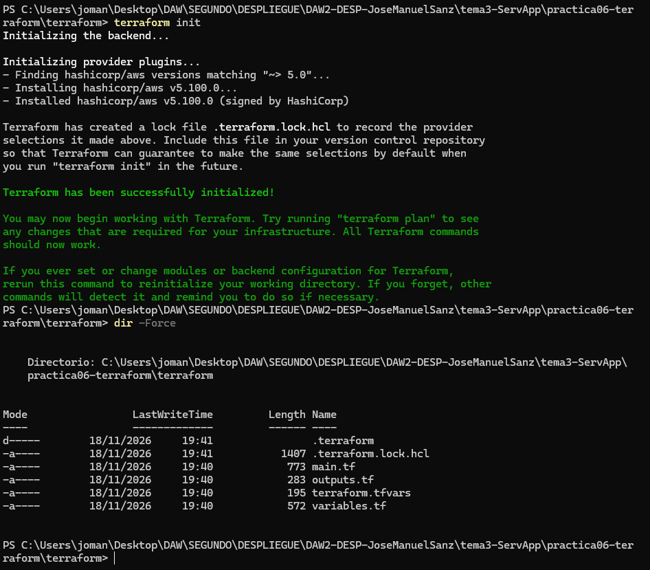
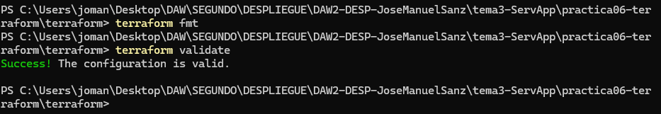
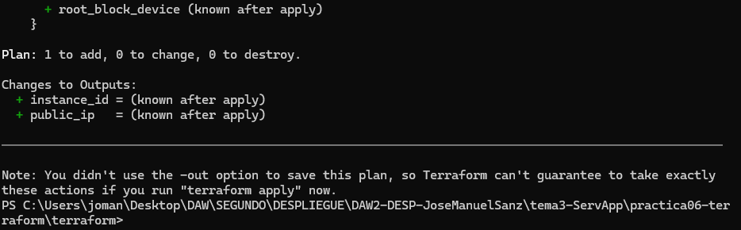

### 5.6 Creación de la infraestructura y análisis de outputs (Tareas 7 y 8)

```powershell
terraform apply
terraform output
```

Tras confirmar con `yes`, Terraform creó la instancia (`Resources: 1 added`). Se comprobó en la consola de AWS (EC2 → Instancias) y se consultaron los outputs (ID de instancia e IP pública):

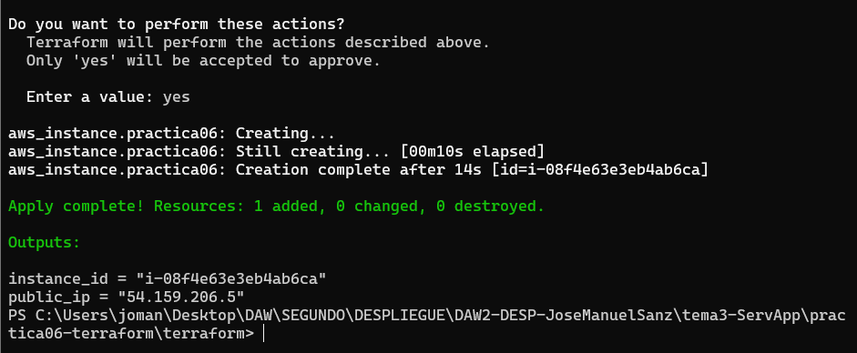
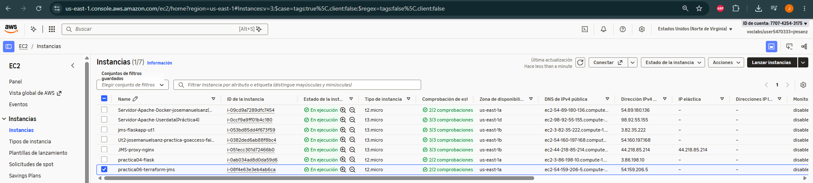
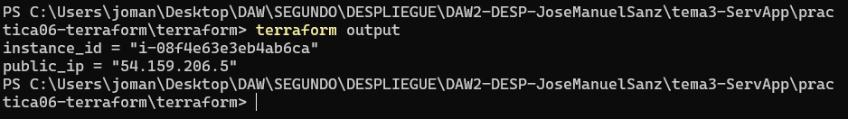

### 5.7 Limitaciones de la infraestructura creada (Tarea 9)

Se comprobó que, aunque la instancia existe, **no es administrable**:

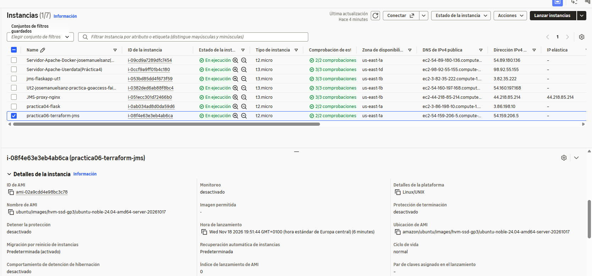
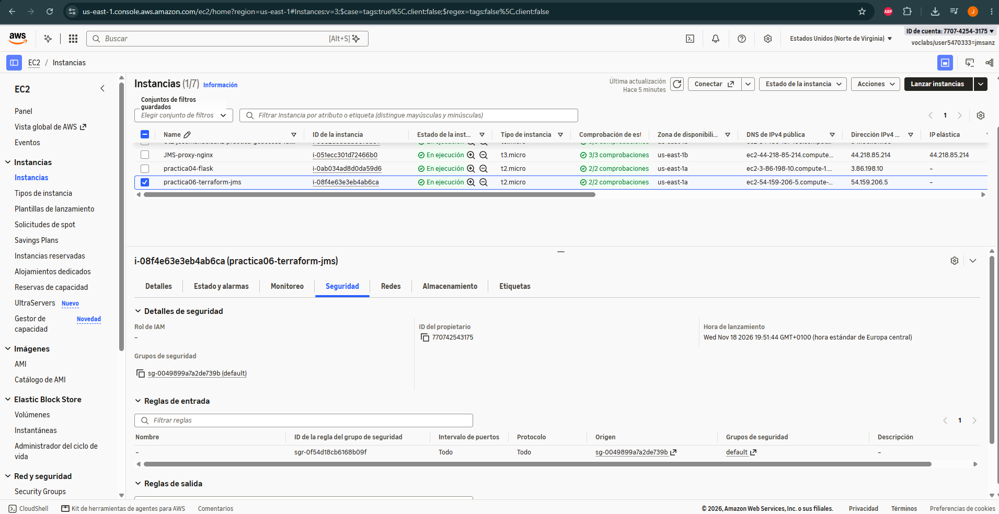

```powershell
Test-NetConnection $IP -Port 22
Test-NetConnection $IP -Port 80
```

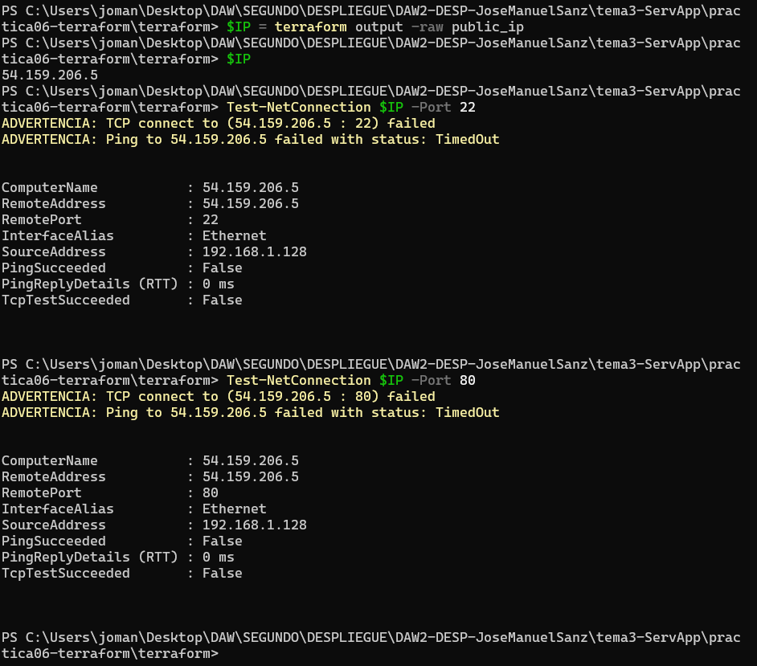

| Pregunta | Respuesta |
|---|---|
| ¿Existe una clave SSH asociada a la instancia? | **No.** El recurso no define `key_name`, y la consola muestra el campo del par de claves vacío. |
| ¿Podemos conectarnos mediante SSH? | **No.** La imagen de Ubuntu solo acepta autenticación por clave y no hay ninguna clave pública instalada en la instancia. |
| ¿Está abierto el puerto 22? | **No.** `Test-NetConnection` devuelve `TcpTestSucceeded : False`. |
| ¿Existe algún Security Group configurado? | **Sí, pero no es adecuado.** Como no se definió ninguno, AWS asignó el Security Group `default` de la VPC, cuya única regla de entrada permite tráfico procedente de los miembros del propio grupo, nunca desde Internet. |
| ¿Está abierta la comunicación HTTP o HTTPS? | **No.** Los puertos 80 y 443 tampoco aceptan conexiones (`TcpTestSucceeded : False` en el 80). |

**Conclusión:** Terraform ha creado una instancia EC2 funcional a nivel de máquina virtual, pero la infraestructura es **incompleta**: no tiene Key Pair, no tiene un Security Group adecuado y no es posible conectarse por SSH. Hay que evolucionarla.

### 5.8 Modificación de la infraestructura (Tarea 10)

**Paso 1. Security Group.** Se añadió a `main.tf` el recurso `aws_security_group`, que permite SSH (22), HTTP (80) y HTTPS (443) de entrada y todo el tráfico de salida:

```hcl
resource "aws_security_group" "practica06_sg" {
  name        = "practica06-sg"
  description = "Practica 06 JMS - SSH, HTTP y HTTPS"

  ingress {
    description = "SSH"
    from_port   = 22
    to_port     = 22
    protocol    = "tcp"
    cidr_blocks = ["0.0.0.0/0"]
  }

  ingress {
    description = "HTTP"
    from_port   = 80
    to_port     = 80
    protocol    = "tcp"
    cidr_blocks = ["0.0.0.0/0"]
  }

  ingress {
    description = "HTTPS"
    from_port   = 443
    to_port     = 443
    protocol    = "tcp"
    cidr_blocks = ["0.0.0.0/0"]
  }

  egress {
    description = "Todo el trafico de salida"
    from_port   = 0
    to_port     = 0
    protocol    = "-1"
    cidr_blocks = ["0.0.0.0/0"]
  }

  tags = {
    Name = "practica06-sg"
  }
}
```

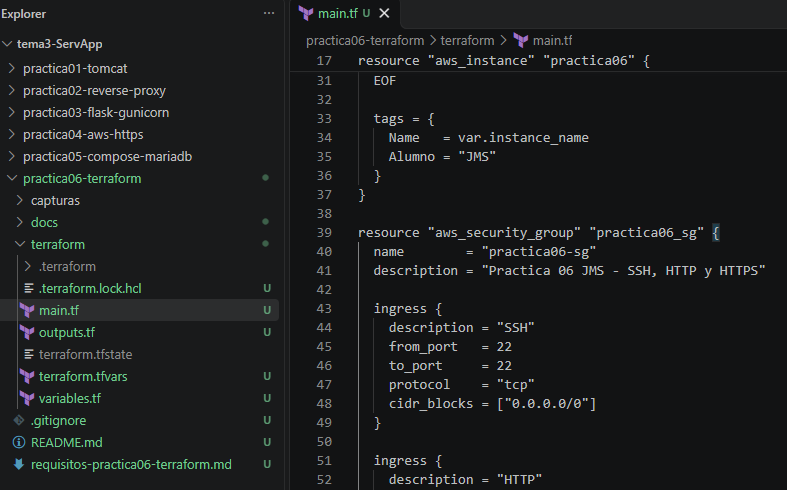

**Paso 2. Key Pair.** En la consola de AWS (EC2 → Pares de claves) se comprobó que la clave utilizada en las prácticas anteriores es `practica04`. Se añadió como variable en `variables.tf` y su valor en `terraform.tfvars`:

```hcl
variable "key_name" {
  description = "Nombre del Key Pair ya existente en AWS (el mismo de la practica 4)"
  type        = string
}
```

```hcl
key_name      = "practica04"
```

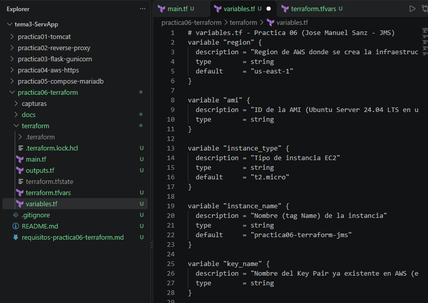

El recurso EC2 de `main.tf` se modificó para usar el Key Pair y el Security Group:

```hcl
resource "aws_instance" "practica06" {
  ami                         = var.ami
  instance_type               = var.instance_type
  key_name                    = var.key_name
  vpc_security_group_ids      = [aws_security_group.practica06_sg.id]
  associate_public_ip_address = true

  # Instala Docker en el primer arranque (igual que en la practica 4)
  user_data = <<-EOF
    #!/bin/bash
    export DEBIAN_FRONTEND=noninteractive
    apt update -y
    apt install -y docker.io git curl
    systemctl enable docker
    systemctl start docker
    usermod -aG docker ubuntu
  EOF

  tags = {
    Name   = var.instance_name
    Alumno = "JMS"
  }
}
```

Además se añadieron dos outputs a `outputs.tf`:

```hcl
output "security_group_id" {
  description = "ID del Security Group creado"
  value       = aws_security_group.practica06_sg.id
}

output "ssh_command" {
  description = "Comando para conectarse por SSH"
  value       = "ssh -i practica04.pem ubuntu@${aws_instance.practica06.public_ip}"
}
```

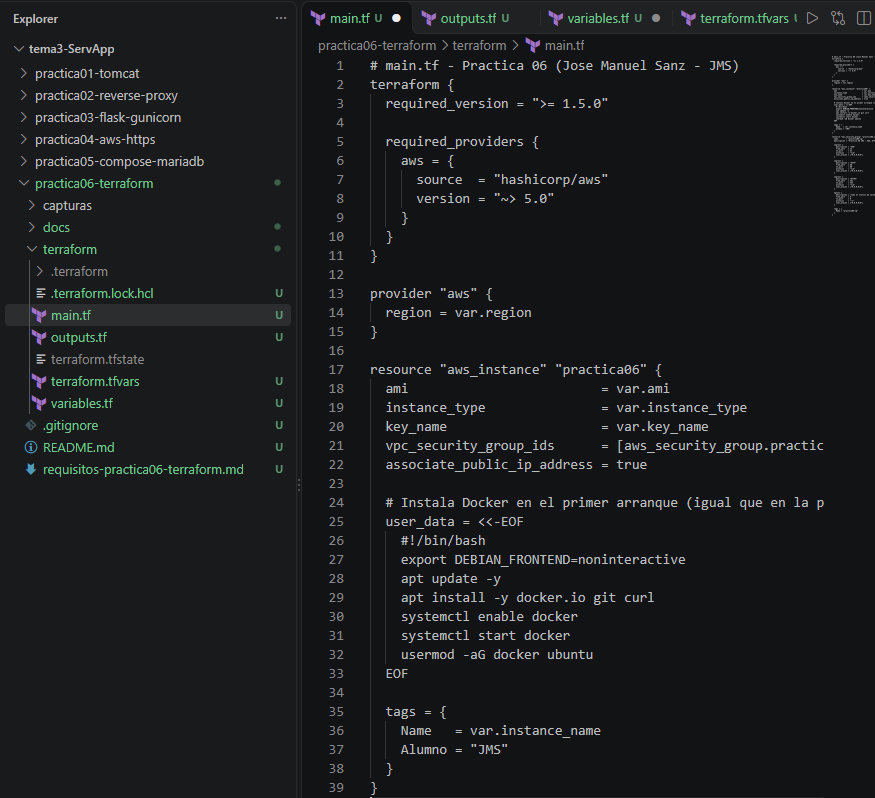

**Paso 3. Validación.**

```powershell
terraform validate
```

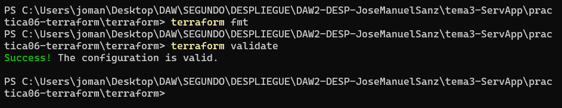

**Paso 4. Plan.** Terraform indicó:

- `aws_security_group.practica06_sg` **will be created** → recurso nuevo.
- `aws_instance.practica06` **must be replaced** (`-/+`) → cambio sobre la instancia EC2. El motivo es `key_name ... # forces replacement`: la clave pública SSH se instala en el primer arranque, así que AWS no permite cambiar el Key Pair de una instancia ya creada y Terraform la destruye y la recrea.
- Resumen: `Plan: 2 to add, 0 to change, 1 to destroy.`

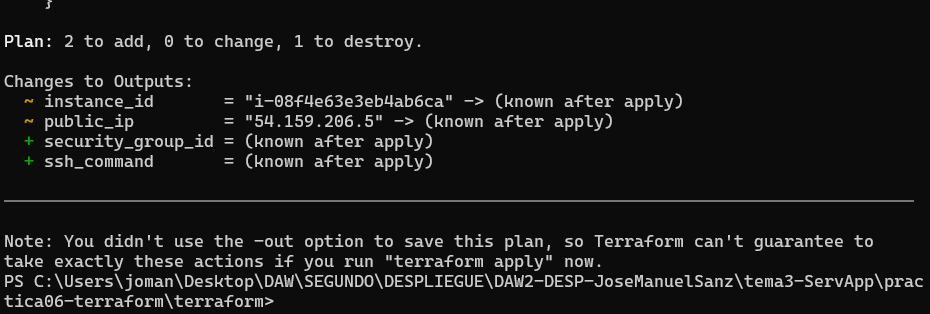

**Paso 5. Aplicación.**

```powershell
terraform apply
```

Resultado: `Apply complete! Resources: 2 added, 0 changed, 1 destroyed.` La instancia nueva tiene otra IP pública.

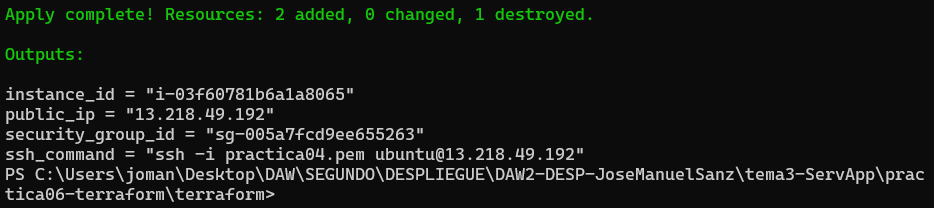

### 5.9 Conexión a la instancia (Tarea 11)

Se obtuvo la IP con `terraform output` y se usó la misma clave de las prácticas anteriores:

```powershell
terraform output
$IP = terraform output -raw public_ip
ssh -i C:\Users\joman\.ssh\practica04.pem ubuntu@${IP}
```

La conexión funcionó (mensaje `Welcome to Ubuntu 24.04...`):

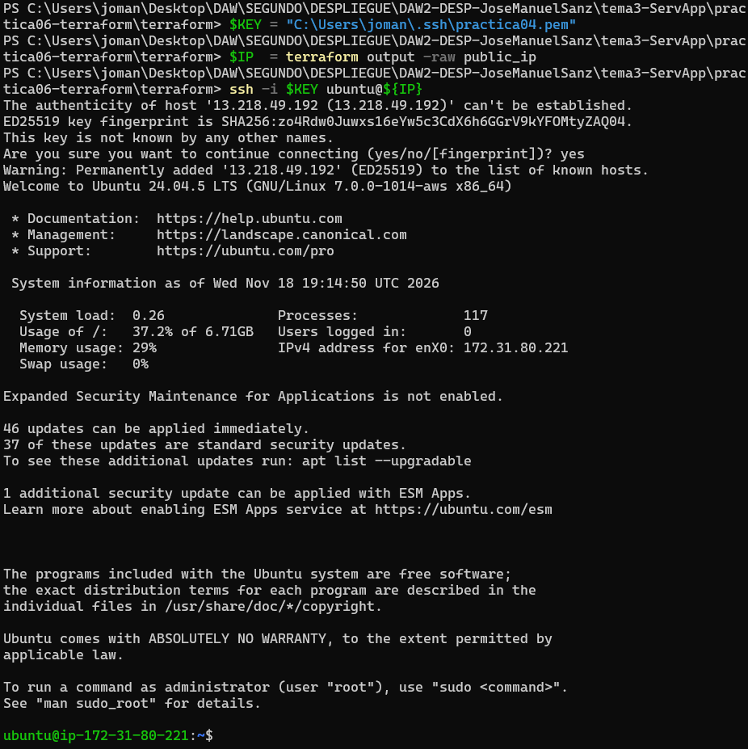

Dentro de la instancia se comprobó que el `user_data` instaló Docker automáticamente:

```bash
cloud-init status --wait
docker --version
systemctl is-active docker
```

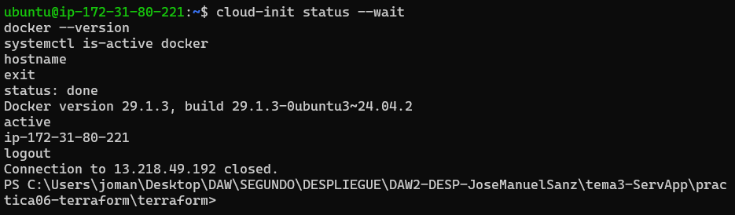

### 5.10 Destrucción de la infraestructura

Terminadas las pruebas, se eliminaron los recursos para no consumir crédito del laboratorio:

```powershell
terraform destroy
```

Resultado: `Destroy complete! Resources: 2 destroyed.` El Key Pair `practica04` se conserva, porque no fue creado por Terraform (solo se referencia por su nombre).

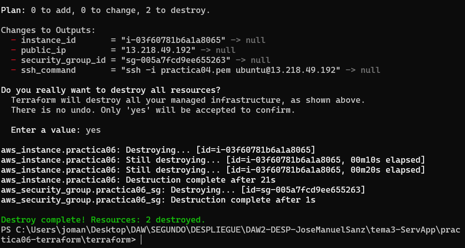

---

## 6. Recursos creados

| Recurso | Tipo | Descripción |
|---|---|---|
| `aws_instance.practica06` | EC2 | Instancia `practica06-terraform-jms`: Ubuntu Server 24.04 LTS, `t2.micro`, IP pública, con Key Pair `practica04` y Docker instalado por `user_data`. |
| `aws_security_group.practica06_sg` | Security Group | `practica06-sg`: entrada por 22 (SSH), 80 (HTTP) y 443 (HTTPS); salida libre. Se crea en la segunda fase. |
| Key Pair `practica04` | Reutilizado | Ya existía en AWS (práctica 4). No lo gestiona Terraform. |

Evolución de la infraestructura:

| Fase | Recursos | Resultado |
|---|---|---|
| 1 (Tareas 4 a 8) | Instancia EC2 | Máquina creada, pero **sin acceso**: sin Key Pair y con el Security Group `default`. |
| 2 (Tarea 10) | Security Group + Key Pair asociado (la instancia se reemplaza) | Instancia **accesible por SSH** y con los puertos 80 y 443 abiertos. |

Outputs definidos: `instance_id`, `public_ip`, `security_group_id` y `ssh_command`.

**Nota de seguridad:** el puerto 22 está abierto a `0.0.0.0/0` para facilitar la práctica. En un entorno real se restringiría a las IP de administración.

---

## 7. Análisis final (Tarea 12)

**Infrastructure as Code: ¿qué significa?**
Gestionar y aprovisionar la infraestructura (servidores, redes, reglas de seguridad...) mediante ficheros de código en lugar de hacerlo manualmente. El código describe el estado deseado, se guarda en un repositorio Git y puede ejecutarse tantas veces como haga falta, con el mismo resultado.

**Terraform: ¿qué ventajas aporta frente a la creación manual de recursos?**
Es más **rápido** (un comando crea todo), **reproducible** (siempre el mismo resultado), **menos propenso a errores** (no hay clics ni pasos olvidados), **versionable** (historial de cambios en Git) y **documenta** la infraestructura. Además, `plan` permite revisar los cambios antes de aplicarlos y la infraestructura se puede destruir y recrear fácilmente.

**Security Groups: ¿qué función desempeñan?**
Actúan como un cortafuegos virtual asociado a la instancia: controlan qué tráfico de entrada y de salida se permite, por protocolo, puerto y origen. Sin las reglas adecuadas (22, 80 y 443) la instancia no es accesible desde Internet, como se comprobó en la Tarea 9.

**Key Pairs: ¿por qué son necesarias?**
Permiten la autenticación por SSH sin contraseña mediante criptografía asimétrica: AWS instala la clave **pública** en la instancia durante el primer arranque, y el administrador se conecta con la clave **privada** (`.pem`). Las imágenes de Ubuntu de AWS no admiten acceso por contraseña, de modo que sin Key Pair no se puede entrar por SSH.

**terraform init: ¿para qué sirve?**
Inicializa el directorio de trabajo: descarga los providers necesarios (aquí `hashicorp/aws`), crea el directorio `.terraform/` y el fichero de bloqueo de versiones `.terraform.lock.hcl`. Debe ejecutarse antes que el resto de comandos.

**terraform plan: ¿para qué sirve?**
Compara la configuración con el estado real y muestra qué recursos se crearían, modificarían o destruirían, **sin ejecutar nada**. Permite revisar los cambios (por ejemplo, el reemplazo de la instancia) antes de aplicarlos.

**terraform apply: ¿para qué sirve?**
Ejecuta los cambios planificados para crear o modificar la infraestructura en AWS. Pide confirmación (`yes`) y, al terminar, muestra los outputs.

**terraform destroy: ¿para qué sirve?**
Elimina todos los recursos gestionados por Terraform. Es útil para no consumir crédito y para dejar el entorno limpio cuando la infraestructura ya no es necesaria.

**Automatización: ¿qué ventajas presenta Terraform para equipos DevOps?**
Permite trabajar con la infraestructura como si fuera software: **revisión de cambios** mediante Git, entornos idénticos para desarrollo, pruebas y producción, **colaboración** entre varios miembros del equipo, integración con **CI/CD**, recuperación rápida ante desastres (se recrea todo desde el código) y una **documentación** siempre actualizada.

**Automatización: ¿qué ventajas presenta frente a la creación manual de recursos?**
Ahorra tiempo (en la práctica 4 crear la instancia y prepararla llevó varios pasos manuales y aquí se hace con `terraform apply`), elimina errores humanos, garantiza la **repetibilidad**, facilita **escalar** (crear varias instancias iguales) y deja un registro exacto de lo que existe y de cada cambio.

---

## 8. Evidencias obtenidas

| Tarea | Evidencia | Captura |
|---|---|---|
| 1 | AWS Academy y estructura | `01-aws-academy.png`, `02-estructura-proyecto.png` |
| 2 | Terraform instalado | `03-terraform-version.png` |
| 3 | Credenciales de AWS | `04-credenciales-aws.png` |
| 4 | Ficheros de Terraform | `05-ficheros-terraform.png` |
| 5 | `terraform init` | `06-terraform-init.png` |
| 6 | `validate` y `plan` | `07-terraform-validate.png`, `08-terraform-plan.png` |
| 7 | `apply` y EC2 creada | `09-terraform-apply.png`, `10-ec2-creada.png` |
| 8 | Outputs | `11-terraform-output.png` |
| 9 | Limitaciones de la instancia | `19-instancia-sin-clave.png`, `20-security-group-default.png`, `21-puertos-cerrados.png` |
| 10 | Security Group y Key Pair | `12-security-group.png`, `13-variablestf.png`, `14-keypair-terraform.png` |
| 10 | Validación, plan y apply de la modificación | `15-terraform-validate-ssh.png`, `16-modificacion-plan.png`, `17-modificacion-apply.png` |
| 11 | Conexión SSH y Docker | `18-ssh-ec2.png`, `22-docker-instalado.png` |
| Extra | `terraform destroy` | `23-terraform-destroy.png` |
| Extra | Repositorio | `24-github-repo.png` |

## Repositorio en GitHub después de terminar la práctica 6
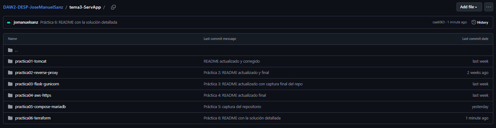

---

## 9. Problemas encontrados

1. **`terraform` no se reconocía** como comando justo después de instalarlo con `winget`.
2. **`No valid credential sources found`**, `ExpiredToken` o `AuthFailure` al ejecutar `plan` o `apply`.
3. **La instancia creada en la primera fase no era accesible** por SSH.
4. **`plan` indicaba que la instancia se destruía y se volvía a crear** al añadir el Key Pair.
5. **La IP pública cambió** tras aplicar la modificación.
6. **`ssh` daba `UNPROTECTED PRIVATE KEY FILE`** con la clave `.pem`.
7. **`ssh` daba `Connection timed out`** o `Connection refused` justo después del `apply`.
8. **El `user_data` no instalaba Docker** o `docker --version` no existía al conectar.

---

## 10. Soluciones aplicadas

1. Cerrar y volver a abrir PowerShell (y VS Code), ya que el PATH solo se actualiza en las ventanas nuevas.
2. Copiar de nuevo las tres credenciales desde *AWS Details* en el Learner Lab y volver a definir las variables de entorno en la ventana de trabajo. Caducan al finalizar la sesión del laboratorio.
3. Era el comportamiento esperado de la Tarea 9: sin Key Pair y con el Security Group `default` no hay acceso. Se resolvió en la Tarea 10 añadiendo el Security Group y el Key Pair.
4. Es el comportamiento correcto de AWS: el Key Pair solo se puede asignar al crear la instancia, por lo que `key_name` fuerza el reemplazo (`# forces replacement`). Terraform lo explica en el plan antes de ejecutar nada.
5. Consecuencia del reemplazo: la instancia nueva obtiene otra IP. Se consulta siempre con `terraform output -raw public_ip`.
6. Quitar los permisos heredados con `icacls $KEY /inheritance:r` y concederse solo lectura con `icacls $KEY /grant:r "${env:USERNAME}:R"`.
7. Esperar un minuto a que la instancia termine de arrancar y repetir la conexión.
8. Esperar a que finalice el script con `cloud-init status --wait`; si `docker` daba `permission denied`, cerrar la sesión SSH y volver a entrar.

---

## 11. Conclusiones

- **Terraform** permite crear la infraestructura de AWS con código: lo que en la práctica 4 requería muchos pasos manuales (instancia, Security Group, clave, Docker) se reduce a `terraform apply`.
- El flujo `init → validate → plan → apply → destroy` hace que los cambios sean **predecibles**: `plan` muestra siempre qué va a ocurrir, como el reemplazo de la instancia al añadir el Key Pair.
- Crear una instancia **no es suficiente**: sin Key Pair y sin un Security Group adecuado la máquina no era administrable. Las reglas de red y la gestión de claves forman parte de la infraestructura.
- Con `user_data`, Docker queda instalado en el primer arranque, así que la instancia nace lista para desplegar contenedores (prácticas anteriores).
- Las credenciales temporales del Learner Lab se gestionan con variables de entorno, sin guardarlas en ficheros del repositorio. El estado (`terraform.tfstate`) y la clave `.pem` tampoco se versionan.
- Con `terraform destroy` se elimina todo lo creado, de modo que no se consume crédito, y con `apply` puede recrearse en minutos: la infraestructura es **reproducible**.
- Mejoras posibles: limitar el puerto 22 a las IP de administración, guardar el estado en un *backend* remoto (por ejemplo, S3), parametrizar más recursos (varias instancias, VPC propia) y automatizar el despliegue de la aplicación completa con Terraform.
- Se han cumplido los criterios de evaluación f e i, además de documentar la infraestructura y automatizar la creación de recursos cloud.