# Práctica 06. Terraform + AWS EC2

## Resultado de aprendizaje

Automatizar el aprovisionamiento de infraestructura en AWS utilizando Terraform como herramienta de Infrastructure as Code (IaC).

---

# Criterios de evaluación

- f) Realizar los ajustes necesarios para el despliegue de aplicaciones.
- i) Aplicar procedimientos de despliegue utilizando tecnologías de virtualización y contenedores.
- Documentar la infraestructura desplegada.
- Automatizar la creación de recursos cloud.

---

# Justificación

Hasta la práctica anterior se ha trabajado con AWS EC2 creando y configurando la infraestructura manualmente.

Cada vez que era necesario desplegar una nueva instancia EC2 había que:

- Acceder a AWS Academy.
- Crear una instancia EC2.
- Configurar grupos de seguridad.
- Asociar una clave SSH.
- Conectarse al servidor.
- Configurar manualmente Docker.
- Configurar manualmente el entorno de trabajo.

Este enfoque es válido para aprender, pero presenta varios problemas:

```text
Lento
Difícil de reproducir
Propenso a errores
Complicado de mantener
```

Terraform permite definir toda la infraestructura mediante código.

En lugar de crear recursos manualmente, se utilizan ficheros de configuración:

```text
main.tf
variables.tf
outputs.tf
```

que describen la infraestructura deseada.

Posteriormente Terraform se encarga de:

```text
Crear
Modificar
Actualizar
Eliminar
```

los recursos necesarios en AWS.

Este enfoque recibe el nombre de:

```text
Infrastructure as Code (IaC)
```

y constituye uno de los pilares fundamentales de DevOps.

---

# Objetivos

Al finalizar la práctica el alumnado será capaz de:

- Instalar Terraform.
- Configurar Terraform para AWS.
- Crear infraestructura mediante código.
- Crear una instancia EC2 automáticamente.
- Gestionar grupos de seguridad.
- Conectarse a una instancia creada por Terraform.
- Destruir infraestructura cuando ya no sea necesaria.
- Documentar infraestructuras reproducibles.

---

# Arquitectura objetivo

```text
Terraform
     │
     ▼
 AWS API
     │
     ▼
 EC2
     │
     ▼
 Ubuntu Server
     │
     ▼
 Docker
```
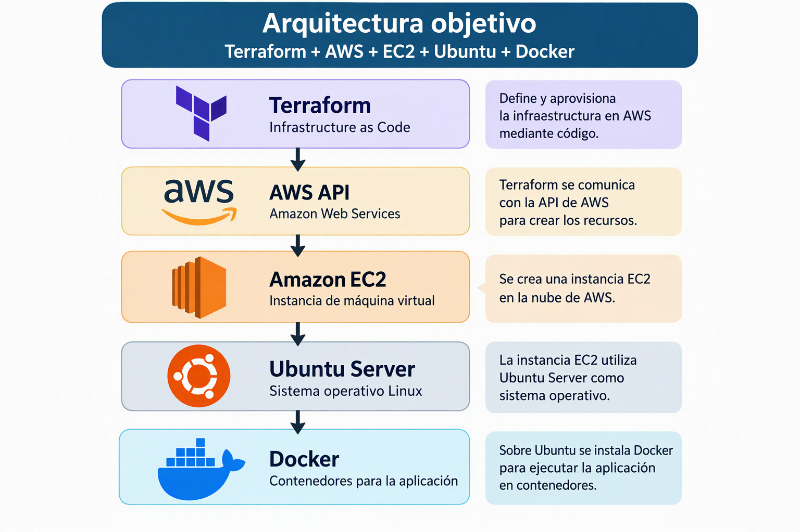

---

# TAREA 1. Preparar el entorno local

## Paso 1. Verificar AWS Academy

Iniciar AWS Academy.

Acceder al Learner Lab.

Verificar que las credenciales temporales se encuentran disponibles.

### Captura obligatoria

```text
capturas/01-aws-academy.png
```

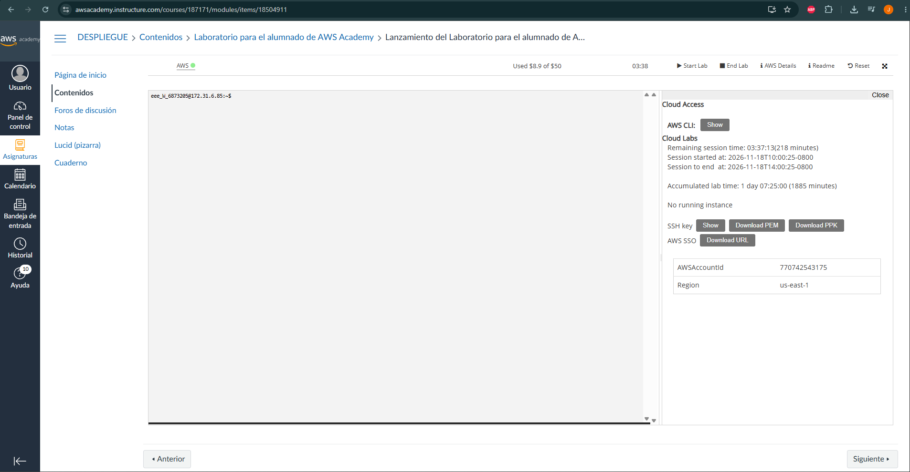

---

## Paso 2. Crear directorio de trabajo

Crear:

```text
practica06-terraform/
```

Estructura inicial:

```text
practica06-terraform/
│
└── terraform/
```

### Captura obligatoria

```text
capturas/02-estructura-proyecto.png
```

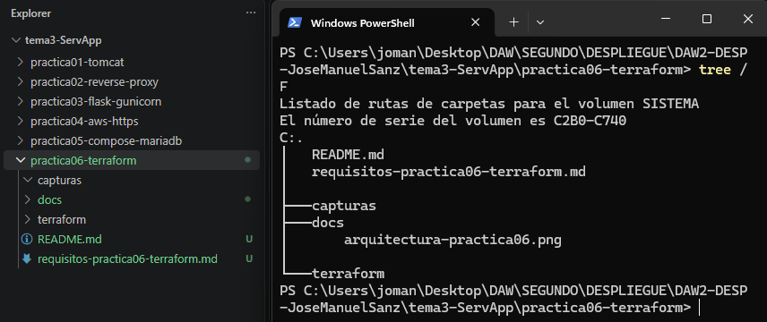

---

# TAREA 2. Instalar Terraform

## Paso 1. Verificar instalación

Comprobar:

```bash
terraform version
```

Si Terraform no está instalado, instalar la versión estable más reciente.

### Captura obligatoria

```text
capturas/03-terraform-version.png
```

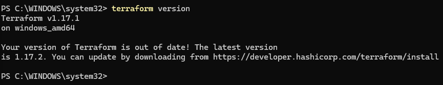

---

# TAREA 3. Configurar credenciales AWS

## Paso 1. Obtener credenciales

Desde AWS Academy obtener:

```text
AWS_ACCESS_KEY_ID

AWS_SECRET_ACCESS_KEY

AWS_SESSION_TOKEN
```

---

## Paso 2. Configurar variables de entorno

Configurar las credenciales en el sistema operativo.

Comprobar que Terraform puede autenticarse correctamente contra AWS.

### Captura obligatoria

```text
capturas/04-credenciales-aws.png
```

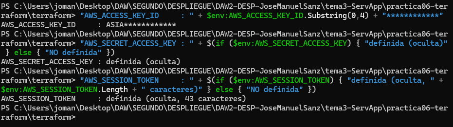

---

# TAREA 4. Crear proyecto Terraform

## Paso 1. Crear main.tf

Crear:

```text
terraform/main.tf
```

El fichero deberá definir:

```text
Provider AWS
```

y una:

```text
Instancia EC2
```

---

## Paso 2. Crear variables.tf

Crear:

```text
terraform/variables.tf
```

Incluir al menos:

```text
AMI
Tipo de instancia
Región
```

---

## Paso 3. Crear outputs.tf

Crear:

```text
terraform/outputs.tf
```

Mostrar al menos:

```text
IP pública
ID de instancia
```

### Captura obligatoria

```text
capturas/05-ficheros-terraform.png
```

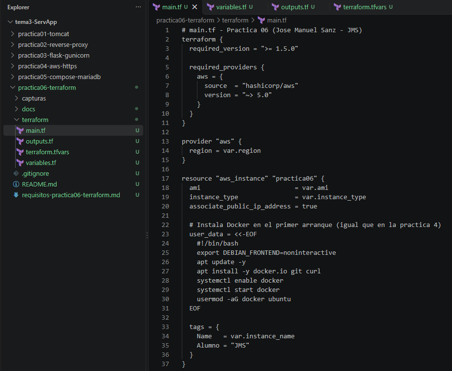

---

# TAREA 5. Inicializar Terraform

## Paso 1. Inicializar proyecto

Acceder al directorio:

```bash
cd terraform
```

Ejecutar:

```bash
terraform init
```

Analizar:

```text
Provider instalado
Plugins descargados
Directorio .terraform creado
```

### Captura obligatoria

```text
capturas/06-terraform-init.png
```

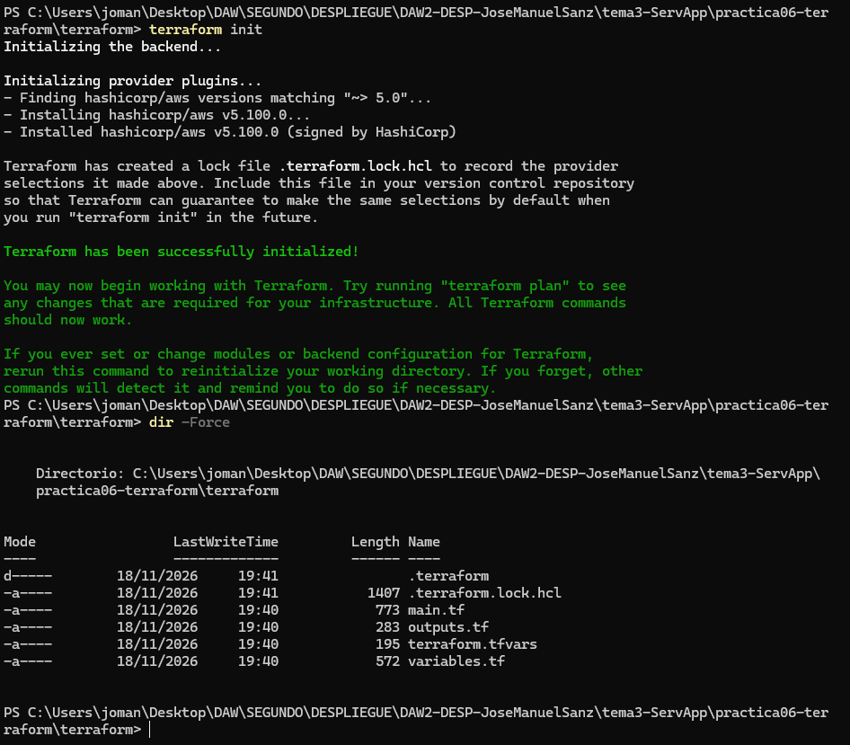

---

# TAREA 6. Validar infraestructura

## Paso 1. Validar sintaxis

Ejecutar:

```bash
terraform validate
```

Verificar que no existen errores.

### Captura obligatoria

```text
capturas/07-terraform-validate.png
```

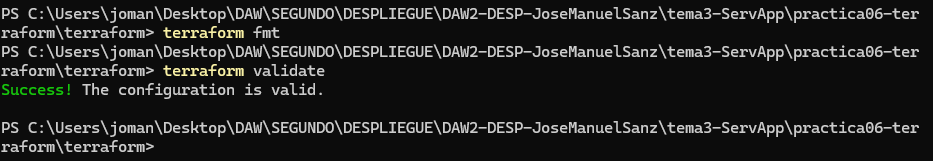

---

## Paso 2. Visualizar cambios

Ejecutar:

```bash
terraform plan
```

Analizar:

```text
Recursos que serán creados
```

### Captura obligatoria

```text
capturas/08-terraform-plan.png
```

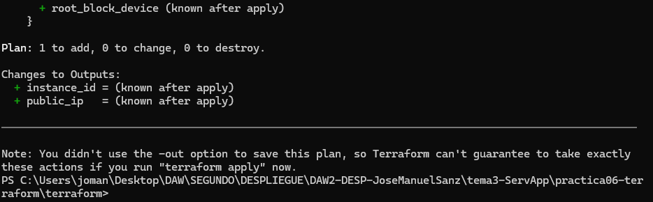

---

# TAREA 7. Crear infraestructura

## Paso 1. Aprovisionar recursos

Ejecutar:

```bash
terraform apply
```

Confirmar la operación.

Terraform deberá crear automáticamente:

```text
Instancia EC2
```

### Captura obligatoria

```text
capturas/09-terraform-apply.png
```

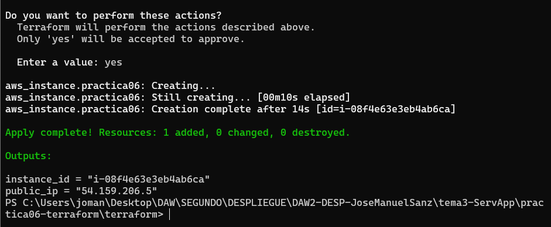

---

## Paso 2. Verificar recurso creado

Acceder al portal AWS.

Comprobar que la instancia aparece creada.

### Captura obligatoria

```text
capturas/10-ec2-creada.png
```

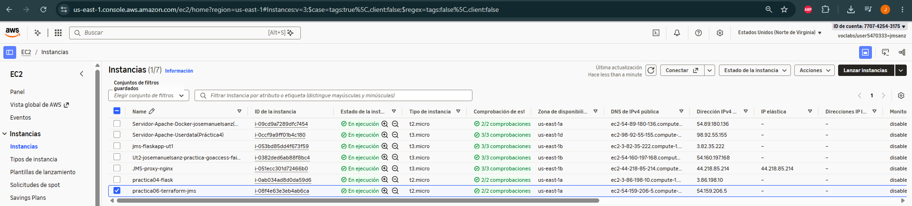

---

# TAREA 8. Analizar outputs

## Paso 1. Consultar outputs

Ejecutar:

```bash
terraform output
```

Identificar:

```text
IP pública
ID de instancia
```

### Captura obligatoria

```text
capturas/11-terraform-output.png
```

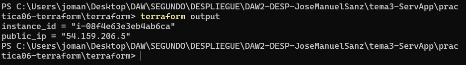

---
 
# TAREA 9. Analizar limitaciones de la infraestructura creada

Hasta este momento Terraform ha creado una instancia EC2 de forma automática.

Sin embargo, disponer de una máquina virtual creada no implica necesariamente que sea accesible o funcional para un administrador.

En esta tarea se analizarán las limitaciones de la infraestructura actual.

## Paso 1. Analizar el acceso remoto

Reflexionar sobre las siguientes preguntas:

```text
¿Existe una clave SSH asociada a la instancia?

¿Podemos conectarnos mediante SSH?

¿Está abierto el puerto 22?

¿Existe algún Security Group configurado?

¿Está abierta la comunicación HTTP o HTTPS?
```

Documentar las respuestas en el README.

---

## Conclusión esperada

El alumnado deberá concluir que:

```text
Terraform ha creado una instancia EC2.

Sin embargo:

- No existe una Key Pair configurada.
- No existe un Security Group adecuado.
- No es posible conectarse mediante SSH.
```

Por tanto, la infraestructura creada es todavía incompleta.

Será necesario evolucionarla en la siguiente tarea.

---

# TAREA 10. Modificar la infraestructura

## Objetivo

Ampliar la definición de Terraform para crear una infraestructura funcional que permita la administración remota.

---

## Paso 1. Crear un Security Group

Modificar:

```text
terraform/main.tf
```

para incluir un Security Group.

El Security Group deberá permitir:

```text
SSH  (22)

HTTP (80)

HTTPS (443)
```

Investigar el recurso Terraform:

```text
aws_security_group
```

### Captura obligatoria

```text
capturas/12-security-group.png
```

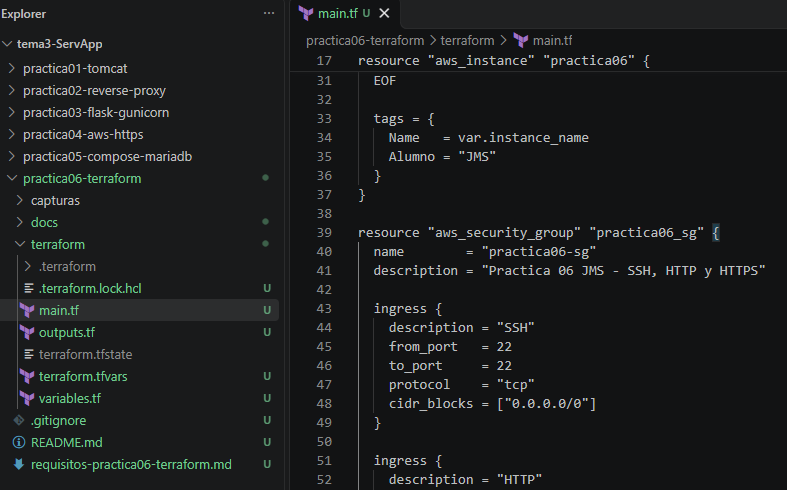

---

## Paso 2. Asociar una Key Pair

Accedemos a AWS:

AWS Console -->EC2 --> Key Pairs
La infraestructura deberá reutilizar la misma clave utilizada en prácticas anteriores.
Vemos que la clave generada es practica04

La añadimos a variables.tf
### Captura obligatoria

```text
capturas/13-variablestf.png
```

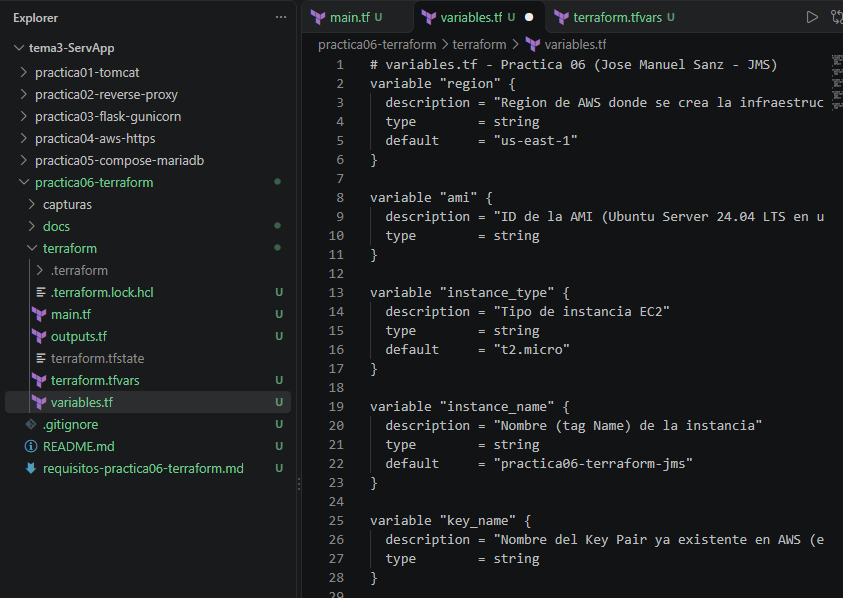

Y modificamos el recurso EC2 en terraform/main.tf


### Captura obligatoria

```text
capturas/14-keypair-terraform.png
```

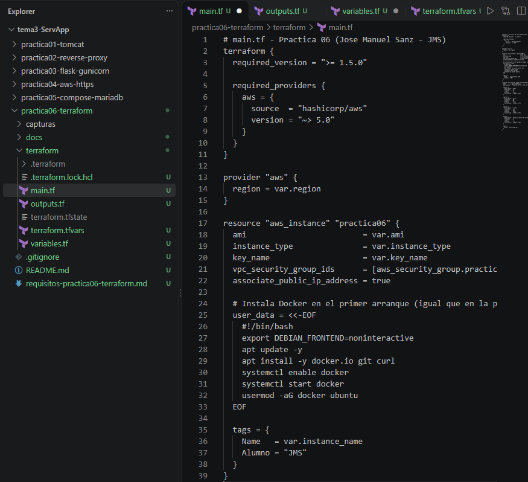

---

## Paso 3. Validar cambios

Ejecutar:

```bash
terraform validate
```

### Captura obligatoria

```text
capturas/15-terraform-validate-ssh.png
```

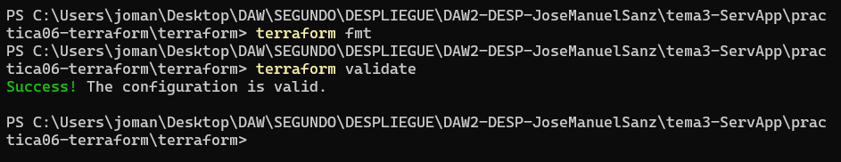

---

## Paso 4. Visualizar cambios
```text
!Aviso: si hemos reiniciado el laboratorio, las credenciales de AWS Academy habrán caducado y hay que copiar de nuevo 
-AWS_ACCESS_KEY_ID
-AWS_SECRET_ACCESS_KEY
-AWS_SESSION_TOKEN
```
Ejecutar:

```bash
terraform plan
```

Analizar:

```text
Recursos modificados

Recursos nuevos

Cambios sobre la instancia EC2
```

### Captura obligatoria

```text
capturas/16-modificacion-plan.png
```

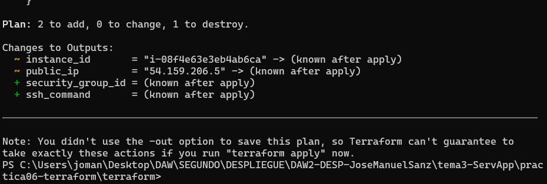

---

## Paso 5. Aplicar cambios

Ejecutar:

```bash
terraform apply
```

Confirmar:

```text
yes
```

Terraform deberá actualizar la infraestructura.

### Captura obligatoria

```text
capturas/17-modificacion-apply.png
```

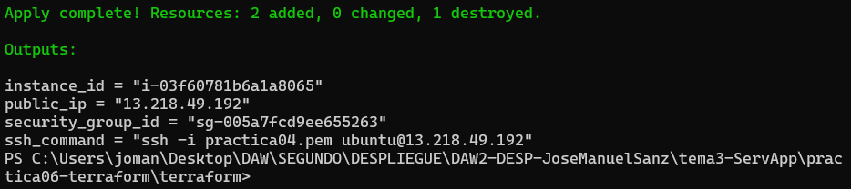

---

# TAREA 11. Conectarse a la instancia

## Paso 1. Obtener la IP pública

Mostrar:

```bash
terraform output
```

---

## Paso 2. Conectarse mediante SSH

Utilizar la misma clave utilizada en prácticas anteriores.


```bash
ssh -i practica04.pem ubuntu@IP_PUBLICA
```

según la clave utilizada.

### Captura obligatoria

```text
capturas/18-ssh-ec2.png
```

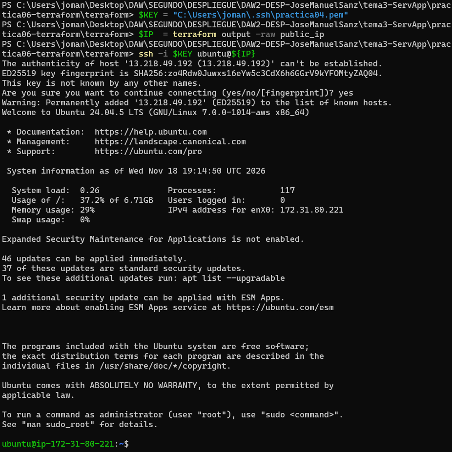


---

# TAREA 12. Análisis final

Responder:

## Infrastructure as Code

- ¿Qué significa?

## Terraform

- ¿Qué ventajas aporta frente a la creación manual de recursos?

## Security Groups

- ¿Qué función desempeñan?

## Key Pairs

- ¿Por qué son necesarias?

## terraform init

- ¿Para qué sirve?

## terraform plan

- ¿Para qué sirve?

## terraform apply

- ¿Para qué sirve?

## terraform destroy

- ¿Para qué sirve?

## Automatización

- ¿Qué ventajas presenta Terraform para equipos DevOps?
  

## Automatización

- ¿Qué ventajas presenta frente a la creación manual de recursos?

---

# README.md

El README deberá incluir:

```text
Introducción.

Terraform.

AWS.

Infrastructure as Code.

Configuración realizada.

Recursos creados.

Problemas encontrados.

Soluciones aplicadas.

Conclusiones.
```

---

# Estructura obligatoria de entrega

```text
practica06-terraform/
│
├── requisitos-practica06-terraform.md
├── README.md
│
├── terraform/
│   ├── main.tf
│   ├── variables.tf
│   ├── outputs.tf
│   └── terraform.tfvars
│
├── capturas/
│   ├── 01-aws-academy.png
│   ├── 02-estructura-proyecto.png
│   ├── 03-terraform-version.png
│   ├── 04-credenciales-aws.png
│   ├── 05-ficheros-terraform.png
│   ├── 06-terraform-init.png
│   ├── 07-terraform-validate.png
│   ├── 08-terraform-plan.png
│   ├── 09-terraform-apply.png
│   ├── 10-ec2-creada.png
│   ├── 11-terraform-output.png
│   ├── 12-security-group.png 
│   ├── 13-variablestf.png
│   ├── 14-keypair-terraform.png  
│   ├── 15-terraform-validate-ssh.png
│   ├── 16-modificacion-plan.png 
│   ├── 17-modificacion-apply.png
│   └── 18-ssh-ec2.png
│
└── docs/
    └── arquitectura-practica06.png
```
 